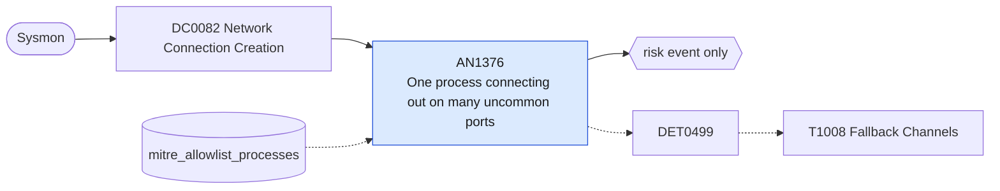

# AN1376 One process connecting out on many uncommon ports

[ATT&CK analytic](https://attack.mitre.org/detectionstrategies/DET0499#AN1376) · DET0499 Behavioral Detection of Fallback or Alternate C2 Channels · [T1008 Fallback Channels](https://attack.mitre.org/techniques/T1008) · tactics: command-and-control · platforms: Windows

**Content type:** anomaly → risk event only · **Severity:** low · **Status:** implemented · **Technique prevalence score:** 64

A process on a host makes outbound connections (Sysmon 3) to external addresses on several distinct uncommon ports within an hour. Malware whose primary channel is blocked cycles through fallback ports and protocols; ordinary software uses a small fixed set.



## What ATT&CK asks for

> Establishing network connections on uncommon ports or protocols following C2 disruption or blocking. Often executed by processes that typically exhibit no network activity.

## What this implementation detects

A process on a host makes outbound connections (Sysmon 3) to external addresses on several distinct uncommon ports within an hour. Malware whose primary channel is blocked cycles through fallback ports and protocols; ordinary software uses a small fixed set.

**Not covered:** Fallback to the same port on another domain is not counted here (AN1189 and the network analytics cover destinations). Peer-to-peer and game clients are noisy and must be allow-listed.

## Tuning

ATT&CK mutable elements and where each is bound. Edit macros in `local/macros.conf` and lookups in place; do not edit the search.

| Mutable element | ATT&CK guidance | Bound to | Default |
|---|---|---|---|
| DestinationPort | Can be tuned to include unexpected or high-entropy ports not typically associated with the process. | macro `mitre_an1376_common_ports` | `DestinationPort IN (22, 25, 53, 80, 88, 110, 123, 135, 139, 143, 389, 443, 445, 465, 587, 636, 993, 995, 1433, 3268, 3269, 3389, 5985, 5986, 8080, 8443)` |
| ProcessName | Useful to filter benign applications vs suspicious fallback attempts. | lookup `mitre_allowlist_processes` |  |
| DataVolumeRatio | Tunable ratio of sent/received bytes to indicate potential C2 beaconing or exfiltration. | macro `mitre_an1376_port_threshold` — Distinct uncommon external ports per process per hour. | `4` |
| TimeWindow | Adjust temporal window to match likely fallback C2 retries after primary channel fails. | filter macro `mitre_an1376_filter` |  |

## Splunk

Stanza `[MITRE - AN1376 - One process connecting out on many uncommon ports - Rule]` in `DA-ESS-mitre-attack-detections`. Schedule `17 * * * *`, window `-65m@m` to `-5m@m`. Ships disabled.

```spl
`mitre_dc0082_sysmon` EventCode=3 Initiated="true" NOT `mitre_an1376_common_ports`
| `mitre_normalize_host`
| where NOT `mitre_is_internal(DestinationIp)` AND NOT match(DestinationIp, "^(127\.|::1|fe80:|169\.254\.)")
| eval process_name=lower(replace(Image, "^.*\\\\", ""))
| search `mitre_not_allowlisted_process`
| bin _time span=1h
| stats dc(DestinationPort) as distinct_ports values(DestinationPort) as dest_port dc(DestinationIp) as distinct_dests values(DestinationIp) as dest_ip min(_time) as firstTime max(_time) as lastTime by dest user process_name _time
| where distinct_ports >= `mitre_an1376_port_threshold`
| eval dest_ip=mvindex(dest_ip, 0, 19)
| `mitre_ctime(firstTime)` | `mitre_ctime(lastTime)`
| `mitre_an1376_filter`
```

Risk: `dest` (system, 25). Threat objects: `process_name`. Message: $process_name$ on $dest$ tried $distinct_ports$ uncommon external ports in an hour

Throttle: dest, process_name for 14400s.

Data components: [DC0082](../data-components/DC0082-network-connection-creation.md).

## Sigma

Rule file: `dist/sigma/rules/an1376_one_process_connecting_out_on_many_uncommon_ports.yml` (base rule plus a correlation rule).

## Known false positives

- Peer-to-peer, VoIP, game and remote-support clients; vulnerability scanners on admin hosts.
