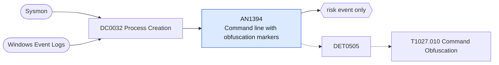

# AN1394 Command line with obfuscation markers

[ATT&CK analytic](https://attack.mitre.org/detectionstrategies/DET0505#AN1394) · DET0505 Detection Strategy for Command Obfuscation · [T1027.010 Command Obfuscation](https://attack.mitre.org/techniques/T1027/010) · tactics: stealth · platforms: Windows

**Content type:** anomaly → risk event only · **Severity:** medium · **Status:** implemented · **Technique prevalence score:** 112

Interpreter command lines (cmd, PowerShell, script hosts, mshta) that are unusually long, contain a long base64-like token, use many caret escapes or string concatenations, or use cmd environment variable substring expansion. Each marker is reported so the analyst can see why it fired.



## What ATT&CK asks for

> Detection of command-line activity exhibiting syntactic obfuscation patterns, such as excessive escape characters, base64 encoding, command concatenation, or outlier command length and entropy.

## What this implementation detects

Interpreter command lines (cmd, PowerShell, script hosts, mshta) that are unusually long, contain a long base64-like token, use many caret escapes or string concatenations, or use cmd environment variable substring expansion. Each marker is reported so the analyst can see why it fired.

**Not covered:** Shannon entropy is not computed (stock SPL has no entropy function; URL Toolbox ut_shannon can be added in the filter macro). Follow-on child or file activity within the TimeWindow is not correlated.

## Tuning

ATT&CK mutable elements and where each is bound. Edit macros in `local/macros.conf` and lookups in place; do not edit the search.

| Mutable element | ATT&CK guidance | Bound to | Default |
|---|---|---|---|
| CommandLineEntropyThreshold | Used to flag base64 or token-heavy command-line strings | macro `mitre_an1394_length_threshold` — Command-line length used as a proxy for encoded payloads. | `2000` |
| SuspiciousCharacterCount | Escape character and symbol frequency in command-line strings | macro `mitre_an1394_symbol_threshold` — Minimum number of caret escapes or quote-plus concatenations. | `6` |
| TimeWindow | Window between command execution and follow-up child or file write behavior | filter macro `mitre_an1394_filter` (not bound separately) | `search *` |

## Splunk

Stanza `[MITRE - AN1394 - Command line with obfuscation markers - Rule]` in `DA-ESS-mitre-attack-detections`. Schedule `3-59/15 * * * *`, window `-20m@m` to `-5m@m`. Ships disabled.

```spl
| tstats `mitre_summariesonly` count min(_time) as firstTime max(_time) as lastTime
    from `mitre_dc0032_dm` where `mitre_dc0032_dm_where` Processes.process_name IN ("cmd.exe", "powershell.exe", "pwsh.exe", "wscript.exe", "cscript.exe", "mshta.exe")
    by Processes.dest Processes.user Processes.parent_process_name Processes.process_name Processes.process
| `drop_dm_object_name(Processes)`
| eval cmd_length=len(process), caret_count=mvcount(split(process, "^"))-1, concat_count=max(mvcount(split(process, "'+'"))-1, mvcount(split(process, "\"+\""))-1)
| eval has_b64_blob=if(match(process, "[A-Za-z0-9+/]{120,}={0,2}"), 1, 0), has_env_substring=if(match(process, "%[A-Za-z]+:~-?[0-9]+,-?[0-9]+%"), 1, 0)
| where cmd_length >= `mitre_an1394_length_threshold` OR caret_count >= `mitre_an1394_symbol_threshold` OR concat_count >= `mitre_an1394_symbol_threshold` OR has_b64_blob=1 OR has_env_substring=1
| `mitre_ctime(firstTime)` | `mitre_ctime(lastTime)`
| `mitre_an1394_filter`
```

Risk: `dest` (system, 35), `user` (user, 35). Threat objects: `process`. Message: Obfuscated command line on $dest$ run by $user$

Throttle: dest, user, process_name for 3600s.

Data components: [DC0032](../data-components/DC0032-process-creation.md).

## Sigma

Rule file: `dist/sigma/rules/an1394_command_line_with_obfuscation_markers.yml`.

Sigma expresses the base64-blob, caret and environment-substring markers by regex; the length and count thresholds are Splunk only.

## Known false positives

- Management agents passing long encoded scripts; build systems generating long command lines.
