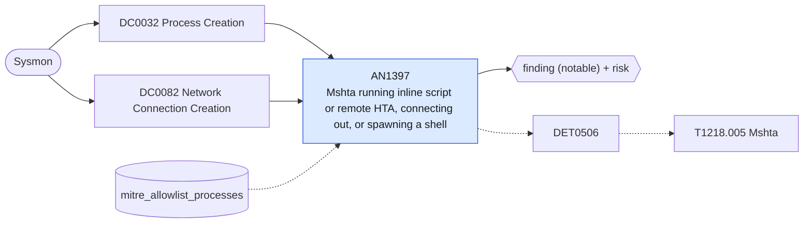

# AN1397 Mshta running inline script or remote HTA, connecting out, or spawning a shell

[ATT&CK analytic](https://attack.mitre.org/detectionstrategies/DET0506#AN1397) · DET0506 Detecting Mshta-based Proxy Execution via Suspicious HTA or Script Invocation · [T1218.005 Mshta](https://attack.mitre.org/techniques/T1218/005) · tactics: stealth · platforms: Windows

**Content type:** ttp → finding (notable) + risk · **Severity:** high · **Status:** implemented · **Technique prevalence score:** 49

mshta with javascript:, vbscript: or an http(s) URL on the command line, or an HTA from Downloads, Temp, Public or ProgramData; mshta opening an outbound connection to an external address; or mshta starting a shell, script host or download utility. Enterprises rarely run HTAs at all, and none of these shapes are normal administration.



## What ATT&CK asks for

> Detection of mshta.exe execution where command-line arguments reference remote or local HTA/script content (VBScript/JScript) followed by subsequent file creation, network retrieval, or process spawning that indicates payload execution outside standard Internet Explorer security context. Correlation includes parent process lineage, command-line inspection, and network connection creation to untrusted or anomalous endpoints.

## What this implementation detects

mshta with javascript:, vbscript: or an http(s) URL on the command line, or an HTA from Downloads, Temp, Public or ProgramData; mshta opening an outbound connection to an external address; or mshta starting a shell, script host or download utility. Enterprises rarely run HTAs at all, and none of these shapes are normal administration.

**Not covered:** The file-creation leg (payload written by mshta) is not joined. HTAs embedded in other containers (LNK, ISO) are caught only when mshta runs.

## Tuning

ATT&CK mutable elements and where each is bound. Edit macros in `local/macros.conf` and lookups in place; do not edit the search.

| Mutable element | ATT&CK guidance | Bound to | Default |
|---|---|---|---|
| CommandLinePattern | Regex patterns for mshta.exe arguments referencing remote HTA/script content; may need tuning to exclude known-good internal scripts. | macro `mitre_an1397_suspicious_args` | `CommandLine IN ("*javascript:*", "*vbscript:*", "*http://*", "*https://*", "*\\AppData\\Local\\Temp\\*", "*\\Downloads\\*", "*\\Users\\Public\\*", "*\\ProgramData\\*", "*\\INetCache\\*")` |
| SuspiciousParentProcesses | List of parent processes considered suspicious when spawning mshta.exe (e.g., Office applications, script interpreters). | macro `mitre_an1397_children` | `Image IN ("*\\cmd.exe", "*\\powershell.exe", "*\\pwsh.exe", "*\\wscript.exe", "*\\cscript.exe", "*\\rundll32.exe", "*\\regsvr32.exe", "*\\certutil.exe", "*\\bitsadmin.exe", "*\\curl.exe", "*\\msiexec.exe")` |
| AllowedHTASources | Whitelist of domains/paths from which legitimate HTAs are executed. | lookup `mitre_allowlist_processes` — Line-of-business HTAs (process_name mshta.exe with the parent that launches them). |  |
| TimeWindow | Time threshold for correlating mshta.exe execution with subsequent network connections or file creations. | filter macro `mitre_an1397_filter` |  |

## Splunk

Stanza `[MITRE - AN1397 - Mshta running inline script or remote HTA, connecting out, or spawning a shell - Rule]` in `DA-ESS-mitre-attack-detections`. Schedule `2-59/15 * * * *`, window `-20m@m` to `-5m@m`. Ships disabled.

```spl
(`mitre_dc0032_sysmon` EventCode=1 (((Image="*\\mshta.exe" OR OriginalFileName="MSHTA.EXE") `mitre_an1397_suspicious_args`) OR (ParentImage="*\\mshta.exe" `mitre_an1397_children`)))
OR (`mitre_dc0082_sysmon` EventCode=3 Initiated="true" Image="*\\mshta.exe")
| `mitre_normalize_host`
| where EventCode==1 OR NOT `mitre_is_internal(DestinationIp)`
| eval process_name="mshta.exe", signal=case(EventCode==3, "connection to ".DestinationIp.":".DestinationPort, match(ParentImage, "(?i)mshta\.exe$"), "child: ".CommandLine, true(), "args: ".CommandLine)
| search `mitre_not_allowlisted_process`
| stats count min(_time) as firstTime max(_time) as lastTime values(signal) as signal values(user) as user by dest
| eval signal=mvindex(signal, 0, 9)
| `mitre_ctime(firstTime)` | `mitre_ctime(lastTime)`
| `mitre_an1397_filter`
```

Risk: `dest` (system, 60), `user` (user, 45). Threat objects: `process_name`. Message: Mshta proxy execution on $dest$ ($signal$)

Throttle: dest for 86400s.

Data components: [DC0032](../data-components/DC0032-process-creation.md), [DC0082](../data-components/DC0082-network-connection-creation.md).

## Sigma

Rule file: `dist/sigma/rules/an1397_mshta_running_inline_script_or_remote_hta_connecting_out_or_.yml`.

## Known false positives

- Legacy line-of-business HTA applications served from an intranet URL.
