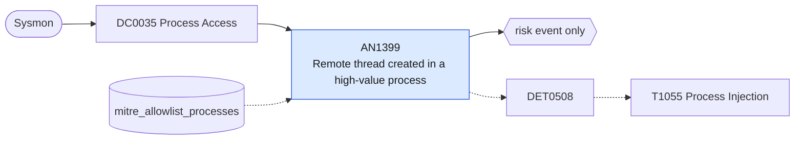

# AN1399 Remote thread created in a high-value process

[ATT&CK analytic](https://attack.mitre.org/detectionstrategies/DET0508#AN1399) · DET0508 Behavioral Detection of Process Injection Across Platforms · [T1055 Process Injection](https://attack.mitre.org/techniques/T1055) · tactics: stealth, privilege-escalation · platforms: Windows

**Content type:** anomaly → risk event only · **Severity:** medium · **Status:** implemented · **Technique prevalence score:** 110

Sysmon EventCode 8 (CreateRemoteThread) where the target is a commonly injected process (lsass, explorer, svchost, winlogon, browsers, dllhost, rundll32, notepad, werfault) and the source is not a Windows system process or an allow-listed product.



## What ATT&CK asks for

> Detects process injection by correlating memory manipulation API calls (e.g., VirtualAllocEx, WriteProcessMemory), suspicious thread creation (e.g., CreateRemoteThread), and unusual DLL loads within another process's context.

## What this implementation detects

Sysmon EventCode 8 (CreateRemoteThread) where the target is a commonly injected process (lsass, explorer, svchost, winlogon, browsers, dllhost, rundll32, notepad, werfault) and the source is not a Windows system process or an allow-listed product.

**Not covered:** Memory allocation and write API calls, handle access masks (EventCode 10) and unusual module loads are not correlated; injection without CreateRemoteThread (APC, section mapping, hollowing) is not seen by this event.

## Tuning

ATT&CK mutable elements and where each is bound. Edit macros in `local/macros.conf` and lookups in place; do not edit the search.

| Mutable element | ATT&CK guidance | Bound to | Default |
|---|---|---|---|
| AccessMask | Specific access rights used during process handle acquisition, e.g., PROCESS_VM_WRITE | lookup `mitre_allowlist_processes` — Not an access mask; products that legitimately inject (EDR, accessibility and screen-sharing tools) are excluded by source process name. |  |
| TimeWindow | Time correlation window between API calls and thread creation events | filter macro `mitre_an1399_filter` (not bound separately) | `search *` |
| InjectedProcessList | Known high-value targets often abused for injection (e.g., lsass.exe, explorer.exe) | macro `mitre_an1399_targets` | `TargetImage IN ("*\\lsass.exe", "*\\explorer.exe", "*\\svchost.exe", "*\\winlogon.exe", "*\\services.exe", "*\\spoolsv.exe", "*\\notepad.exe", "*\\rundll32.exe", "*\\dllhost.exe", "*\\regsvr32.exe", "*\\werfault.exe", "*\\msedge.exe", "*\\chrome.exe", "*\\firefox.exe", "*\\iexplore.exe")` |

## Splunk

Stanza `[MITRE - AN1399 - Remote thread created in a high-value process - Rule]` in `DA-ESS-mitre-attack-detections`. Schedule `13-59/15 * * * *`, window `-20m@m` to `-5m@m`. Ships disabled.

```spl
`mitre_dc0035_sysmon` EventCode=8 `mitre_an1399_targets`
    NOT SourceImage IN ("C:\\Windows\\System32\\csrss.exe", "C:\\Windows\\System32\\wininit.exe", "C:\\Windows\\System32\\winlogon.exe", "C:\\Windows\\System32\\services.exe", "C:\\Windows\\System32\\svchost.exe", "C:\\Windows\\System32\\lsass.exe", "C:\\Windows\\System32\\wbem\\WmiPrvSE.exe", "C:\\Windows\\System32\\dwm.exe", "C:\\Program Files\\Windows Defender\\*", "C:\\ProgramData\\Microsoft\\Windows Defender\\*")
| `mitre_normalize_host`
| eval process_name=replace(SourceImage, "^.*\\\\", ""), target_process=replace(TargetImage, "^.*\\\\", ""), user=coalesce(SourceUser, user)
| search `mitre_not_allowlisted_process`
| stats count min(_time) as firstTime max(_time) as lastTime values(StartModule) as start_module values(StartFunction) as start_function by dest user SourceImage process_name target_process
| `mitre_ctime(firstTime)` | `mitre_ctime(lastTime)`
| `mitre_an1399_filter`
```

Risk: `dest` (system, 50), `user` (user, 40). Threat objects: `process_name`. Message: $process_name$ created a remote thread in $target_process$ on $dest$

Throttle: dest, process_name, target_process for 3600s.

Data components: [DC0035](../data-components/DC0035-process-access.md).

## Sigma

Rule file: `dist/sigma/rules/an1399_remote_thread_created_in_a_high_value_process.yml`.

## Known false positives

- Security products, debuggers, screen readers, remote-support tools and some browser helper processes.
