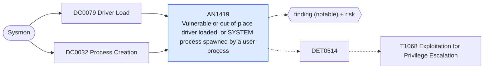

# AN1419 Vulnerable or out-of-place driver loaded, or SYSTEM process spawned by a user process

[ATT&CK analytic](https://attack.mitre.org/detectionstrategies/DET0514#AN1419) · DET0514 Detection Strategy for Exploitation for Privilege Escalation · [T1068 Exploitation for Privilege Escalation](https://attack.mitre.org/techniques/T1068) · tactics: privilege-escalation · platforms: Windows

**Content type:** ttp → finding (notable) + risk · **Severity:** high · **Status:** implemented · **Technique prevalence score:** 69

Two footprints of local privilege escalation: a kernel driver load (Sysmon 6) whose name is a known vulnerable driver used for BYOVD, that is unsigned, or that loads from a user-writable folder; and a process running at System integrity whose parent runs as an ordinary user, which is what a token-stealing or kernel exploit leaves behind.



## What ATT&CK asks for

> Detects exploitation attempts targeting vulnerable kernel drivers or OS components, often followed by unusual process or token behavior.

## What this implementation detects

Two footprints of local privilege escalation: a kernel driver load (Sysmon 6) whose name is a known vulnerable driver used for BYOVD, that is unsigned, or that loads from a user-writable folder; and a process running at System integrity whose parent runs as an ordinary user, which is what a token-stealing or kernel exploit leaves behind.

**Not covered:** The driver list is names, not hashes; renamed vulnerable drivers need the LOLDrivers hash list in a lookup. ParentUser needs Sysmon 13.30 or later. Non-English SYSTEM account names need adding to the macro.

## Tuning

ATT&CK mutable elements and where each is bound. Edit macros in `local/macros.conf` and lookups in place; do not edit the search.

| Mutable element | ATT&CK guidance | Bound to | Default |
|---|---|---|---|
| DriverNamePattern | Targeted BYOVD drivers may vary based on campaign and tooling. | macro `mitre_an1419_vulnerable_drivers` | `ImageLoaded IN ("*\\RTCore64.sys", "*\\RTCore32.sys", "*\\gdrv.sys", "*\\dbutil_2_3.sys", "*\\DBUtilDrv2.sys", "*\\aswArPot.sys", "*\\mhyprot2.sys", "*\\mhyprot3.sys", "*\\kprocesshacker.sys", "*\\iqvw64e.sys", "*\\AsIO.sys", "*\\AsIO2.sys", "*\\AsIO3.sys", "*\\WinRing0x64.sys", "*\\zamguard64.sys", "*\\zam64.sys", "*\\truesight.sys", "*\\ene.sys", "*\\GLCKIO2.sys", "*\\NalDrv.sys", "*\\speedfan.sys", "*\\cpuz141.sys", "*\\rwdrv.sys", "*\\PhyMem.sys", "*\\HW.sys", "*\\viragt64.sys", "*\\wnbios.sys")` |
| TimeWindow | Controls temporal linking of driver load → process spawn → privilege use. | filter macro `mitre_an1419_filter` |  |
| ParentProcessPath | Parent-child relationships vary by exploitation vector (e.g., LOLBin vs. dropper). | macro `mitre_an1419_system_accounts` | `ParentUser IN ("NT AUTHORITY\\*", "AUTORITE NT\\*", "NT-AUTORITÄT\\*", "Window Manager\\*", "Font Driver Host\\*", "-")` |
| DriverPath *(implementation)* |  | macro `mitre_an1419_writable_paths` | `ImageLoaded IN ("C:\\Users\\*", "C:\\ProgramData\\*", "C:\\Windows\\Temp\\*", "C:\\PerfLogs\\*", "C:\\$Recycle.Bin\\*", "*\\AppData\\*")` |

## Splunk

Stanza `[MITRE - AN1419 - Vulnerable or out-of-place driver loaded, or SYSTEM process spawned by a user process - Rule]` in `DA-ESS-mitre-attack-detections`. Schedule `1-59/15 * * * *`, window `-20m@m` to `-5m@m`. Ships disabled.

```spl
(`mitre_dc0079_sysmon` EventCode=6 (`mitre_an1419_vulnerable_drivers` OR `mitre_an1419_writable_paths` OR Signed="false"))
OR (`mitre_dc0032_sysmon` EventCode=1 IntegrityLevel="System" ParentUser="*" NOT `mitre_an1419_system_accounts`)
| `mitre_normalize_host`
| eval user=if(EventCode==1, ParentUser, null()), signal=if(EventCode==6, "driver load: ".ImageLoaded." (signed=".coalesce(Signed, "unknown").", ".coalesce(Signature, "no signature").")", "SYSTEM process from user parent: ".ParentImage." -> ".Image), process_name=if(EventCode==1, lower(replace(Image, "^.*\\\\", "")), lower(replace(ImageLoaded, "^.*\\\\", "")))
| stats count min(_time) as firstTime max(_time) as lastTime values(signal) as signal values(process_name) as process_name values(user) as user by dest
| `mitre_ctime(firstTime)` | `mitre_ctime(lastTime)`
| `mitre_an1419_filter`
```

Risk: `dest` (system, 70), `user` (user, 60). Threat objects: `process_name`. Message: Privilege escalation footprint on $dest$ ($signal$)

Throttle: dest for 86400s.

Data components: [DC0079](../data-components/DC0079-driver-load.md), [DC0032](../data-components/DC0032-process-creation.md).

## Sigma

Rule file: `dist/sigma/rules/an1419_vulnerable_or_out_of_place_driver_loaded_or_system_process_s.yml`.

## Known false positives

- Hardware monitoring, overclocking and anti-cheat utilities that ship the listed drivers legitimately.
- Management agents that start SYSTEM processes on behalf of a user session (check the parent and allow-list it in the filter).
