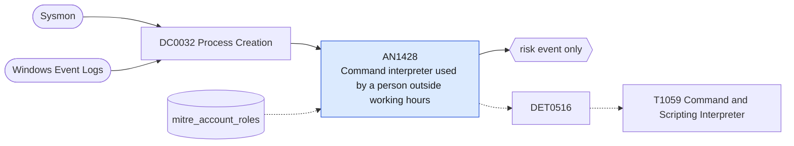

# AN1428 Command interpreter used by a person outside working hours

[ATT&CK analytic](https://attack.mitre.org/detectionstrategies/DET0516#AN1428) · DET0516 Behavioral Detection of Command and Scripting Interpreter Abuse · [T1059 Command and Scripting Interpreter](https://attack.mitre.org/techniques/T1059) · tactics: execution · platforms: Windows

**Content type:** anomaly → risk event only · **Severity:** low · **Status:** implemented · **Technique prevalence score:** 67

cmd, PowerShell or a script host started by a user account (not SYSTEM, not a machine or service account) outside working hours, with an interactive parent (explorer, a terminal, an RDP session). Hands-on-keyboard intrusions often happen when the account's owner is not working.



## What ATT&CK asks for

> Detects the execution of scripting or command interpreters (e.g., powershell.exe, cmd.exe, wscript.exe) outside expected administrative time windows or from abnormal user contexts, often followed by encoded/obfuscated arguments or secondary execution events.

## What this implementation detects

cmd, PowerShell or a script host started by a user account (not SYSTEM, not a machine or service account) outside working hours, with an interactive parent (explorer, a terminal, an RDP session). Hands-on-keyboard intrusions often happen when the account's owner is not working.

**Not covered:** Working hours are fixed in a macro, not learned per user; time is evaluated in the search head's time zone.

## Tuning

ATT&CK mutable elements and where each is bound. Edit macros in `local/macros.conf` and lookups in place; do not edit the search.

| Mutable element | ATT&CK guidance | Bound to | Default |
|---|---|---|---|
| CommandLinePattern | Tunable to match encoded or uncommon script execution patterns specific to the environment. | lookup `mitre_account_roles` — Accounts with role=service are excluded through mitre_accounts_with_role(service). |  |
| ParentProcessName | May vary across managed/unmanaged workstations or user-driven script activity. | macro `mitre_an1428_interactive_parents` | `Processes.parent_process_name IN ("explorer.exe", "windowsterminal.exe", "conhost.exe", "openconsole.exe", "rdpclip.exe", "runtimebroker.exe")` |
| TimeWindow | Used to restrict analysis to work hours or known admin maintenance windows. | macro `mitre_an1428_off_hours` — Evaluated on the 1-hour bucket time. | `(hour < 7 OR hour >= 20 OR weekday IN ("Saturday", "Sunday"))` |

## Splunk

Stanza `[MITRE - AN1428 - Command interpreter used by a person outside working hours - Rule]` in `DA-ESS-mitre-attack-detections`. Schedule `7 * * * *`, window `-65m@m` to `-5m@m`. Ships disabled.

```spl
| tstats `mitre_summariesonly` count from `mitre_dc0032_dm` where `mitre_dc0032_dm_where`
    Processes.process_name IN ("cmd.exe", "powershell.exe", "pwsh.exe", "wscript.exe", "cscript.exe", "mshta.exe") `mitre_an1428_interactive_parents`
    by Processes.dest Processes.user Processes.process_name _time span=1h
| `drop_dm_object_name(Processes)`
| where NOT match(user, "(?i)(^|\\\\)(system|local service|network service)$|\$$")
| eval hour=tonumber(strftime(_time, "%H")), weekday=strftime(_time, "%A")
| where `mitre_an1428_off_hours`
| search NOT `mitre_accounts_with_role(service)`
| stats sum(count) as count values(process_name) as process_name min(_time) as firstTime max(_time) as lastTime by dest user
| `mitre_ctime(firstTime)` | `mitre_ctime(lastTime)`
| `mitre_an1428_filter`
```

Risk: `user` (user, 15), `dest` (system, 15). Message: $user$ used command interpreters on $dest$ outside working hours

Throttle: dest, user for 43200s.

Data components: [DC0032](../data-components/DC0032-process-creation.md).

## Sigma

Not expressed in Sigma: The condition is a time-of-day window and an account-role lookup; Sigma has no time-of-day or lookup construct.

## Known false positives

- On-call administrators and developers working late; shift workers.
