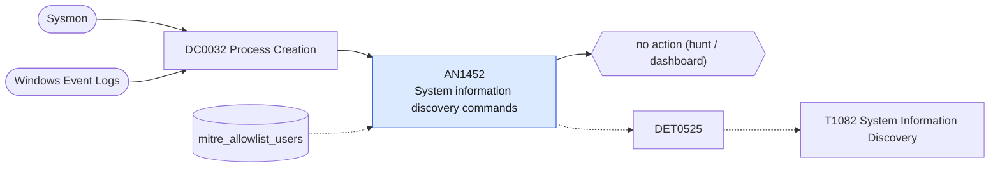

# AN1452 System information discovery commands

[ATT&CK analytic](https://attack.mitre.org/detectionstrategies/DET0525#AN1452) · DET0525 System Discovery via Native and Remote Utilities · [T1082 System Information Discovery](https://attack.mitre.org/techniques/T1082) · tactics: discovery · platforms: Windows

**Content type:** hunting → no action (hunt / dashboard) · **Severity:** informational · **Status:** implemented · **Technique prevalence score:** 511

Lists hosts and users running OS, hardware and patch-level enumeration (systeminfo, hostname, msinfo32, wmic os/computersystem/bios/qfe, reg query of version keys, Get-ComputerInfo, Win32_OperatingSystem, Get-HotFix), grouped into ten-minute buckets with the distinct commands seen.



## What ATT&CK asks for

> Detection of processes executing system environment inspection operations followed by access to OS configuration APIs or registry locations that expose OS version, architecture, patch level, or hardware characteristics. Defenders observe process execution retrieving system configuration metadata immediately after process startup.

## What this implementation detects

Lists hosts and users running OS, hardware and patch-level enumeration (systeminfo, hostname, msinfo32, wmic os/computersystem/bios/qfe, reg query of version keys, Get-ComputerInfo, Win32_OperatingSystem, Get-HotFix), grouped into ten-minute buckets with the distinct commands seen.

**Not covered:** PowerShell script-block content and registry reads are not included. On its own this is routine administration, so it produces no finding or risk; use it to scope an investigation.

## Tuning

ATT&CK mutable elements and where each is bound. Edit macros in `local/macros.conf` and lookups in place; do not edit the search.

| Mutable element | ATT&CK guidance | Bound to | Default |
|---|---|---|---|
| TimeWindow | Detect multiple discovery commands executed in short succession. | filter macro `mitre_an1452_filter` — Bucket size is fixed at 10 minutes; add a threshold here, e.g. where distinct_commands >= 3. |  |
| UserContext | Scope alerts to unusual user accounts or service accounts. | lookup `mitre_allowlist_users` |  |

## Splunk

Stanza `[MITRE - AN1452 - System information discovery commands - Rule]` in `DA-ESS-mitre-attack-detections`. Schedule `14-59/15 * * * *`, window `-20m@m` to `-5m@m`. Ships disabled.

```spl
| tstats `mitre_summariesonly` count from `mitre_dc0032_dm` where `mitre_dc0032_dm_where`
    (Processes.process_name IN ("systeminfo.exe", "hostname.exe", "msinfo32.exe")
      OR (Processes.process_name="wmic.exe" Processes.process IN ("* os *", "*computersystem*", "* bios *", "*csproduct*", "* qfe *"))
      OR (Processes.process_name="reg.exe" Processes.process="*query*" Processes.process IN ("*\\windows nt\\currentversion*", "*\\control\\systeminformation*"))
      OR (Processes.process_name IN ("powershell.exe", "pwsh.exe") Processes.process IN ("*get-computerinfo*", "*win32_operatingsystem*", "*win32_computersystem*", "*get-hotfix*")))
    by Processes.dest Processes.user Processes.parent_process_name Processes.process _time span=10m
| `drop_dm_object_name(Processes)`
| search `mitre_not_allowlisted_user`
| stats sum(count) as count dc(process) as distinct_commands values(process) as process values(parent_process_name) as parent_process_name by dest user _time
| sort - distinct_commands
| `mitre_an1452_filter`
```

Data components: [DC0032](../data-components/DC0032-process-creation.md).

## Sigma

Rule file: `dist/sigma/rules/an1452_system_information_discovery_commands.yml`.

## Known false positives

- Inventory agents, help-desk scripts and administrators.
