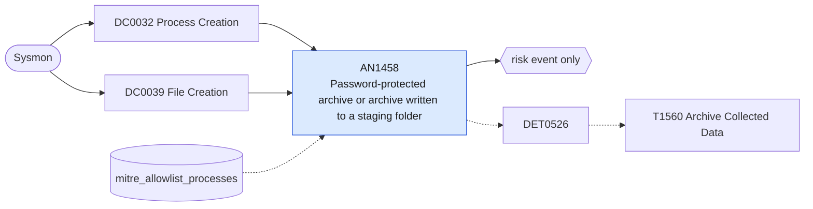

# AN1458 Password-protected archive or archive written to a staging folder

[ATT&CK analytic](https://attack.mitre.org/detectionstrategies/DET0526#AN1458) · DET0526 Detect Archiving and Encryption of Collected Data (T1560) · [T1560 Archive Collected Data](https://attack.mitre.org/techniques/T1560) · tactics: collection · platforms: Windows

**Content type:** anomaly → risk event only · **Severity:** medium · **Status:** implemented · **Technique prevalence score:** 70

An archiver (7-Zip, RAR, WinRAR, makecab, tar, PowerShell Compress-Archive) run with a password or header encryption switch, or an archive file written to a staging folder (Public, ProgramData, Windows\Temp, PerfLogs, the Recycle Bin, user Temp). Encrypted archives in odd places are how collected data is packed before exfiltration.



## What ATT&CK asks for

> Detects adversarial archiving of files prior to exfiltration by correlating execution of compression/encryption utilities (e.g., makecab.exe, rar.exe, 7z.exe, powershell Compress-Archive) with subsequent creation of large compressed or encrypted files. Identifies abnormal process lineage involving crypt32.dll usage, command-line arguments invoking compression switches, and file write operations to temporary or staging directories.

## What this implementation detects

An archiver (7-Zip, RAR, WinRAR, makecab, tar, PowerShell Compress-Archive) run with a password or header encryption switch, or an archive file written to a staging folder (Public, ProgramData, Windows\Temp, PerfLogs, the Recycle Bin, user Temp). Encrypted archives in odd places are how collected data is packed before exfiltration.

**Not covered:** Sysmon 11 has no file size, so "large" archives are not distinguished; archiving through libraries (crypt32, .NET ZipFile) without an archiver process is only caught by the staging-folder leg.

## Tuning

ATT&CK mutable elements and where each is bound. Edit macros in `local/macros.conf` and lookups in place; do not edit the search.

| Mutable element | ATT&CK guidance | Bound to | Default |
|---|---|---|---|
| ArchiveExtensions | List of file extensions treated as suspicious when created outside of expected paths. | macro `mitre_an1458_archive_extensions` | `TargetFilename IN ("*.zip", "*.7z", "*.rar", "*.cab", "*.tar", "*.tgz", "*.gz", "*.z01", "*.001")` |
| ProcessAllowlist | Known business processes permitted to use compression/encryption utilities. | macro `mitre_an1458_archivers` | `(Image IN ("*\\7z.exe", "*\\7za.exe", "*\\7zr.exe", "*\\7zG.exe", "*\\rar.exe", "*\\WinRAR.exe", "*\\makecab.exe", "*\\tar.exe") OR OriginalFileName IN ("7z.exe", "7za.exe", "rar.exe", "WinRAR.exe", "makecab.exe") OR CommandLine="*Compress-Archive*")` |
| FileSizeThresholdMB | Minimum file size for flagging archive creation to reduce noise from benign small compressions. | lookup `mitre_allowlist_processes` — Backup agents and log shippers that archive into these folders. |  |
| StagingPaths *(implementation)* |  | macro `mitre_an1458_staging_paths` | `TargetFilename IN ("C:\\Users\\Public\\*", "C:\\ProgramData\\*", "C:\\Windows\\Temp\\*", "C:\\PerfLogs\\*", "C:\\$Recycle.Bin\\*", "*\\AppData\\Local\\Temp\\*")` |

## Splunk

Stanza `[MITRE - AN1458 - Password-protected archive or archive written to a staging folder - Rule]` in `DA-ESS-mitre-attack-detections`. Schedule `5-59/15 * * * *`, window `-20m@m` to `-5m@m`. Ships disabled.

```spl
(`mitre_dc0032_sysmon` EventCode=1 `mitre_an1458_archivers`)
OR (`mitre_dc0039_sysmon` EventCode=11 `mitre_an1458_archive_extensions` `mitre_an1458_staging_paths`)
| `mitre_normalize_host`
| eval process_name=lower(replace(Image, "^.*\\\\", "")), protected=if(EventCode==1 AND match(CommandLine, "(?i)( -p| -hp| -mhe=on|-password)"), 1, 0), archive=if(EventCode==11, TargetFilename, null()), command=if(EventCode==1, CommandLine, null())
| search `mitre_not_allowlisted_process`
| stats count min(_time) as firstTime max(_time) as lastTime max(protected) as password_protected values(command) as process values(archive) as archive values(user) as user by dest process_name
| where password_protected=1 OR isnotnull(archive)
| eval archive=mvindex(archive, 0, 19), process=mvindex(process, 0, 9)
| `mitre_ctime(firstTime)` | `mitre_ctime(lastTime)`
| `mitre_an1458_filter`
```

Risk: `dest` (system, 35), `user` (user, 30). Threat objects: `process_name`. Message: $process_name$ packed data on $dest$ (password protected $password_protected$)

Throttle: dest, process_name for 86400s.

Data components: [DC0032](../data-components/DC0032-process-creation.md), [DC0039](../data-components/DC0039-file-creation.md).

## Sigma

Rule file: `dist/sigma/rules/an1458_password_protected_archive_or_archive_written_to_a_staging_f.yml`.

## Known false positives

- Backup and log-rotation jobs writing archives to ProgramData or Windows\Temp; users sending encrypted archives on purpose.
