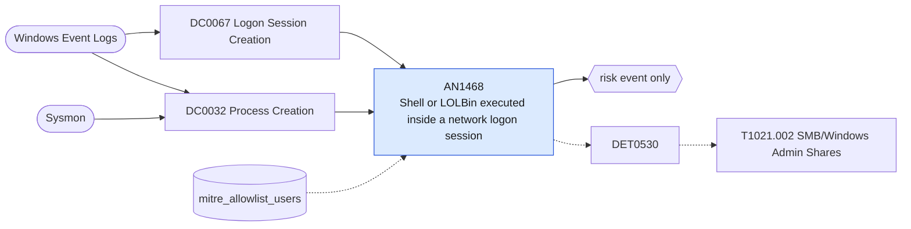

# AN1468 Shell or LOLBin executed inside a network logon session

[ATT&CK analytic](https://attack.mitre.org/detectionstrategies/DET0530#AN1468) · DET0530 Multi-Event Detection for SMB Admin Share Lateral Movement · [T1021.002 SMB/Windows Admin Shares](https://attack.mitre.org/techniques/T1021/002) · tactics: lateral-movement · platforms: Windows

**Content type:** anomaly → risk event only · **Severity:** medium · **Status:** implemented · **Technique prevalence score:** 103

A process from a watch list (cmd, PowerShell, script hosts, rundll32, regsvr32, mshta, certutil, net, sc, schtasks, wmic, reg) runs on a host inside a logon session that was created by a network logon (4624 type 3) from another address. Sysmon's LogonId is joined to the 4624 TargetLogonId, so the source address and account of the remote execution are reported.



## What ATT&CK asks for

> An SMB-based remote file share access followed by lateral movement actions such as remote service creation, task scheduling, or suspicious process execution on the target host using ADMIN$ or C$ shares.

## What this implementation detects

A process from a watch list (cmd, PowerShell, script hosts, rundll32, regsvr32, mshta, certutil, net, sc, schtasks, wmic, reg) runs on a host inside a logon session that was created by a network logon (4624 type 3) from another address. Sysmon's LogonId is joined to the 4624 TargetLogonId, so the source address and account of the remote execution are reported.

**Not covered:** The SMB file write to ADMIN$/C$ itself is not required (use Network Share Access 5145 in the detection strategy). Logons that started before the search window are missed.

## Tuning

ATT&CK mutable elements and where each is bound. Edit macros in `local/macros.conf` and lookups in place; do not edit the search.

| Mutable element | ATT&CK guidance | Bound to | Default |
|---|---|---|---|
| ShareName | Targeted admin share path, such as C$, ADMIN$, IPC$ | filter macro `mitre_an1468_filter` (not bound separately) | `search *` |
| TimeWindow | Correlation window between remote file access and remote execution (e.g., 5-10 minutes) | filter macro `mitre_an1468_filter` — The window is the search time range (default 65 minutes); change dispatch.earliest_time locally. |  |
| UserContext | Distinguish expected remote administrators vs. rare/first-time access by specific users | lookup `mitre_allowlist_users` — Remote administration and deployment accounts. |  |
| ProcessList | List of suspicious binaries or tools executed post remote copy (e.g., cmd.exe, powershell.exe, runonce.exe) | macro `mitre_an1468_processes` | `Image IN ("*\\cmd.exe", "*\\powershell.exe", "*\\pwsh.exe", "*\\wscript.exe", "*\\cscript.exe", "*\\mshta.exe", "*\\rundll32.exe", "*\\regsvr32.exe", "*\\certutil.exe", "*\\net.exe", "*\\net1.exe", "*\\sc.exe", "*\\schtasks.exe", "*\\wmic.exe", "*\\reg.exe")` |

## Splunk

Stanza `[MITRE - AN1468 - Shell or LOLBin executed inside a network logon session - Rule]` in `DA-ESS-mitre-attack-detections`. Schedule `10-59/15 * * * *`, window `-65m@m` to `-5m@m`. Ships disabled.

```spl
(`mitre_dc0067_wineventlog` EventCode=4624 LogonType=3 NOT TargetUserName="*$" NOT IpAddress IN ("-", "127.0.0.1", "::1"))
  OR (`mitre_dc0032_sysmon` EventCode=1 `mitre_an1468_processes`)
| `mitre_normalize_host`
| eval logon_id=lower(coalesce(TargetLogonId, LogonId))
| stats min(_time) as firstTime max(_time) as lastTime dc(EventCode) as signals values(eval(if(EventCode==4624, IpAddress, null()))) as src values(eval(if(EventCode==4624, TargetUserName, null()))) as user values(Image) as process_path values(CommandLine) as process by dest logon_id
| where signals=2
| search `mitre_not_allowlisted_user`
| `mitre_ctime(firstTime)` | `mitre_ctime(lastTime)`
| `mitre_an1468_filter`
```

Risk: `dest` (system, 45), `user` (user, 45). Threat objects: `src`. Message: Remote execution on $dest$ from $src$ as $user$

Throttle: dest, logon_id for 14400s.

Data components: [DC0067](../data-components/DC0067-logon-session-creation.md), [DC0032](../data-components/DC0032-process-creation.md).

## Sigma

Rule file: `dist/sigma/rules/an1468_shell_or_lolbin_executed_inside_a_network_logon_session.yml` (base rule plus a correlation rule).

The join between the logon and the process is expressed as a temporal correlation with a field alias for the logon id.

## Known false positives

- Remote management (SCCM, PDQ, WinRM-based tooling, vulnerability scanners with credentials).
