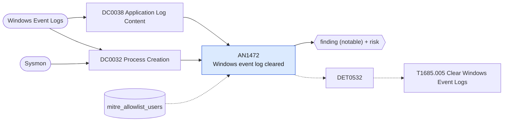

# AN1472 Windows event log cleared

[ATT&CK analytic](https://attack.mitre.org/detectionstrategies/DET0532#AN1472) · DET0532 Detection of Event Log Clearing on Windows via Behavioral Chain · [T1685.005 Clear Windows Event Logs](https://attack.mitre.org/techniques/T1685/005) · tactics: defense-impairment · platforms: Windows

**Content type:** ttp → finding (notable) + risk · **Severity:** high · **Status:** implemented · **Technique prevalence score:** 59

The Security log was cleared (EventCode 1102), another log was cleared (System EventCode 104), or a process ran wevtutil cl / Clear-EventLog / Remove-EventLog. Results are grouped per host and user and list which of the three signals were seen.



## What ATT&CK asks for

> Detects behavioral sequence where an adversary gains elevated privileges and clears event logs using native binaries (e.g., wevtutil), PowerShell, or direct file deletion of .evtx files.

## What this implementation detects

The Security log was cleared (EventCode 1102), another log was cleared (System EventCode 104), or a process ran wevtutil cl / Clear-EventLog / Remove-EventLog. Results are grouped per host and user and list which of the three signals were seen.

**Not covered:** Direct deletion of .evtx files (Sysmon EventCode 23) is not included.

## Tuning

ATT&CK mutable elements and where each is bound. Edit macros in `local/macros.conf` and lookups in place; do not edit the search.

| Mutable element | ATT&CK guidance | Bound to | Default |
|---|---|---|---|
| TimeWindow | Time range between log-clearing command and 1102 event; tunable to reduce false positives | filter macro `mitre_an1472_filter` (not bound separately) | `search *` |
| UserContext | Filter by admin/elevated users; allow tuning to detect abuse of high-privilege accounts | lookup `mitre_allowlist_users` — Accounts that clear logs as part of imaging or lab resets. |  |
| CommandLinePattern | Match common variations of log-clearing commands like `Remove-EventLog`, `wevtutil cl` | macro `mitre_an1472_commands` | `((Image="*\\wevtutil.exe" CommandLine IN ("* cl *", "* clear-log *")) OR CommandLine IN ("*Clear-EventLog*", "*Remove-EventLog*", "*ClearEventLog(*"))` |
| TargetLogName | Scope detection to Security, System, Application, or custom logs based on environment | filter macro `mitre_an1472_filter` (not bound separately) | `search *` |

## Splunk

Stanza `[MITRE - AN1472 - Windows event log cleared - Rule]` in `DA-ESS-mitre-attack-detections`. Schedule `13-59/15 * * * *`, window `-20m@m` to `-5m@m`. Ships disabled.

```spl
(`mitre_dc0038_wineventlog` EventCode IN (1102, 104)) OR (`mitre_dc0032_sysmon` EventCode=1 `mitre_an1472_commands`)
| `mitre_normalize_host`
| eval signal=case(EventCode==1102, "security_log_cleared", EventCode==104, "event_log_cleared", true(), "clear_command")
| search `mitre_not_allowlisted_user`
| stats count min(_time) as firstTime max(_time) as lastTime values(signal) as signals values(CommandLine) as process values(Channel) as cleared_log by dest user
| `mitre_ctime(firstTime)` | `mitre_ctime(lastTime)`
| `mitre_an1472_filter`
```

Risk: `dest` (system, 70), `user` (user, 70). Message: Event log cleared on $dest$ by $user$

Throttle: dest, user for 3600s.

Data components: [DC0038](../data-components/DC0038-application-log-content.md), [DC0032](../data-components/DC0032-process-creation.md).

## Sigma

Rule file: `dist/sigma/rules/an1472_windows_event_log_cleared.yml`.

## Known false positives

- Image preparation (sysprep), lab resets and some log-rotation scripts.
