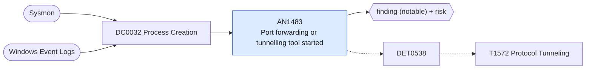

# AN1483 Port forwarding or tunnelling tool started

[ATT&CK analytic](https://attack.mitre.org/detectionstrategies/DET0538#AN1483) · DET0538 Detection Strategy for Protocol Tunneling accross OS platforms. · [T1572 Protocol Tunneling](https://attack.mitre.org/techniques/T1572) · tactics: command-and-control · platforms: Windows

**Content type:** ttp → finding (notable) + risk · **Severity:** medium · **Status:** implemented · **Technique prevalence score:** 66

plink or ssh is started with a local, remote or dynamic port-forward switch; netsh adds a portproxy rule; or a known tunnelling client (chisel, ngrok, frpc, cloudflared tunnel, ligolo) is started.



## What ATT&CK asks for

> Processes such as plink.exe, ssh.exe, or netsh.exe establishing outbound network connections where traffic patterns show encapsulated protocols (e.g., RDP over SSH). Defender observations include anomalous process-to-network relationships, large asymmetric data flows, and port usage mismatches.

## What this implementation detects

plink or ssh is started with a local, remote or dynamic port-forward switch; netsh adds a portproxy rule; or a known tunnelling client (chisel, ngrok, frpc, cloudflared tunnel, ligolo) is started.

**Not covered:** The resulting network connection and the DataAsymmetryThreshold on flow byte counts are not evaluated here; see the network analytics for flow-side detection.

## Tuning

ATT&CK mutable elements and where each is bound. Edit macros in `local/macros.conf` and lookups in place; do not edit the search.

| Mutable element | ATT&CK guidance | Bound to | Default |
|---|---|---|---|
| AllowedTools | Whitelist legitimate tunneling tools (e.g., used by admins). | macro `mitre_an1483_patterns` — Matching is case-insensitive, so ssh -L/-R/-D and -l (login name) both match; exclude administrators in the filter macro if that is noisy. | `((Processes.process_name IN ("plink.exe", "ssh.exe") Processes.process IN ("* -r *", "* -l *", "* -d *", "*:127.0.0.1:*", "*:localhost:*")) OR (Processes.process_name="netsh.exe" Processes.process="*portproxy*add*") OR Processes.process_name IN ("chisel.exe", "ngrok.exe", "frpc.exe", "ligolo*.exe", "gost.exe") OR (Processes.process_name="cloudflared.exe" Processes.process="*tunnel*"))` |
| DataAsymmetryThreshold | Ratio of sent vs received bytes that indicates tunneling activity. | filter macro `mitre_an1483_filter` (not bound separately) | `search *` |
| TimeWindow | Correlate process creation with network connection within N seconds. | filter macro `mitre_an1483_filter` (not bound separately) | `search *` |

## Splunk

Stanza `[MITRE - AN1483 - Port forwarding or tunnelling tool started - Rule]` in `DA-ESS-mitre-attack-detections`. Schedule `6-59/15 * * * *`, window `-20m@m` to `-5m@m`. Ships disabled.

```spl
| tstats `mitre_summariesonly` count min(_time) as firstTime max(_time) as lastTime
    from `mitre_dc0032_dm` where `mitre_dc0032_dm_where` `mitre_an1483_patterns`
    by Processes.dest Processes.user Processes.parent_process_name Processes.process_name Processes.process
| `drop_dm_object_name(Processes)`
| `mitre_ctime(firstTime)` | `mitre_ctime(lastTime)`
| `mitre_an1483_filter`
```

Risk: `dest` (system, 55), `user` (user, 45). Threat objects: `process_name`. Message: Tunnelling tool $process_name$ started on $dest$ by $user$

Throttle: dest, user, process_name for 3600s.

Data components: [DC0032](../data-components/DC0032-process-creation.md).

## Sigma

Rule file: `dist/sigma/rules/an1483_port_forwarding_or_tunnelling_tool_started.yml`.

## Known false positives

- Administrators and developers using SSH port forwarding or approved tunnel clients.
