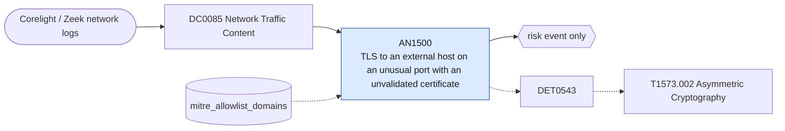

# AN1500 TLS to an external host on an unusual port with an unvalidated certificate

[ATT&CK analytic](https://attack.mitre.org/detectionstrategies/DET0543#AN1500) · DET0543 Detection Strategy for Encrypted Channel via Asymmetric Cryptography across OS Platforms · [T1573.002 Asymmetric Cryptography](https://attack.mitre.org/techniques/T1573/002) · tactics: command-and-control · platforms: Network Devices

**Content type:** anomaly → risk event only · **Severity:** medium · **Status:** implemented · **Technique prevalence score:** 116

Corelight ssl.log sessions to external hosts on ports outside the usual TLS set, where the certificate failed validation or the client sent no server name. Implants bring their own self-signed certificates and often skip SNI.



## What ATT&CK asks for

> Encrypted sessions detected with asymmetric key exchange anomalies on non-standard ports or with invalid/malformed certs. Defender correlates NetFlow/IPFIX with IDS/IPS detecting RSA exchanges outside expected TLS flows.

## What this implementation detects

Corelight ssl.log sessions to external hosts on ports outside the usual TLS set, where the certificate failed validation or the client sent no server name. Implants bring their own self-signed certificates and often skip SNI.

**Not covered:** validation_status is only populated when the sensor validates certificates (Corelight default; plain Zeek needs the validation script). Malformed handshakes without a completed session are not in ssl.log.

## Tuning

ATT&CK mutable elements and where each is bound. Edit macros in `local/macros.conf` and lookups in place; do not edit the search.

| Mutable element | ATT&CK guidance | Bound to | Default |
|---|---|---|---|
| PortProfiles | Define expected ports for asymmetric cryptography (e.g., 443, 993). | macro `mitre_an1500_tls_ports` — Ports on which TLS is expected; matched with NOT. | `dest_port IN (443, 8443, 993, 995, 465, 587, 636, 853, 989, 990, 5061, 3389)` |
| CertValidationPolicy | Thresholds for rejecting untrusted/self-signed certs. | lookup `mitre_allowlist_domains` — Server names known to use private certificates (domain column). |  |

## Splunk

Stanza `[MITRE - AN1500 - TLS to an external host on an unusual port with an unvalidated certificate - Rule]` in `DA-ESS-mitre-attack-detections`. Schedule `8-59/15 * * * *`, window `-20m@m` to `-5m@m`. Ships disabled.

```spl
`mitre_dc0085_corelight` `mitre_st_corelight_ssl`
| `mitre_normalize_zeek`
| where NOT `mitre_is_internal(dest)`
| search NOT `mitre_an1500_tls_ports`
| where (isnotnull(validation_status) AND validation_status!="ok") OR isnull(server_name) OR server_name=="-"
| lookup mitre_allowlist_domains domain AS server_name OUTPUT reason AS allow_reason
| where isnull(allow_reason)
| stats count min(_time) as firstTime max(_time) as lastTime values(validation_status) as validation_status values(server_name) as server_name values(ja3) as ja3 by src dest dest_port
| `mitre_ctime(firstTime)` | `mitre_ctime(lastTime)`
| `mitre_an1500_filter`
```

Risk: `src` (system, 30). Threat objects: `dest`. Message: $src$ used TLS with an unvalidated certificate to $dest$ on port $dest_port$

Throttle: src, dest for 14400s.

Data components: [DC0085](../data-components/DC0085-network-traffic-content.md).

## Sigma

Rule file: `dist/sigma/rules/an1500_tls_to_an_external_host_on_an_unusual_port_with_an_unvalidat.yml`.

## Known false positives

- Vendor appliances and VPNs with self-signed certificates on custom ports.
