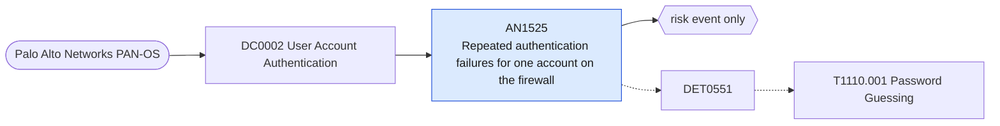

# AN1525 Repeated authentication failures for one account on the firewall

[ATT&CK analytic](https://attack.mitre.org/detectionstrategies/DET0551#AN1525) · DET0551 Password Guessing via Multi-Source Authentication Failure Correlation · [T1110.001 Password Guessing](https://attack.mitre.org/techniques/T1110/001) · tactics: credential-access · platforms: Network Devices

**Content type:** anomaly → risk event only · **Severity:** medium · **Status:** implemented · **Technique prevalence score:** 17

Palo Alto system logs (subtype auth, event auth-fail) show many failed logins for the same account on the same firewall within ten minutes: password guessing against the management interface or an authentication profile.



## What ATT&CK asks for

> Login attempt failures over SNMP, Telnet, or SSH interface, often reflected in logs or syslog events

## What this implementation detects

Palo Alto system logs (subtype auth, event auth-fail) show many failed logins for the same account on the same firewall within ten minutes: password guessing against the management interface or an authentication profile.

**Not covered:** Only the firewall is covered; routers and switches need the netdev_syslog feed. The interface (web, SSH, API) is not separated because the description text varies by PAN-OS version.

## Tuning

ATT&CK mutable elements and where each is bound. Edit macros in `local/macros.conf` and lookups in place; do not edit the search.

| Mutable element | ATT&CK guidance | Bound to | Default |
|---|---|---|---|
| InterfaceType | Specify monitoring of Telnet/SSH/SNMP for login activity | filter macro `mitre_an1525_filter` |  |
| FailedAttemptThreshold | How many failures in short succession should trigger alerting | macro `mitre_an1525_threshold` — Failures per account per firewall per 10 minutes. | `10` |

## Splunk

Stanza `[MITRE - AN1525 - Repeated authentication failures for one account on the firewall - Rule]` in `DA-ESS-mitre-attack-detections`. Schedule `5-59/15 * * * *`, window `-20m@m` to `-5m@m`. Ships disabled.

```spl
`mitre_dc0002_palo_alto` `mitre_st_palo_alto_system`
| `mitre_normalize_pan_system`
| where pan_subtype=="auth" AND pan_event_id=="auth-fail"
| bin _time span=10m
| stats count as failures min(_time) as firstTime max(_time) as lastTime dc(src) as distinct_sources values(src) as src by dvc user _time
| where failures >= `mitre_an1525_threshold`
| rename dvc as dest
| `mitre_ctime(firstTime)` | `mitre_ctime(lastTime)`
| `mitre_an1525_filter`
```

Risk: `user` (user, 30), `dest` (system, 20). Threat objects: `src`. Message: $failures$ failed logins for $user$ on firewall $dest$ in ten minutes

Throttle: dest, user for 3600s.

Data components: [DC0002](../data-components/DC0002-user-account-authentication.md).

## Sigma

Rule file: `dist/sigma/rules/an1525_repeated_authentication_failures_for_one_account_on_the_fire.yml`.

## Known false positives

- Expired credentials on a monitoring or backup system that logs in to the firewall.
