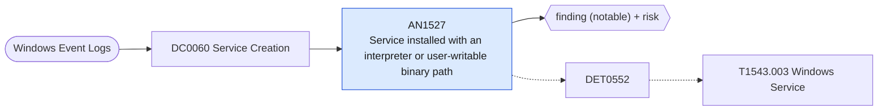

# AN1527 Service installed with an interpreter or user-writable binary path

[ATT&CK analytic](https://attack.mitre.org/detectionstrategies/DET0552#AN1527) · DET0552 Detection of Windows Service Creation or Modification · [T1543.003 Windows Service](https://attack.mitre.org/techniques/T1543/003) · tactics: persistence, privilege-escalation · platforms: Windows

**Content type:** ttp → finding (notable) + risk · **Severity:** medium · **Status:** implemented · **Technique prevalence score:** 172

A new service is registered (System 7045 or Security 4697) whose image path runs a command interpreter or LOLBin, or points into Users, ProgramData, Temp, AppData, PerfLogs or an ADMIN$ / loopback UNC path. Covers PsExec-style and malware service persistence.



## What ATT&CK asks for

> Detects creation or modification of Windows Services through command-line tools (e.g., `sc.exe`, `powershell.exe`), Registry key changes under `HKLM\System\CurrentControlSet\Services`, and service execution under SYSTEM with unsigned or anomalous binary paths. Detects privilege escalation via driver installation or `CreateServiceW` usage. Correlates parent-child lineage, startup behavior, and rare service names.

## What this implementation detects

A new service is registered (System 7045 or Security 4697) whose image path runs a command interpreter or LOLBin, or points into Users, ProgramData, Temp, AppData, PerfLogs or an ADMIN$ / loopback UNC path. Covers PsExec-style and malware service persistence.

**Not covered:** Service key registry changes, driver loads (Sysmon 6), signature checks and rare-name analysis from ATT&CK's description are not included.

## Tuning

ATT&CK mutable elements and where each is bound. Edit macros in `local/macros.conf` and lookups in place; do not edit the search.

| Mutable element | ATT&CK guidance | Bound to | Default |
|---|---|---|---|
| ServiceNamePattern | Regex for suspicious or uncommon service names (e.g., `svhostx`, `winhelp`, etc.) | filter macro `mitre_an1527_filter` |  |
| ImagePathFilter | Flag services whose image path resides in uncommon directories (e.g., `C:\Users\`, `C:\Temp\`) | macro `mitre_an1527_suspicious_paths` | `service_path IN ("*\\Users\\*", "*\\ProgramData\\*", "*\\Windows\\Temp\\*", "*\\AppData\\*", "*\\PerfLogs\\*", "*%COMSPEC%*", "*cmd.exe*", "*cmd /c*", "*powershell*", "*pwsh*", "*rundll32*", "*regsvr32*", "*mshta*", "*\\ADMIN$\\*", "*\\\\127.0.0.1\\*")` |
| DriverExtensionList | Watch for `.sys` files loaded by `sc`, Registry, or `ZwLoadDriver` APIs | filter macro `mitre_an1527_filter` (not bound separately) | `search *` |
| StartupTypeChangeWindow | Temporal window to correlate Registry `Start` key changes with service creation | filter macro `mitre_an1527_filter` (not bound separately) | `search *` |
| UnsignedBinaryAlert | Raise alerts for unsigned binaries registered as services | filter macro `mitre_an1527_filter` (not bound separately) | `search *` |

## Splunk

Stanza `[MITRE - AN1527 - Service installed with an interpreter or user-writable binary path - Rule]` in `DA-ESS-mitre-attack-detections`. Schedule `9-59/15 * * * *`, window `-20m@m` to `-5m@m`. Ships disabled.

```spl
`mitre_dc0060_wineventlog` EventCode IN (7045, 4697)
| `mitre_normalize_host`
| eval service_path=coalesce(ImagePath, ServiceFileName), service_name=ServiceName, service_account=coalesce(AccountName, ServiceAccount)
| search `mitre_an1527_suspicious_paths` NOT service_path="*\\ProgramData\\Microsoft\\Windows Defender\\*"
| stats count min(_time) as firstTime max(_time) as lastTime values(service_account) as service_account values(EventCode) as signature_id by dest user service_name service_path
| `mitre_ctime(firstTime)` | `mitre_ctime(lastTime)`
| `mitre_an1527_filter`
```

Risk: `dest` (system, 60), `user` (user, 40). Threat objects: `service_name`. Message: Suspicious service $service_name$ installed on $dest$

Throttle: dest, service_name for 3600s.

Data components: [DC0060](../data-components/DC0060-service-creation.md).

## Sigma

Rule file: `dist/sigma/rules/an1527_service_installed_with_an_interpreter_or_user_writable_binar.yml`.

## Known false positives

- Vendor software that installs services from ProgramData; remote administration with PsExec-like tools.
