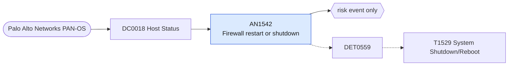

# AN1542 Firewall restart or shutdown

[ATT&CK analytic](https://attack.mitre.org/detectionstrategies/DET0559#AN1542) · DET0559 Multi-Platform Shutdown or Reboot Detection via Execution and Host Status Events · [T1529 System Shutdown/Reboot](https://attack.mitre.org/techniques/T1529) · tactics: impact · platforms: Network Devices

**Content type:** anomaly → risk event only · **Severity:** medium · **Status:** implemented · **Technique prevalence score:** 37

A Palo Alto system log records a device restart, reboot or shutdown. An unplanned restart of a perimeter firewall is either an outage or someone using a reload to apply tampered configuration or software.



## What ATT&CK asks for

> Monitor CLI 'reload' commands issued without scheduled maintenance, and correlate to TACACS+/AAA logs for privilege validation.

## What this implementation detects

A Palo Alto system log records a device restart, reboot or shutdown. An unplanned restart of a perimeter firewall is either an outage or someone using a reload to apply tampered configuration or software.

**Not covered:** Matched on the description text because restart event ids differ across PAN-OS versions; change-window correlation (ChangeTicketCorrelation) is left to the filter macro. Routers and switches need the netdev_syslog feed.

## Tuning

ATT&CK mutable elements and where each is bound. Edit macros in `local/macros.conf` and lookups in place; do not edit the search.

| Mutable element | ATT&CK guidance | Bound to | Default |
|---|---|---|---|
| PrivilegeLevel | TACACS+/AAA role thresholds for command execution. | macro `mitre_an1542_patterns` | `description IN ("*restart*", "*reboot*", "*shutdown*", "*shut down*")` |
| ChangeTicketCorrelation | Track change control windows or ITSM integration. | filter macro `mitre_an1542_filter` — Exclude maintenance windows, e.g. search NOT date_wday="sunday". |  |

## Splunk

Stanza `[MITRE - AN1542 - Firewall restart or shutdown - Rule]` in `DA-ESS-mitre-attack-detections`. Schedule `1-59/15 * * * *`, window `-20m@m` to `-5m@m`. Ships disabled.

```spl
`mitre_dc0018_palo_alto` `mitre_st_palo_alto_system` `mitre_an1542_patterns`
| `mitre_normalize_pan_system`
| stats count min(_time) as firstTime max(_time) as lastTime values(description) as description values(user) as user values(pan_event_id) as signature by dvc
| rename dvc as dest
| `mitre_ctime(firstTime)` | `mitre_ctime(lastTime)`
| `mitre_an1542_filter`
```

Risk: `dest` (system, 25). Message: Firewall $dest$ restarted or shut down

Throttle: dest for 3600s.

Data components: [DC0018](../data-components/DC0018-host-status.md).

## Sigma

Rule file: `dist/sigma/rules/an1542_firewall_restart_or_shutdown.yml`.

## Known false positives

- Planned upgrades and HA failover tests.
