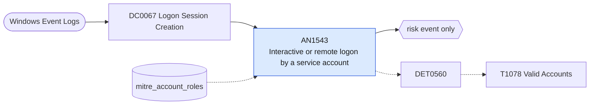

# AN1543 Interactive or remote logon by a service account

[ATT&CK analytic](https://attack.mitre.org/detectionstrategies/DET0560#AN1543) · DET0560 Detection of Valid Account Abuse Across Platforms · [T1078 Valid Accounts](https://attack.mitre.org/techniques/T1078) · tactics: stealth, persistence, privilege-escalation, initial-access · platforms: Windows

**Content type:** anomaly → risk event only · **Severity:** medium · **Status:** implemented · **Technique prevalence score:** 129

An account whose role in the mitre_account_roles lookup is "service" logs on interactively (type 2), over RDP (type 10) or with cached credentials at the console (type 11). Service accounts should only produce service and network logons.



## What ATT&CK asks for

> Detection of compromised or misused valid accounts via anomalous logon patterns, abnormal logon types, and inconsistent geographic or time-based activity across Windows endpoints.

## What this implementation detects

An account whose role in the mitre_account_roles lookup is "service" logs on interactively (type 2), over RDP (type 10) or with cached credentials at the console (type 11). Service accounts should only produce service and network logons.

**Not covered:** Geographic and time-of-day anomalies, failed-logon patterns (4625/4776) and follow-on process activity from ATT&CK's description are not evaluated. The analytic only works once service accounts are listed in mitre_account_roles.

## Tuning

ATT&CK mutable elements and where each is bound. Edit macros in `local/macros.conf` and lookups in place; do not edit the search.

| Mutable element | ATT&CK guidance | Bound to | Default |
|---|---|---|---|
| LogonType | Flag unexpected logon types (e.g., Type 10 for remote interactive logins) for sensitive accounts. | macro `mitre_an1543_logon_types` | `LogonType IN (2, 10, 11)` |
| TimeWindow | Define acceptable hours for interactive logon activity (e.g., 9AM-6PM local). | lookup `mitre_account_roles` — Populate with role=service rows; the shared macro mitre_accounts_with_role(1) reads it. |  |
| GeoIPMismatch | Trigger on location anomalies based on prior user behavior or policy. | filter macro `mitre_an1543_filter` (not bound separately) | `search *` |

## Splunk

Stanza `[MITRE - AN1543 - Interactive or remote logon by a service account - Rule]` in `DA-ESS-mitre-attack-detections`. Schedule `0-59/15 * * * *`, window `-20m@m` to `-5m@m`. Ships disabled.

```spl
`mitre_dc0067_wineventlog` EventCode=4624 `mitre_an1543_logon_types`
| `mitre_normalize_host`
| eval user=TargetUserName, src=IpAddress
| search `mitre_accounts_with_role(service)`
| stats count min(_time) as firstTime max(_time) as lastTime values(LogonType) as logon_type values(src) as src by dest user
| `mitre_ctime(firstTime)` | `mitre_ctime(lastTime)`
| `mitre_an1543_filter`
```

Risk: `user` (user, 45), `dest` (system, 30). Message: Service account $user$ logged on interactively to $dest$

Throttle: dest, user for 14400s.

Data components: [DC0067](../data-components/DC0067-logon-session-creation.md).

## Sigma

Not expressed in Sigma: The condition depends on the mitre_account_roles lookup (which accounts are service accounts); Sigma has no lookup construct.

## Known false positives

- Administrators troubleshooting with a service account; accounts mislabelled in the lookup.
