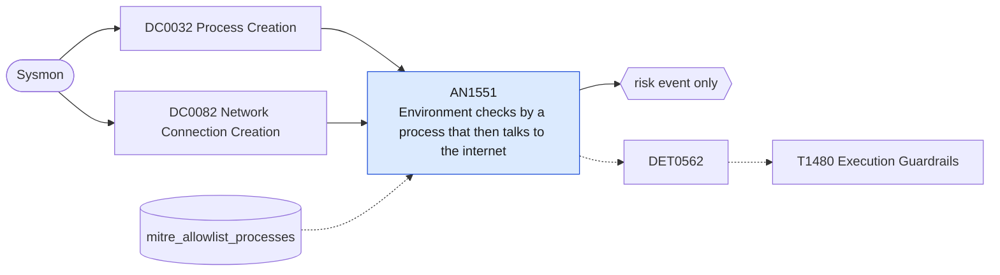

# AN1551 Environment checks by a process that then talks to the internet

[ATT&CK analytic](https://attack.mitre.org/detectionstrategies/DET0562#AN1551) · DET0562 Multi-Platform Execution Guardrails Environmental Validation Detection Strategy · [T1480 Execution Guardrails](https://attack.mitre.org/techniques/T1480) · tactics: stealth · platforms: Windows

**Content type:** anomaly → risk event only · **Severity:** medium · **Status:** implemented · **Technique prevalence score:** 58

One parent process spawns several distinct environment-discovery commands (whoami, hostname, ipconfig, systeminfo, nltest, wmic computersystem/csproduct/bios, reg query MachineGuid) within the search window and the same parent process (matched by Sysmon ProcessGuid) makes an outbound connection to an external address. Guardrailed payloads collect host, domain and hardware identifiers, check them, and only then fetch or run the next stage.



## What ATT&CK asks for

> Windows environmental validation behavioral chain: (1) Rapid system discovery reconnaissance through WMI queries, registry enumeration, and network share discovery, (2) Environment-specific artifact collection (hostname, domain, IP addresses, installed software, hardware identifiers), (3) Cryptographic operations or conditional logic based on collected environmental values, (4) Selective payload execution contingent on environmental validation results, (5) Temporal correlation between discovery activities and subsequent execution or network communication

## What this implementation detects

One parent process spawns several distinct environment-discovery commands (whoami, hostname, ipconfig, systeminfo, nltest, wmic computersystem/csproduct/bios, reg query MachineGuid) within the search window and the same parent process (matched by Sysmon ProcessGuid) makes an outbound connection to an external address. Guardrailed payloads collect host, domain and hardware identifiers, check them, and only then fetch or run the next stage.

**Not covered:** Checks done in-process through APIs or WMI (no child processes) are invisible here; the WMI-Activity and module-load legs ATT&CK lists are not joined.

## Tuning

ATT&CK mutable elements and where each is bound. Edit macros in `local/macros.conf` and lookups in place; do not edit the search.

| Mutable element | ATT&CK guidance | Bound to | Default |
|---|---|---|---|
| DiscoveryTimeWindow | Maximum time window for correlating multiple discovery activities indicating reconnaissance phase - adjust based on normal system behavior (default: 300 seconds) | filter macro `mitre_an1551_filter` — The window is the search range (20 minutes on a 15-minute schedule). |  |
| DiscoveryActivityThreshold | Minimum number of different discovery techniques within time window to trigger detection - balance between false positives and coverage (default: 4 activities) | macro `mitre_an1551_threshold` — Distinct discovery binaries spawned by one parent process. | `3` |
| CryptographicLibraryWhitelist | Approved cryptographic libraries and modules for legitimate organizational use - maintain based on approved software inventory | lookup `mitre_allowlist_processes` — Inventory and management agents that collect host facts and report home. |  |
| WMIQueryComplexityThreshold | Complexity score for WMI queries indicating reconnaissance vs. legitimate administration - tune based on administrative patterns | filter macro `mitre_an1551_filter` (not bound separately) | `search *` |
| EnvironmentalArtifactList | Environment-specific values commonly targeted by guardrails (hostnames, domains, network shares) - customize for organizational environment | macro `mitre_an1551_discovery` | `(Image IN ("*\\whoami.exe", "*\\hostname.exe", "*\\ipconfig.exe", "*\\systeminfo.exe", "*\\nltest.exe", "*\\getmac.exe", "*\\quser.exe", "*\\net.exe", "*\\net1.exe") OR (Image="*\\wmic.exe" CommandLine IN ("*computersystem*", "*csproduct*", "*bios*", "*os get*", "*nicconfig*")) OR (Image="*\\reg.exe" CommandLine="*MachineGuid*"))` |
| ExecutionDelayBaseline | Statistical baseline for normal delay between discovery and execution activities - establish through historical analysis | filter macro `mitre_an1551_filter` (not bound separately) | `search *` |

## Splunk

Stanza `[MITRE - AN1551 - Environment checks by a process that then talks to the internet - Rule]` in `DA-ESS-mitre-attack-detections`. Schedule `*/15 * * * *`, window `-20m@m` to `now`. Ships disabled.

```spl
(`mitre_dc0032_sysmon` EventCode=1 `mitre_an1551_discovery`)
OR (`mitre_dc0082_sysmon` EventCode=3 Initiated="true")
| `mitre_normalize_host`
| eval guid=if(EventCode==1, ParentProcessGuid, ProcessGuid), discovery=if(EventCode==1, lower(replace(Image, "^.*\\\\", "")), null()), external=if(EventCode==3 AND NOT `mitre_is_internal(DestinationIp)` AND NOT match(DestinationIp, "^(127\.|::1|fe80:|169\.254\.)"), DestinationIp, null()), parent=if(EventCode==1, ParentImage, Image)
| stats dc(discovery) as distinct_discovery values(discovery) as discovery values(external) as dest_ip values(parent) as parent_process values(user) as user min(_time) as firstTime max(_time) as lastTime by dest guid
| where distinct_discovery >= `mitre_an1551_threshold` AND isnotnull(dest_ip)
| eval parent_process_name=lower(replace(mvindex(parent_process, 0), "^.*\\\\", "")), process_name=parent_process_name
| search `mitre_not_allowlisted_process`
| `mitre_ctime(firstTime)` | `mitre_ctime(lastTime)`
| `mitre_an1551_filter`
```

Risk: `dest` (system, 40). Threat objects: `parent_process_name`. Message: $parent_process_name$ on $dest$ ran $distinct_discovery$ environment checks and connected out

Throttle: dest, parent_process_name for 86400s.

Data components: [DC0032](../data-components/DC0032-process-creation.md), [DC0082](../data-components/DC0082-network-connection-creation.md).

## Sigma

Rule file: `dist/sigma/rules/an1551_environment_checks_by_a_process_that_then_talks_to_the_inter.yml` (base rule plus a correlation rule).

## Known false positives

- Inventory, monitoring and RMM agents that shell out for host facts; login scripts that also map drives over the internet.
