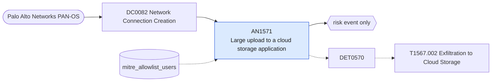

# AN1571 Large upload to a cloud storage application

[ATT&CK analytic](https://attack.mitre.org/detectionstrategies/DET0570#AN1571) · DET0570 Detection Strategy for Exfiltration to Cloud Storage · [T1567.002 Exfiltration to Cloud Storage](https://attack.mitre.org/techniques/T1567/002) · tactics: exfiltration · platforms: Windows

**Content type:** anomaly → risk event only · **Severity:** medium · **Status:** implemented · **Technique prevalence score:** 72

Palo Alto traffic logs where App-ID identifies a consumer cloud storage service and the bytes sent by one source and user within the hour exceed a threshold.



## What ATT&CK asks for

> Unusual processes (e.g., powershell.exe, excel.exe) accessing large local files and subsequently initiating HTTPS POST requests to domains associated with cloud storage services (e.g., dropbox.com, drive.google.com, box.com). Defender perspective: correlation between file reads in sensitive directories and high outbound traffic volume to known storage APIs.

## What this implementation detects

Palo Alto traffic logs where App-ID identifies a consumer cloud storage service and the bytes sent by one source and user within the hour exceed a threshold.

**Not covered:** ATT&CK describes the endpoint view (file reads, then a non-browser process posting to storage APIs via Sysmon). This implementation uses the same Network Connection Creation component through the firewall, where volume is measurable; the reading process is not known.

## Tuning

ATT&CK mutable elements and where each is bound. Edit macros in `local/macros.conf` and lookups in place; do not edit the search.

| Mutable element | ATT&CK guidance | Bound to | Default |
|---|---|---|---|
| CloudStorageDomains | List of monitored domains for cloud services (dropbox.com, drive.google.com, onedrive.live.com). | macro `mitre_an1571_cloud_storage_apps` — App-ID names. Remove the sanctioned service for your organisation, or exclude its users. | `app IN ("dropbox*", "google-drive*", "ms-onedrive*", "onedrive*", "boxnet*", "mega*", "wetransfer*", "pcloud*", "icloud*", "sendspace*", "mediafire*", "4shared*", "amazon-cloud-drive*")` |
| ExfilVolumeThreshold | Data volume threshold (e.g., >10MB in single session) used to flag abnormal transfers. | macro `mitre_an1571_bytes_threshold` — Bytes sent per source and user per hour (default 50 MB). | `52428800` |
| UserContext | User accounts permitted to use sanctioned cloud services versus unexpected accounts. | lookup `mitre_allowlist_users` |  |

## Splunk

Stanza `[MITRE - AN1571 - Large upload to a cloud storage application - Rule]` in `DA-ESS-mitre-attack-detections`. Schedule `23 * * * *`, window `-65m@m` to `-5m@m`. Ships disabled.

```spl
`mitre_dc0082_palo_alto` `mitre_st_palo_alto_traffic` `mitre_an1571_cloud_storage_apps`
| `mitre_normalize_pan`
| fillnull value="unknown" user
| stats count min(_time) as firstTime max(_time) as lastTime sum(bytes_out) as bytes_out values(app) as app dc(dest) as distinct_destinations by src user
| where bytes_out >= `mitre_an1571_bytes_threshold`
| search `mitre_not_allowlisted_user`
| eval mb_out=round(bytes_out / 1048576, 1)
| `mitre_ctime(firstTime)` | `mitre_ctime(lastTime)`
| `mitre_an1571_filter`
```

Risk: `src` (system, 40), `user` (user, 40). Message: $src$ ($user$) uploaded $mb_out$ MB to cloud storage

Throttle: src, user for 14400s.

Data components: [DC0082](../data-components/DC0082-network-connection-creation.md).

## Sigma

Rule file: `dist/sigma/rules/an1571_large_upload_to_a_cloud_storage_application.yml`.

The rule matches the application; the byte threshold per source is left to the SPL.

## Known false positives

- Sanctioned sync clients, backups to personal storage allowed by policy, large legitimate shares.
