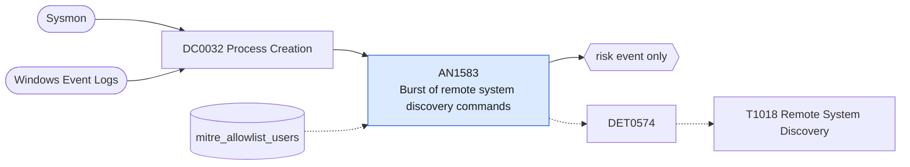

# AN1583 Burst of remote system discovery commands

[ATT&CK analytic](https://attack.mitre.org/detectionstrategies/DET0574#AN1583) · DET0574 Detection Strategy for Remote System Enumeration Behavior · [T1018 Remote System Discovery](https://attack.mitre.org/techniques/T1018) · tactics: discovery · platforms: Windows

**Content type:** anomaly → risk event only · **Severity:** low · **Status:** implemented · **Technique prevalence score:** 161

One user on one host runs several distinct network enumeration commands within ten minutes: net view, net group "domain computers", nltest, ping, tracert, nslookup, arp, nbtstat -A, adfind, dsquery computer, Get-ADComputer, Test-Connection. A ping sweep counts because each target is a distinct command line.



## What ATT&CK asks for

> Execution of network enumeration utilities (e.g., net.exe, ping.exe, tracert.exe) in short succession, often chained with lateral movement tools or system enumeration commands.

## What this implementation detects

One user on one host runs several distinct network enumeration commands within ten minutes: net view, net group "domain computers", nltest, ping, tracert, nslookup, arp, nbtstat -A, adfind, dsquery computer, Get-ADComputer, Test-Connection. A ping sweep counts because each target is a distinct command line.

**Not covered:** Network connections produced by the enumeration (Sysmon 3) are not correlated; AN1057 covers the connection-side scan pattern.

## Tuning

ATT&CK mutable elements and where each is bound. Edit macros in `local/macros.conf` and lookups in place; do not edit the search.

| Mutable element | ATT&CK guidance | Bound to | Default |
|---|---|---|---|
| TimeWindow | Define bursty execution patterns of enumeration commands (e.g., <30s) | macro `mitre_an1583_threshold` — Distinct enumeration command lines per host and user per 10-minute bucket. | `5` |
| CommandLinePattern | Tunable per org’s scripting/IT tools (e.g., exclude SCCM, PsExec) | lookup `mitre_allowlist_users` — Monitoring and deployment accounts (SCCM, scanners). |  |
| ParentProcess | Flag suspicious process ancestry (e.g., Word.exe spawning net.exe) | filter macro `mitre_an1583_filter` |  |

## Splunk

Stanza `[MITRE - AN1583 - Burst of remote system discovery commands - Rule]` in `DA-ESS-mitre-attack-detections`. Schedule `7-59/15 * * * *`, window `-30m@m` to `-5m@m`. Ships disabled.

```spl
| tstats `mitre_summariesonly` count from `mitre_dc0032_dm` where `mitre_dc0032_dm_where`
    ((Processes.process_name IN ("net.exe", "net1.exe") Processes.process IN ("* view*", "*domain computers*", "*domain controllers*"))
      OR Processes.process_name IN ("nltest.exe", "ping.exe", "tracert.exe", "nslookup.exe", "adfind.exe", "nbtscan.exe")
      OR (Processes.process_name="arp.exe" Processes.process="* -a*")
      OR (Processes.process_name="nbtstat.exe" Processes.process="* -a *")
      OR (Processes.process_name="dsquery.exe" Processes.process="*computer*")
      OR (Processes.process_name IN ("powershell.exe", "pwsh.exe") Processes.process IN ("*get-adcomputer*", "*get-domaincomputer*", "*get-netcomputer*", "*test-connection*", "*test-netconnection*")))
    by Processes.dest Processes.user Processes.process _time span=10m
| `drop_dm_object_name(Processes)`
| stats sum(count) as count min(_time) as firstTime max(_time) as lastTime dc(process) as distinct_commands values(process) as process by dest user _time
| where distinct_commands >= `mitre_an1583_threshold`
| search `mitre_not_allowlisted_user`
| eval process=mvindex(process, 0, 19)
| `mitre_ctime(firstTime)` | `mitre_ctime(lastTime)`
| `mitre_an1583_filter`
```

Risk: `dest` (system, 20), `user` (user, 20). Message: $distinct_commands$ remote system discovery commands on $dest$ by $user$ in ten minutes

Throttle: dest, user for 3600s.

Data components: [DC0032](../data-components/DC0032-process-creation.md).

## Sigma

Rule file: `dist/sigma/rules/an1583_burst_of_remote_system_discovery_commands.yml` (base rule plus a correlation rule).

## Known false positives

- Monitoring scripts, network troubleshooting and software deployment.
