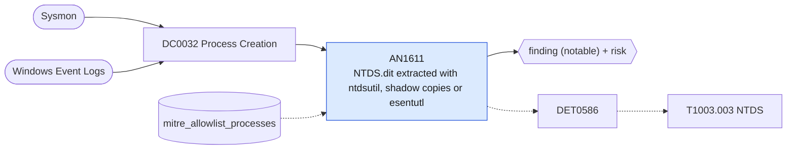

# AN1611 NTDS.dit extracted with ntdsutil, shadow copies or esentutl

[ATT&CK analytic](https://attack.mitre.org/detectionstrategies/DET0586#AN1611) · DET0586 Detection of NTDS.dit Credential Dumping from Domain Controllers · [T1003.003 NTDS](https://attack.mitre.org/techniques/T1003/003) · tactics: credential-access · platforms: Windows

**Content type:** ttp → finding (notable) + risk · **Severity:** critical · **Status:** implemented · **Technique prevalence score:** 50

Commands that copy the Active Directory database: ntdsutil IFM or "create full", copying ntds.dit out of a volume shadow copy path, esentutl copying ntds.dit with /vss, or diskshadow/vssadmin creating a shadow copy on a domain controller followed by access to NTDS paths in the same command.



## What ATT&CK asks for

> Detects credential dumping attempts targeting the NTDS.dit database by monitoring shadow copy creation, suspicious file access to %SystemRoot%\NTDS\ntds.dit, and the use of tooling like ntdsutil.exe or volume management APIs.

## What this implementation detects

Commands that copy the Active Directory database: ntdsutil IFM or "create full", copying ntds.dit out of a volume shadow copy path, esentutl copying ntds.dit with /vss, or diskshadow/vssadmin creating a shadow copy on a domain controller followed by access to NTDS paths in the same command.

**Not covered:** Raw volume reads by custom tooling and the VSS operational log are not used; DCSync over the network is a different technique (T1003.006).

## Tuning

ATT&CK mutable elements and where each is bound. Edit macros in `local/macros.conf` and lookups in place; do not edit the search.

| Mutable element | ATT&CK guidance | Bound to | Default |
|---|---|---|---|
| TargetFilePath | Tunable for NTDS file location or backup paths if organization uses custom domain controller storage structure. | macro `mitre_an1611_patterns` | `((Processes.process_name="ntdsutil.exe" Processes.process IN ("*ifm*", "*create full*", "*snapshot*")) OR Processes.process IN ("*harddiskvolumeshadowcopy*ntds*", "*\\ntds\\ntds.dit*", "*ntds.dit*system*") OR (Processes.process_name="esentutl.exe" Processes.process="*ntds*") OR (Processes.process_name="vssadmin.exe" Processes.process="*create shadow*") OR (Processes.process_name="diskshadow.exe" Processes.process="*/s *"))` |
| ParentProcessName | Can suppress backup-related parent processes to reduce false positives. | lookup `mitre_allowlist_processes` — AD backup software (process_name column). |  |
| TimeWindow | Temporal correlation between shadow copy creation and NTDS file access (e.g., 5 min window). | filter macro `mitre_an1611_filter` (not bound separately) | `search *` |
| UserContext | Tune based on expected privileged user/service account behavior. | filter macro `mitre_an1611_filter` |  |

## Splunk

Stanza `[MITRE - AN1611 - NTDS.dit extracted with ntdsutil, shadow copies or esentutl - Rule]` in `DA-ESS-mitre-attack-detections`. Schedule `4-59/15 * * * *`, window `-20m@m` to `-5m@m`. Ships disabled.

```spl
| tstats `mitre_summariesonly` count min(_time) as firstTime max(_time) as lastTime
    from `mitre_dc0032_dm` where `mitre_dc0032_dm_where` `mitre_an1611_patterns`
    by Processes.dest Processes.user Processes.parent_process_name Processes.process_name Processes.process
| `drop_dm_object_name(Processes)`
| search `mitre_not_allowlisted_process`
| `mitre_ctime(firstTime)` | `mitre_ctime(lastTime)`
| `mitre_an1611_filter`
```

Risk: `dest` (system, 90), `user` (user, 90). Threat objects: `process_name`. Message: NTDS.dit extraction with $process_name$ on $dest$ by $user$

Throttle: dest, user for 3600s.

Data components: [DC0032](../data-components/DC0032-process-creation.md).

## Sigma

Rule file: `dist/sigma/rules/an1611_ntds_dit_extracted_with_ntdsutil_shadow_copies_or_esentutl.yml`.

## Known false positives

- Domain controller backups and IFM media creation for new DCs; vssadmin shadow creation by backup agents.
