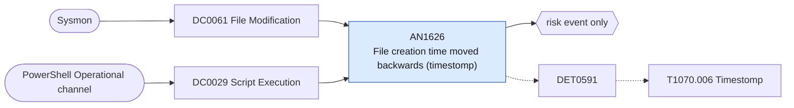

# AN1626 File creation time moved backwards (timestomp)

[ATT&CK analytic](https://attack.mitre.org/detectionstrategies/DET0591#AN1626) · DET0591 Cross-Platform Behavioral Detection of File Timestomping via Metadata Tampering · [T1070.006 Timestomp](https://attack.mitre.org/techniques/T1070/006) · tactics: stealth · platforms: Windows

**Content type:** anomaly → risk event only · **Severity:** medium · **Status:** implemented · **Technique prevalence score:** 74

Sysmon 2 (a process changed a file's creation time) where the new creation time is earlier than the previous one by more than a day, written by a process that does not normally restore timestamps; or a PowerShell script block that assigns CreationTime, LastWriteTime or LastAccessTime. Backdating makes a dropped file blend in with the operating system files around it.



## What ATT&CK asks for

> Detects attempts to modify file timestamps via API usage (e.g., `SetFileTime`), CLI tools (e.g., `w32tm`, PowerShell), or double-timestomp behavior where $SI and $FN timestamps are mismatched or reverted.

## What this implementation detects

Sysmon 2 (a process changed a file's creation time) where the new creation time is earlier than the previous one by more than a day, written by a process that does not normally restore timestamps; or a PowerShell script block that assigns CreationTime, LastWriteTime or LastAccessTime. Backdating makes a dropped file blend in with the operating system files around it.

**Not covered:** Sysmon 2 reports only the creation time ($STANDARD_INFORMATION); $FILE_NAME mismatches need an NTFS parser. Sysmon configs often scope event 2 to user-writable paths. Security 4663 is not used (it does not record the timestamps).

## Tuning

ATT&CK mutable elements and where each is bound. Edit macros in `local/macros.conf` and lookups in place; do not edit the search.

| Mutable element | ATT&CK guidance | Bound to | Default |
|---|---|---|---|
| TimeWindow | Correlate timestamp change with preceding file creation or suspicious access | filter macro `mitre_an1626_filter` |  |
| APINamePattern | Include SetFileTime, NtSetInformationFile, or other timestamp APIs | macro `mitre_an1626_script_patterns` | `ScriptBlockText IN ("*.CreationTime =*", "*.CreationTime=*", "*.LastWriteTime =*", "*.LastWriteTime=*", "*.LastAccessTime =*", "*.LastAccessTime=*", "*CreationTimeUtc*=*", "*SetFileTime*", "*SetCreationTime(*", "*SetLastWriteTime(*")` |
| TimestampDeltaThreshold | Trigger on excessive backdating (e.g., >90 days) | macro `mitre_an1626_backdate_seconds` | `86400` |
| ProcessName *(implementation)* |  | macro `mitre_an1626_benign_writers` | `Image IN ("*\\7z.exe", "*\\7zG.exe", "*\\7zFM.exe", "*\\WinRAR.exe", "*\\explorer.exe", "*\\msiexec.exe", "*\\TiWorker.exe", "*\\TrustedInstaller.exe", "*\\OneDrive.exe", "*\\robocopy.exe", "*\\chrome.exe", "*\\msedge.exe", "*\\firefox.exe", "*\\setup.exe", "*\\svchost.exe")` |

## Splunk

Stanza `[MITRE - AN1626 - File creation time moved backwards (timestomp) - Rule]` in `DA-ESS-mitre-attack-detections`. Schedule `1-59/15 * * * *`, window `-20m@m` to `-5m@m`. Ships disabled.

```spl
(`mitre_dc0061_sysmon` EventCode=2 NOT `mitre_an1626_benign_writers`)
OR (`mitre_dc0029_powershell_logging` EventCode=4104 `mitre_an1626_script_patterns`)
| `mitre_normalize_host`
| eval new_ctime=strptime(CreationUtcTime, "%Y-%m-%d %H:%M:%S.%3N"), old_ctime=strptime(PreviousCreationUtcTime, "%Y-%m-%d %H:%M:%S.%3N")
| where EventCode==4104 OR (old_ctime - new_ctime) >= `mitre_an1626_backdate_seconds`
| eval process_name=lower(replace(coalesce(Image, "powershell.exe"), "^.*\\\\", "")), file_path=if(EventCode==2, TargetFilename, null()), script=if(EventCode==4104, substr(ScriptBlockText, 1, 300), null())
| stats count min(_time) as firstTime max(_time) as lastTime values(file_path) as file_path values(script) as script values(process_name) as process_name values(user) as user by dest
| eval file_path=mvindex(file_path, 0, 19)
| `mitre_ctime(firstTime)` | `mitre_ctime(lastTime)`
| `mitre_an1626_filter`
```

Risk: `dest` (system, 35). Threat objects: `process_name`, `file_path`. Message: File timestamps backdated on $dest$ by $process_name$

Throttle: dest for 86400s.

Data components: [DC0061](../data-components/DC0061-file-modification.md), [DC0029](../data-components/DC0029-script-execution.md).

## Sigma

Rule file: `dist/sigma/rules/an1626_file_creation_time_moved_backwards_timestomp.yml`.

## Known false positives

- Archive extraction and copy tools that preserve original timestamps (allow-list them in the benign-writers macro).
- Build systems and package managers that normalise timestamps for reproducible output.
