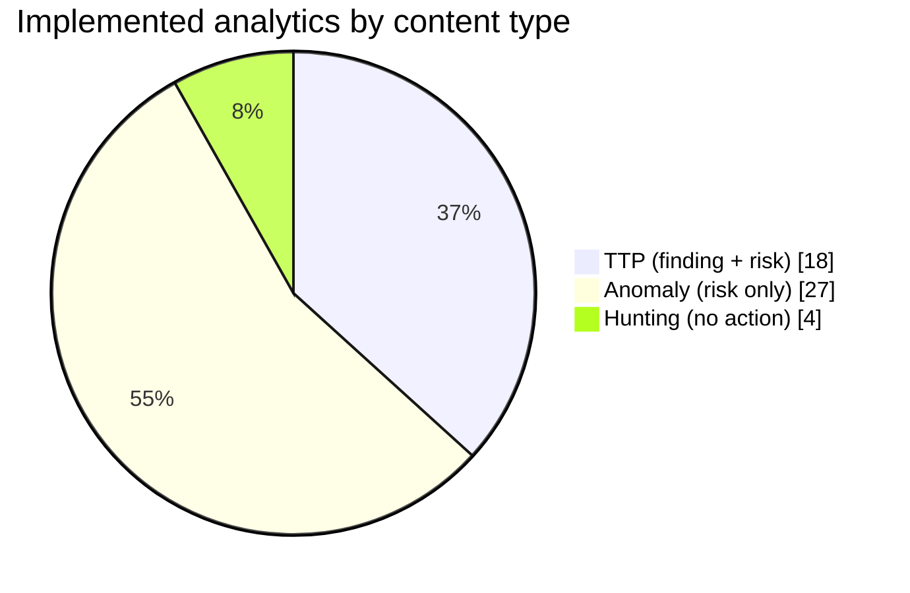
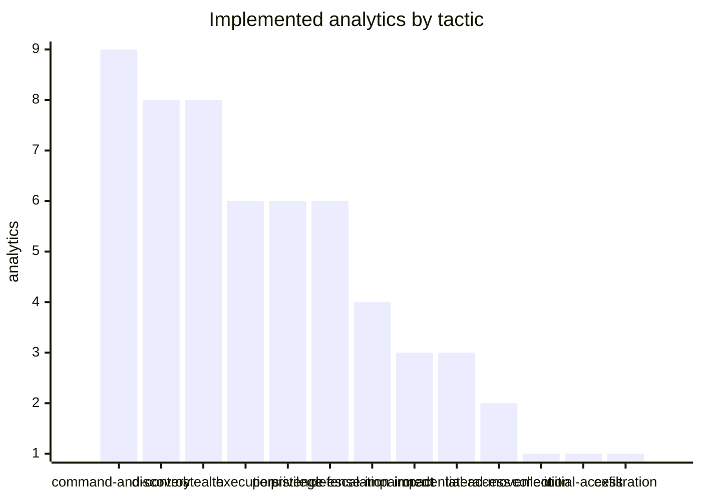

# Analytics (ATT&CK v20.1)

49 of 1773 ATT&CK analytics are implemented as ES detections and Sigma rules; 511 are coverable by the feeds ticked in `config/stack.yml`. The rest are in the [backlog](backlog.md), ranked by technique prevalence.





| Analytic | Detection | Type | Severity | Technique | Tactics | Data components | Feeds |
|---|---|---|---|---|---|---|---|
| AN0165 | [LOLBin or script process connected externally and dropped a file](AN0165-lolbin-or-script-process-connected-externally-and-dropped-a-.md) | anomaly | medium | T1105 Ingress Tool Transfer | command-and-control | DC0082, DC0039 | sysmon |
| AN1452 | [System information discovery commands](AN1452-system-information-discovery-commands.md) | hunting | informational | T1082 System Information Discovery | discovery | DC0032 | sysmon, wineventlog |
| AN0075 | [HTTP to external hosts with a non-browser user agent](AN0075-http-to-external-hosts-with-a-non-browser-user-agent.md) | anomaly | medium | T1071.001 Web Protocols | command-and-control | DC0085 | corelight |
| AN0079 | [Repeated HTTP requests carrying long encoded tokens in the URI](AN0079-repeated-http-requests-carrying-long-encoded-tokens-in-the-u.md) | anomaly | low | T1071.001 Web Protocols | command-and-control | DC0085 | corelight |
| AN0578 | [cmd.exe started by an unusual parent or running a batch file from a staging path](AN0578-cmd-exe-started-by-an-unusual-parent-or-running-a-batch-file.md) | anomaly | low | T1059.003 Windows Command Shell | execution | DC0032 | sysmon, wineventlog |
| AN0767 | [Built-in utility used to decode or reassemble a payload](AN0767-built-in-utility-used-to-decode-or-reassemble-a-payload.md) | ttp | medium | T1140 Deobfuscate/Decode Files or Information | stealth | DC0032 | sysmon, wineventlog |
| AN0095 | [Process discovery commands](AN0095-process-discovery-commands.md) | hunting | informational | T1057 Process Discovery | discovery | DC0032 | sysmon, wineventlog |
| AN0559 | [Network configuration discovery commands](AN0559-network-configuration-discovery-commands.md) | hunting | informational | T1016 System Network Configuration Discovery | discovery | DC0032 | sysmon, wineventlog |
| AN1252 | [PowerShell started with encoded, download or in-memory execution arguments](AN1252-powershell-started-with-encoded-download-or-in-memory-execut.md) | anomaly | medium | T1059.001 PowerShell | execution | DC0032 | sysmon, wineventlog |
| AN1032 | [Run key value pointing to a script or user-writable path](AN1032-run-key-value-pointing-to-a-script-or-user-writable-path.md) | anomaly | medium | T1547.001 Registry Run Keys / Startup Folder | persistence, privilege-escalation | DC0063 | sysmon |
| AN0983 | [Windows system process name running from an unexpected directory](AN0983-windows-system-process-name-running-from-an-unexpected-direc.md) | ttp | medium | T1036.005 Match Legitimate Resource Name or Location | stealth | DC0032 | sysmon, wineventlog |
| AN0254 | [User and session discovery commands](AN0254-user-and-session-discovery-commands.md) | hunting | informational | T1033 System Owner/User Discovery | discovery | DC0032 | sysmon, wineventlog |
| AN0819 | [Document or mail application spawned an interpreter or LOLBin](AN0819-document-or-mail-application-spawned-an-interpreter-or-lolbi.md) | ttp | high | T1204.002 Malicious File | execution | DC0032 | sysmon, wineventlog |
| AN1221 | [Scheduled task registered with an interpreter or user-writable action](AN1221-scheduled-task-registered-with-an-interpreter-or-user-writab.md) | anomaly | medium | T1053.005 Scheduled Task | execution, persistence, privilege-escalation | DC0001 | wineventlog |
| AN0781 | [Security-relevant registry value modified](AN0781-security-relevant-registry-value-modified.md) | ttp | medium | T1112 Modify Registry | defense-impairment, persistence | DC0063 | sysmon |
| AN0209 | [Script host chain from Office or into a second-stage interpreter](AN0209-script-host-chain-from-office-or-into-a-second-stage-interpr.md) | anomaly | medium | T1059.005 Visual Basic | execution | DC0032 | sysmon, wineventlog |
| AN1369 | [Security tooling disabled or tampered with](AN1369-security-tooling-disabled-or-tampered-with.md) | ttp | high | T1685 Disable or Modify Tools | defense-impairment | DC0063, DC0032 | sysmon |
| AN1374 | [Firewall logging or monitoring configuration changed](AN1374-firewall-logging-or-monitoring-configuration-changed.md) | ttp | medium | T1685 Disable or Modify Tools | defense-impairment | DC0041 | palo_alto |
| AN0048 | [Security software enumeration](AN0048-security-software-enumeration.md) | anomaly | low | T1518.001 Security Software Discovery | discovery | DC0032 | sysmon, wineventlog |
| AN1527 | [Service installed with an interpreter or user-writable binary path](AN1527-service-installed-with-an-interpreter-or-user-writable-binar.md) | ttp | medium | T1543.003 Windows Service | persistence, privilege-escalation | DC0060 | wineventlog |
| AN1583 | [Burst of remote system discovery commands](AN1583-burst-of-remote-system-discovery-commands.md) | anomaly | low | T1018 Remote System Discovery | discovery | DC0032 | sysmon, wineventlog |
| AN0831 | [Archive created with a password, split volumes or a built-in packer](AN0831-archive-created-with-a-password-split-volumes-or-a-built-in-.md) | anomaly | low | T1560.001 Archive via Utility | collection | DC0032 | sysmon, wineventlog |
| AN1308 | [Rundll32 executing script, remote or user-writable payloads](AN1308-rundll32-executing-script-remote-or-user-writable-payloads.md) | ttp | medium | T1218.011 Rundll32 | stealth | DC0032 | sysmon, wineventlog |
| AN1030 | [LSASS memory access by an unexpected process](AN1030-lsass-memory-access-by-an-unexpected-process.md) | ttp | high | T1003.001 LSASS Memory | credential-access | DC0035 | sysmon |
| AN1258 | [ICMP session with unusual volume or duration](AN1258-icmp-session-with-unusual-volume-or-duration.md) | anomaly | medium | T1095 Non-Application Layer Protocol | command-and-control | DC0078 | corelight |
| AN1543 | [Interactive or remote logon by a service account](AN1543-interactive-or-remote-logon-by-a-service-account.md) | anomaly | medium | T1078 Valid Accounts | stealth, persistence, privilege-escalation, initial-access | DC0067 | wineventlog |
| AN0105 | [Browser credential store read by a non-browser process](AN0105-browser-credential-store-read-by-a-non-browser-process.md) | ttp | high | T1555.003 Credentials from Web Browsers | credential-access | DC0055 | wineventlog |
| AN1057 | [Process connecting to many hosts or ports in one minute](AN1057-process-connecting-to-many-hosts-or-ports-in-one-minute.md) | anomaly | medium | T1046 Network Service Discovery | discovery | DC0082 | sysmon |
| AN0931 | [First-seen RDP logon for a user, source and destination](AN0931-first-seen-rdp-logon-for-a-user-source-and-destination.md) | anomaly | medium | T1021.001 Remote Desktop Protocol | lateral-movement | DC0067 | wineventlog |
| AN1108 | [Web server process spawned a shell or script interpreter](AN1108-web-server-process-spawned-a-shell-or-script-interpreter.md) | ttp | high | T1505.003 Web Shell | persistence | DC0032 | sysmon, wineventlog |
| AN1394 | [Command line with obfuscation markers](AN1394-command-line-with-obfuscation-markers.md) | anomaly | medium | T1027.010 Command Obfuscation | stealth | DC0032 | sysmon, wineventlog |
| AN0602 | [Ransom-note style file dropped across many directories](AN0602-ransom-note-style-file-dropped-across-many-directories.md) | ttp | critical | T1486 Data Encrypted for Impact | impact | DC0039 | sysmon |
| AN1399 | [Remote thread created in a high-value process](AN1399-remote-thread-created-in-a-high-value-process.md) | anomaly | medium | T1055 Process Injection | stealth, privilege-escalation | DC0035 | sysmon |
| AN1233 | [NAT, port-forwarding or policy-based forwarding rule changed on the firewall](AN1233-nat-port-forwarding-or-policy-based-forwarding-rule-changed-.md) | anomaly | medium | T1090 Proxy | command-and-control | DC0051 | palo_alto |
| AN1468 | [Shell or LOLBin executed inside a network logon session](AN1468-shell-or-lolbin-executed-inside-a-network-logon-session.md) | anomaly | medium | T1021.002 SMB/Windows Admin Shares | lateral-movement | DC0067, DC0032 | wineventlog, sysmon |
| AN0363 | [Domain account enumeration from a non-domain-controller](AN0363-domain-account-enumeration-from-a-non-domain-controller.md) | anomaly | low | T1087.002 Domain Account | discovery | DC0032, DC0064 | sysmon, powershell_logging |
| AN0633 | [Office, script or proxy-execution process connecting out on a non-standard port](AN0633-office-script-or-proxy-execution-process-connecting-out-on-a.md) | anomaly | low | T1571 Non-Standard Port | command-and-control | DC0082 | sysmon |
| AN1185 | [Service control manager started an unexpected binary](AN1185-service-control-manager-started-an-unexpected-binary.md) | anomaly | medium | T1569.002 Service Execution | execution | DC0032 | sysmon, wineventlog |
| AN0355 | [Renamed system utility (file name does not match PE original name)](AN0355-renamed-system-utility-file-name-does-not-match-pe-original-.md) | ttp | medium | T1036 Masquerading | stealth | DC0032 | sysmon |
| AN0360 | [Interpreter started with a hidden window](AN0360-interpreter-started-with-a-hidden-window.md) | anomaly | low | T1564.003 Hidden Window | stealth | DC0032 | sysmon, wineventlog |
| AN1094 | [UAC bypass through auto-elevated binary hijack](AN1094-uac-bypass-through-auto-elevated-binary-hijack.md) | ttp | high | T1548.002 Bypass User Account Control | privilege-escalation | DC0063, DC0032 | sysmon |
| AN1571 | [Large upload to a cloud storage application](AN1571-large-upload-to-a-cloud-storage-application.md) | anomaly | medium | T1567.002 Exfiltration to Cloud Storage | exfiltration | DC0082 | palo_alto |
| AN1121 | [DNS tunnelling pattern from a non-browser process](AN1121-dns-tunnelling-pattern-from-a-non-browser-process.md) | anomaly | medium | T1071.004 DNS | command-and-control | DC0085 | sysmon |
| AN1124 | [DNS tunnelling pattern from a client (network view)](AN1124-dns-tunnelling-pattern-from-a-client-network-view.md) | anomaly | medium | T1071.004 DNS | command-and-control | DC0085 | corelight |
| AN1483 | [Port forwarding or tunnelling tool started](AN1483-port-forwarding-or-tunnelling-tool-started.md) | ttp | medium | T1572 Protocol Tunneling | command-and-control | DC0032 | sysmon, wineventlog |
| AN0933 | [Shadow copies, backups or boot recovery disabled with native utilities](AN0933-shadow-copies-backups-or-boot-recovery-disabled-with-native-.md) | ttp | high | T1490 Inhibit System Recovery | impact | DC0032 | sysmon, wineventlog |
| AN0061 | [Burst of service stop or disable commands](AN0061-burst-of-service-stop-or-disable-commands.md) | anomaly | medium | T1489 Service Stop | impact | DC0032 | sysmon, wineventlog |
| AN0235 | [SAM, SYSTEM or SECURITY hive dumped from the command line](AN0235-sam-system-or-security-hive-dumped-from-the-command-line.md) | ttp | high | T1003.002 Security Account Manager | credential-access | DC0032 | sysmon, wineventlog |
| AN1472 | [Windows event log cleared](AN1472-windows-event-log-cleared.md) | ttp | high | T1685.005 Clear Windows Event Logs | defense-impairment | DC0038, DC0032 | wineventlog, sysmon |

## Authoring

```bash
python -m mitremap new-analytic AN0123   # scaffold content/analytics/AN0123.yml with ATT&CK text and suggestions
# edit the curated block: status, title, content_type, spl, risk, tuning, sigma
make build && make test
```

Rules enforced by `mitremap validate`: the SPL uses a `mitre_dcXXXX` macro and the analytic's own `mitre_anXXXX_filter`, has no literal `index=`, references only macros and lookups that exist, and every risk field and message token appears in the search. Tests convert every Sigma rule through the data-component pipeline.
