# ATT&CK 20.0 → 20.1: detection model changes

Generated by `mitremap diff`. Objects compared by ATT&CK id; *changed* means the object's name, description, log sources, platforms or references differ.

```mermaid
xychart-beta
    title "Object counts 20.0 vs 20.1"
    x-axis ["Data components", "Analytics", "Detection strategies", "Techniques"]
    y-axis "count"
    bar [106, 1770, 703, 706]
    bar [106, 1773, 706, 706]
```

### Data components

Added 0, removed 0, changed 2.

**Changed**

- DC0039 File Creation
- DC0085 Network Traffic Content

### Analytics

Added 3, removed 0, changed 1.

**Added**

- AN2292 Analytic 2292
- AN2293 Analytic 2293
- AN2294 Analytic 2294

**Changed**

- AN0272 Analytic 0272

### Detection strategies

Added 3, removed 0, changed 0.

**Added**

- DET0941 Instruction Override with Unauthorized AI Activity
- DET0942 Retrieved Instruction with Unauthorized Agent Action
- DET0943 Adversarial Content Inducing Autonomous Defense Impairment

### Techniques

Added 0, removed 0, changed 0.

### Log source names

New names: 0; dropped: 1.

**Dropped**

- `linus:syslog`
