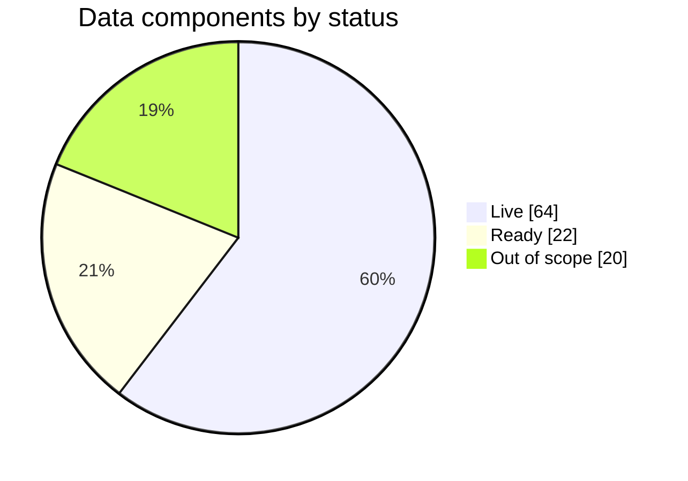

# Coverage (ATT&CK v20.1)

Generated from `config/stack.yml` ticks. *Live* = at least one ticked feed provides the component; *ready* = mapped to an in-scope feed you have not ticked; *gap* = needs a source outside the current platform scope.

## Data components

## Analytics by platform

An analytic is *live* when every log source it references has a ticked feed, *ready* when all are mapped to in-scope feeds, otherwise *gap*.

```mermaid
xychart-beta
    title "Analytics: live vs ready vs gap"
    x-axis ["Windows", "Linux", "Network Devices", "ESXi", "Containers", "IaaS", "Identity Provider", "Office Suite", "PRE", "SaaS", "macOS"]
    y-axis "analytics"
    bar [426, 1, 77, 0, 0, 0, 0, 1, 6, 0, 0]
    bar [458, 358, 86, 107, 35, 0, 21, 3, 6, 1, 0]
    bar [476, 359, 86, 107, 38, 86, 46, 57, 97, 68, 353]
```

Series: live (inner), live+ready (middle), total (outer).

| Platform | In scope | Live | Ready | Gap | Total |
|---|---|---|---|---|---|
| Windows | yes | 426 | 32 | 18 | 476 |
| Linux | yes | 1 | 357 | 1 | 359 |
| Network Devices | yes | 77 | 9 | 0 | 86 |
| ESXi | yes | 0 | 107 | 0 | 107 |
| Containers | yes | 0 | 35 | 3 | 38 |
| IaaS | yes | 0 | 0 | 86 | 86 |
| Identity Provider | yes | 0 | 21 | 25 | 46 |
| Office Suite | no | 1 | 2 | 54 | 57 |
| PRE | no | 6 | 0 | 91 | 97 |
| SaaS | no | 0 | 1 | 67 | 68 |
| macOS | no | 0 | 0 | 353 | 353 |

## Detection strategies by tactic

A detection strategy counts as *live* if at least one of its analytics is live.

| Tactic | DETs | Live | Ready | Gap |
|---|---|---|---|---|
| stealth | 151 | 119 | 25 | 7 |
| persistence | 113 | 80 | 20 | 13 |
| privilege-escalation | 96 | 56 | 26 | 14 |
| credential-access | 68 | 51 | 11 | 6 |
| execution | 66 | 43 | 12 | 11 |
| defense-impairment | 57 | 37 | 7 | 13 |
| resource-development | 51 | 0 | 0 | 51 |
| discovery | 49 | 39 | 6 | 4 |
| reconnaissance | 46 | 6 | 0 | 40 |
| command-and-control | 45 | 40 | 5 | 0 |
| collection | 41 | 29 | 5 | 7 |
| impact | 33 | 25 | 5 | 3 |
| lateral-movement | 23 | 16 | 3 | 4 |
| initial-access | 22 | 16 | 5 | 1 |
| exfiltration | 20 | 19 | 0 | 1 |

## Components by platform

Live feeds per component, for in-scope platforms.

| Component | Windows | Linux | Network Devices | ESXi | Containers | IaaS | Identity Provider |
|---|---|---|---|---|---|---|---|
| [DC0001](data-components/DC0001-scheduled-job-creation.md) Scheduled Job Creation | ✅ wineventlog | ⏳ auditd, linux_syslog |  | ⏳ esxi_syslog | ⏳ auditd, kubernetes_audit, linux_syslog |  |  |
| [DC0002](data-components/DC0002-user-account-authentication.md) User Account Authentication | ✅ corelight, palo_alto, wineventlog | ✅ corelight, palo_alto | ✅ corelight, palo_alto | ✅ corelight, palo_alto | ✅ corelight, palo_alto | ⏳ azure_entra | ⏳ azure_entra |
| [DC0003](data-components/DC0003-malware-metadata.md) Malware Metadata | ✅ palo_alto, trellix_epo, wineventlog | ✅ palo_alto, trellix_epo | ✅ palo_alto | ✅ palo_alto | ✅ palo_alto |  |  |
| [DC0004](data-components/DC0004-firmware-modification.md) Firmware Modification | ✅ palo_alto, wineventlog | ✅ palo_alto | ✅ palo_alto | ✅ palo_alto | ✅ palo_alto |  |  |
| [DC0005](data-components/DC0005-scheduled-job-metadata.md) Scheduled Job Metadata | ✅ wineventlog | ⏳ linux_syslog |  | ⏳ esxi_syslog | ⏳ linux_syslog |  |  |
| [DC0006](data-components/DC0006-web-credential-creation.md) Web Credential Creation | ✅ wineventlog |  |  |  |  | ⏳ azure_entra | ⏳ azure_entra |
| [DC0007](data-components/DC0007-web-credential-usage.md) Web Credential Usage | ✅ corelight, palo_alto | ✅ corelight, palo_alto | ✅ corelight, palo_alto | ✅ corelight, palo_alto | ✅ corelight, palo_alto | ⏳ azure_entra | ⏳ azure_entra |
| [DC0008](data-components/DC0008-wmi-creation.md) WMI Creation | ✅ sysmon, wineventlog |  |  |  |  |  |  |
| [DC0009](data-components/DC0009-user-account-deletion.md) User Account Deletion | ✅ wineventlog |  |  | ⏳ esxi_syslog |  |  |  |
| [DC0010](data-components/DC0010-user-account-modification.md) User Account Modification | ✅ wineventlog | ⏳ auditd, linux_syslog |  |  | ⏳ auditd, kubernetes_audit, linux_syslog | ⏳ azure_activity, azure_entra | ⏳ azure_entra |
| [DC0011](data-components/DC0011-malware-content.md) Malware Content | ✅ corelight, palo_alto, trellix_epo | ✅ corelight, palo_alto, trellix_epo | ✅ corelight, palo_alto | ✅ corelight, palo_alto | ✅ corelight, palo_alto |  |  |
| [DC0012](data-components/DC0012-scheduled-job-modification.md) Scheduled Job Modification | ✅ wineventlog | ⏳ auditd |  |  | ⏳ auditd |  |  |
| [DC0013](data-components/DC0013-user-account-metadata.md) User Account Metadata | ✅ wineventlog | ⏳ auditd, linux_osquery |  |  | ⏳ auditd, linux_osquery | ⏳ azure_activity, azure_entra | ⏳ azure_entra |
| [DC0014](data-components/DC0014-user-account-creation.md) User Account Creation | ✅ palo_alto, wineventlog | ✅ palo_alto | ✅ palo_alto | ✅ palo_alto | ✅ palo_alto | ⏳ azure_entra | ⏳ azure_entra |
| [DC0015](data-components/DC0015-image-creation.md) Image Creation |  |  |  |  | ⏳ container_runtime, kubernetes_audit |  |  |
| [DC0016](data-components/DC0016-module-load.md) Module Load | ✅ solidcore, sysmon, wineventlog | ✅ solidcore |  |  | ⏳ auditd |  |  |
| [DC0017](data-components/DC0017-cloud-storage-enumeration.md) Cloud Storage Enumeration |  |  |  |  |  | ⏳ azure_activity |  |
| [DC0018](data-components/DC0018-host-status.md) Host Status | ✅ palo_alto, sysmon, trellix_epo, wineventlog | ✅ palo_alto, trellix_epo | ✅ palo_alto | ✅ palo_alto | ✅ palo_alto |  |  |
| [DC0019](data-components/DC0019-pod-creation.md) Pod Creation |  |  |  |  | ⏳ kubernetes_audit |  |  |
| [DC0020](data-components/DC0020-process-modification.md) Process Modification | ✅ sysmon | ⏳ auditd, ebpf |  |  | ⏳ auditd, ebpf |  |  |
| [DC0021](data-components/DC0021-os-api-execution.md) OS API Execution | ✅ sysmon, wineventlog | ⏳ auditd, edr_telemetry |  |  | ⏳ auditd |  |  |
| [DC0028](data-components/DC0028-image-metadata.md) Image Metadata |  |  |  |  | ⏳ container_runtime |  |  |
| [DC0029](data-components/DC0029-script-execution.md) Script Execution | ✅ powershell_logging, trellix_epo, wineventlog | ✅ trellix_epo |  | ⏳ esxi_syslog | ⏳ auditd |  |  |
| [DC0030](data-components/DC0030-pod-modification.md) Pod Modification |  |  |  |  | ⏳ kubernetes_audit |  |  |
| [DC0031](data-components/DC0031-kernel-module-load.md) Kernel Module Load |  | ⏳ auditd, linux_syslog |  | ⏳ esxi_syslog | ⏳ auditd, linux_syslog |  |  |
| [DC0032](data-components/DC0032-process-creation.md) Process Creation | ✅ solidcore, sysmon, wineventlog | ✅ solidcore |  | ⏳ esxi_syslog | ⏳ auditd, container_runtime, ebpf, kubernetes_audit, linux_osquery |  |  |
| [DC0033](data-components/DC0033-process-termination.md) Process Termination | ✅ sysmon | ⏳ auditd |  | ⏳ esxi_syslog | ⏳ auditd, container_runtime |  |  |
| [DC0034](data-components/DC0034-process-metadata.md) Process Metadata | ✅ powershell_logging, sysmon, wineventlog | ⏳ auditd, edr_telemetry, linux_osquery |  |  | ⏳ auditd, linux_osquery |  |  |
| [DC0035](data-components/DC0035-process-access.md) Process Access | ✅ sysmon, wineventlog | ⏳ auditd, edr_telemetry |  |  | ⏳ auditd |  |  |
| [DC0036](data-components/DC0036-image-modification.md) Image Modification |  |  |  |  | ⏳ container_runtime |  |  |
| [DC0037](data-components/DC0037-pod-enumeration.md) Pod Enumeration |  |  |  |  | ⏳ kubernetes_audit |  |  |
| [DC0038](data-components/DC0038-application-log-content.md) Application Log Content | ✅ corelight, palo_alto, trellix_epo, wineventlog | ✅ corelight, palo_alto, trellix_epo | ✅ corelight, palo_alto | ✅ corelight, palo_alto | ✅ corelight, palo_alto | ⏳ azure_activity, azure_entra | ⏳ azure_entra |
| [DC0039](data-components/DC0039-file-creation.md) File Creation | ✅ solidcore, sysmon, wineventlog | ✅ solidcore |  | ⏳ esxi_syslog | ⏳ auditd |  |  |
| [DC0040](data-components/DC0040-file-deletion.md) File Deletion | ✅ solidcore, sysmon, wineventlog | ✅ solidcore |  | ⏳ esxi_syslog | ⏳ auditd |  |  |
| [DC0041](data-components/DC0041-service-metadata.md) Service Metadata | ✅ palo_alto, sysmon, wineventlog | ✅ palo_alto | ✅ palo_alto | ✅ palo_alto | ✅ palo_alto |  |  |
| [DC0042](data-components/DC0042-drive-creation.md) Drive Creation | ✅ wineventlog | ⏳ auditd, linux_syslog |  |  | ⏳ auditd, linux_syslog |  |  |
| [DC0043](data-components/DC0043-firewall-disable.md) Firewall Disable | ✅ palo_alto, wineventlog | ✅ palo_alto | ✅ palo_alto | ✅ palo_alto | ✅ palo_alto |  |  |
| [DC0044](data-components/DC0044-firewall-enumeration.md) Firewall Enumeration | ✅ palo_alto, wineventlog | ✅ palo_alto | ✅ palo_alto | ✅ palo_alto | ✅ palo_alto |  |  |
| [DC0045](data-components/DC0045-windows-registry-key-deletion.md) Windows Registry Key Deletion | ✅ solidcore, sysmon, wineventlog | ✅ solidcore |  |  |  |  |  |
| [DC0046](data-components/DC0046-drive-modification.md) Drive Modification | ✅ sysmon, wineventlog |  |  |  |  |  |  |
| [DC0048](data-components/DC0048-named-pipe-metadata.md) Named Pipe Metadata | ✅ sysmon |  |  |  |  |  |  |
| [DC0049](data-components/DC0049-snapshot-deletion.md) Snapshot Deletion |  |  |  | ⏳ esxi_syslog |  | ⏳ azure_activity |  |
| [DC0050](data-components/DC0050-windows-registry-key-access.md) Windows Registry Key Access | ✅ wineventlog |  |  |  |  |  |  |
| [DC0051](data-components/DC0051-firewall-rule-modification.md) Firewall Rule Modification | ✅ palo_alto, wineventlog | ✅ palo_alto | ✅ palo_alto | ✅ palo_alto | ✅ palo_alto |  |  |
| [DC0053](data-components/DC0053-firewall-metadata.md) Firewall Metadata | ✅ palo_alto, wineventlog | ✅ palo_alto | ✅ palo_alto | ✅ palo_alto | ✅ palo_alto |  |  |
| [DC0054](data-components/DC0054-drive-access.md) Drive Access | ✅ sysmon | ⏳ auditd |  |  | ⏳ auditd |  |  |
| [DC0055](data-components/DC0055-file-access.md) File Access | ✅ solidcore, wineventlog | ✅ solidcore |  | ⏳ esxi_syslog | ⏳ auditd, ebpf, kubernetes_audit |  |  |
| [DC0056](data-components/DC0056-windows-registry-key-creation.md) Windows Registry Key Creation | ✅ solidcore, sysmon, wineventlog | ✅ solidcore |  |  |  |  |  |
| [DC0057](data-components/DC0057-snapshot-creation.md) Snapshot Creation |  |  |  | ⏳ esxi_syslog |  | ⏳ azure_activity |  |
| [DC0059](data-components/DC0059-file-metadata.md) File Metadata | ✅ corelight, palo_alto, solidcore, sysmon, trellix_epo, wineventlog | ✅ corelight, palo_alto, solidcore, trellix_epo | ✅ corelight, palo_alto | ✅ corelight, palo_alto | ✅ corelight, palo_alto |  |  |
| [DC0060](data-components/DC0060-service-creation.md) Service Creation | ✅ wineventlog | ⏳ auditd, linux_syslog |  |  | ⏳ auditd, kubernetes_audit, linux_syslog |  |  |
| [DC0061](data-components/DC0061-file-modification.md) File Modification | ✅ palo_alto, solidcore, sysmon, wineventlog | ✅ palo_alto, solidcore | ✅ palo_alto | ✅ palo_alto | ✅ palo_alto |  |  |
| [DC0063](data-components/DC0063-windows-registry-key-modification.md) Windows Registry Key Modification | ✅ solidcore, sysmon, wineventlog | ✅ solidcore |  |  |  |  |  |
| [DC0064](data-components/DC0064-command-execution.md) Command Execution | ✅ palo_alto, powershell_logging, sysmon, trellix_epo, wineventlog | ✅ palo_alto, trellix_epo | ✅ palo_alto | ✅ palo_alto | ✅ palo_alto |  |  |
| [DC0065](data-components/DC0065-service-modification.md) Service Modification | ✅ wineventlog |  |  | ⏳ esxi_syslog |  |  |  |
| [DC0066](data-components/DC0066-active-directory-object-modification.md) Active Directory Object Modification | ✅ wineventlog |  |  |  |  | ⏳ azure_entra | ⏳ azure_entra |
| [DC0067](data-components/DC0067-logon-session-creation.md) Logon Session Creation | ✅ corelight, palo_alto, wineventlog | ✅ corelight, palo_alto | ✅ corelight, palo_alto | ✅ corelight, palo_alto | ✅ corelight, palo_alto | ⏳ azure_entra | ⏳ azure_entra |
| [DC0068](data-components/DC0068-active-directory-object-deletion.md) Active Directory Object Deletion | ✅ wineventlog |  |  |  |  |  |  |
| [DC0069](data-components/DC0069-cloud-service-modification.md) Cloud Service Modification | ⏳ azure_entra |  |  |  |  | ⏳ azure_activity, azure_entra | ⏳ azure_entra |
| [DC0071](data-components/DC0071-active-directory-object-access.md) Active Directory Object Access | ✅ wineventlog |  |  |  |  |  |  |
| [DC0072](data-components/DC0072-container-creation.md) Container Creation |  |  |  |  | ⏳ container_runtime, kubernetes_audit |  |  |
| [DC0073](data-components/DC0073-instance-modification.md) Instance Modification |  |  |  |  |  | ⏳ azure_activity |  |
| [DC0075](data-components/DC0075-instance-enumeration.md) Instance Enumeration |  |  |  |  |  | ⏳ azure_activity |  |
| [DC0076](data-components/DC0076-instance-creation.md) Instance Creation |  |  |  |  |  | ⏳ azure_activity |  |
| [DC0077](data-components/DC0077-container-start.md) Container Start |  |  |  |  | ⏳ container_runtime, kubernetes_audit |  |  |
| [DC0078](data-components/DC0078-network-traffic-flow.md) Network Traffic Flow | ✅ corelight, palo_alto, sysmon, wineventlog, wireshark | ✅ corelight, palo_alto, wireshark | ✅ corelight, palo_alto, wireshark | ✅ corelight, palo_alto | ✅ corelight, palo_alto |  |  |
| [DC0079](data-components/DC0079-driver-load.md) Driver Load | ✅ sysmon, wineventlog | ⏳ auditd, linux_syslog |  |  | ⏳ auditd, linux_syslog |  |  |
| [DC0081](data-components/DC0081-instance-deletion.md) Instance Deletion |  |  |  |  |  | ⏳ azure_activity |  |
| [DC0082](data-components/DC0082-network-connection-creation.md) Network Connection Creation | ✅ corelight, palo_alto, sysmon, wineventlog | ✅ corelight, palo_alto | ✅ corelight, palo_alto | ✅ corelight, palo_alto | ✅ corelight, palo_alto |  |  |
| [DC0083](data-components/DC0083-cloud-service-enumeration.md) Cloud Service Enumeration | ⏳ azure_entra |  |  |  |  | ⏳ azure_activity, azure_entra | ⏳ azure_entra |
| [DC0084](data-components/DC0084-active-directory-credential-request.md) Active Directory Credential Request | ✅ corelight, wineventlog | ✅ corelight | ✅ corelight | ✅ corelight | ✅ corelight |  |  |
| [DC0085](data-components/DC0085-network-traffic-content.md) Network Traffic Content | ✅ corelight, palo_alto, sysmon, wineventlog, wireshark | ✅ corelight, palo_alto, wireshark | ✅ corelight, palo_alto, wireshark | ✅ corelight, palo_alto | ✅ corelight, palo_alto | ⏳ azure_resource |  |
| [DC0087](data-components/DC0087-active-directory-object-creation.md) Active Directory Object Creation | ✅ wineventlog |  |  |  |  | ⏳ azure_entra | ⏳ azure_entra |
| [DC0088](data-components/DC0088-logon-session-metadata.md) Logon Session Metadata | ✅ corelight, palo_alto, wineventlog | ✅ corelight, palo_alto | ✅ corelight, palo_alto | ✅ corelight, palo_alto | ✅ corelight, palo_alto | ⏳ azure_entra | ⏳ azure_entra |
| [DC0090](data-components/DC0090-cloud-service-disable.md) Cloud Service Disable |  |  |  |  |  | ⏳ azure_activity |  |
| [DC0091](data-components/DC0091-container-enumeration.md) Container Enumeration |  |  |  |  | ⏳ container_runtime |  |  |
| [DC0092](data-components/DC0092-volume-modification.md) Volume Modification |  |  |  |  | ⏳ kubernetes_audit |  |  |
| [DC0094](data-components/DC0094-group-modification.md) Group Modification | ✅ wineventlog |  |  |  |  |  |  |
| [DC0097](data-components/DC0097-volume-creation.md) Volume Creation | ✅ wineventlog |  |  | ⏳ esxi_syslog | ⏳ kubernetes_audit |  |  |
| [DC0098](data-components/DC0098-volume-deletion.md) Volume Deletion |  |  |  | ⏳ esxi_syslog |  |  |  |
| [DC0099](data-components/DC0099-group-enumeration.md) Group Enumeration | ✅ wineventlog |  |  |  |  | ⏳ azure_entra | ⏳ azure_entra |
| [DC0101](data-components/DC0101-domain-registration.md) Domain Registration | ✅ corelight, sysmon | ✅ corelight | ✅ corelight | ✅ corelight | ✅ corelight |  |  |
| [DC0102](data-components/DC0102-network-share-access.md) Network Share Access | ✅ corelight, palo_alto, wineventlog | ✅ corelight, palo_alto | ✅ corelight, palo_alto | ✅ corelight, palo_alto | ✅ corelight, palo_alto |  |  |
| [DC0104](data-components/DC0104-response-content.md) Response Content | ✅ corelight, palo_alto | ✅ corelight, palo_alto | ✅ corelight, palo_alto | ✅ corelight, palo_alto | ✅ corelight, palo_alto |  |  |
| [DC0105](data-components/DC0105-group-metadata.md) Group Metadata | ✅ wineventlog |  |  |  |  |  |  |
| [DC0106](data-components/DC0106-response-metadata.md) Response Metadata | ✅ corelight, palo_alto | ✅ corelight, palo_alto | ✅ corelight, palo_alto | ✅ corelight, palo_alto | ✅ corelight, palo_alto |  |  |
