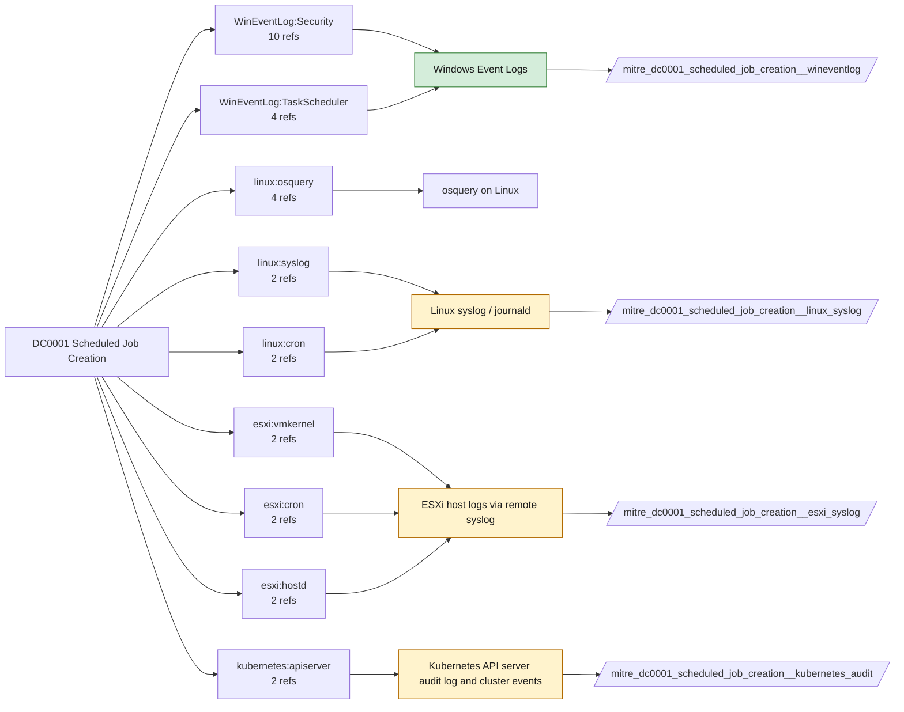

# DC0001 Scheduled Job Creation

[ATT&CK](https://attack.mitre.org/datacomponents/DC0001) · version 3.0 · modified 2026-10-13 · ATT&CK release 20.1

Status: **Live** · umbrella eventtype `mitre_dc0001_scheduled_job_creation`

> The establishment of a task or job that will execute at a predefined time or based on specific triggers.

## Why this component matters

Scheduled tasks and cron jobs remain a top persistence and lateral-movement vehicle. 4698 plus TaskScheduler/Operational 106 on Windows; cron spool and systemd timers on Linux via auditd watches or cron syslog; CronJobs on Kubernetes.

ATT&CK v20.1 has **21 analytics** across **15 detection strategies** that read this component, covering **15 techniques**. Tactics most dependent on it: persistence (14), privilege-escalation (13), execution (10), stealth (3).

Analytic references by platform: Windows 10, Linux 4, macOS 3, ESXi 3, Containers 1

## Where it comes from



## Requirements

Component specific:

- 4698 requires Audit Other Object Access Events; the TaskScheduler/Operational channel must be enabled on the host and added as an input.

Per feed (from `config/stack.yml` and `config/log_sources.yml`):

| Feed | Status | Sourcetype or source | Constraint | Origin | TA / collector |
|---|---|---|---|---|---|
| `wineventlog` | live | source=`XmlWinEventLog:Microsoft-Windows-TaskScheduler/Operational`, source=`XmlWinEventLog:Security` | `EventCode IN (106, 4698)` | defaults | Splunk Add-on for Microsoft Windows (Splunk_TA_windows), XML rendering (renderXml = true) |
| `auditd` | ready (tick in stack.yml) | sourcetype=`linux:audit` | `type IN (PATH, SYSCALL) (syscall IN (open, openat, rename) OR SYSCALL IN (open, openat, rename)) (name="/etc/cron*" OR name="/var/spool/cron/*" OR name="/etc/systemd/system/*.timer")` | defaults | Splunk Add-on for Unix and Linux (linux:audit) or auditd -> auditbeat/syslog |
| `esxi_syslog` | ready (tick in stack.yml) | sourcetype=`vmware:esxlog:syslog` | `(crond)` | defaults | Splunk Add-on for VMware ESXi Logs (vmware:esxlog:<log>) |
| `kubernetes_audit` | ready (tick in stack.yml) | sourcetype=`kube:apiserver-audit` | `verb IN (create) (objectRef.resource=cronjobs)` | defaults | Splunk OpenTelemetry Collector for Kubernetes / Splunk Connect for Kubernetes |
| `linux_syslog` | ready (tick in stack.yml) | sourcetype=`linux_messages_syslog`, sourcetype=`linux_secure`, sourcetype=`syslog` | `(process=CRON OR process=cron OR process=crond OR process=systemd)` | defaults | Splunk Add-on for Unix and Linux (syslog, linux_secure, linux_messages_syslog) |

Collection prerequisites:

- **wineventlog**: Advanced Audit Policy configured (at minimum Process Creation, Logon, Account Management, Object Access, Policy Change, Privilege Use, Detailed Tracking). Without the matching subcategory the EventCodes below never fire.
- **wineventlog**: Include command line in process creation events enabled for 4688 (Computer Configuration > Administrative Templates > System > Audit Process Creation).
- **wineventlog**: PowerShell Script Block Logging (4104) and Module Logging (4103) enabled via GPO for the PowerShell/Operational channel.
- **wineventlog**: Object access events (4656/4663/4657/4660/4670) require SACLs on the files/keys of interest.
- **wineventlog**: Non-default channels (TaskScheduler, WMI-Activity, CodeIntegrity, Defender, Firewall, WinRM, SMBClient/Server...) must be listed as inputs in Splunk_TA_windows inputs.conf; several are disabled by default in Windows.
- **wineventlog**: Enable the Microsoft-Windows-TaskScheduler/Operational log (disabled by default) and add it as an input.
- **auditd**: audit rules for execve, connect, open/openat on sensitive paths, ptrace, module load, mount, setuid; a Neo23x0/auditd baseline or Florian Roth's rule set is a reasonable start.
- **auditd**: log_format = ENRICHED in auditd.conf so syscall names and uids resolve (otherwise syscall numbers are architecture dependent).
- **esxi_syslog**: Syslog.global.logHost set on every host; ESXi Shell/SSH audit enabled; consider Syslog.global.auditRecord (ESXi 8).
- **kubernetes_audit**: Audit policy at Metadata level minimum
- **kubernetes_audit**: RequestResponse for secrets/pods/exec; ship the audit log file from control-plane nodes.

Review notes: `kubernetes_audit` has 2 ATT&CK reference(s) with no usable event filter (prose channel), constraint origin is *defaults*; `linux_syslog` has 2 ATT&CK reference(s) with no usable event filter (prose channel), constraint origin is *defaults*.

## Splunk

Eventtypes (literal constraints, see `dist/splunk/TA-mitre-attack-datacomponents/default/eventtypes.conf`):

```ini
[mitre_dc0001_scheduled_job_creation__wineventlog]
search = index=wineventlog source IN ("XmlWinEventLog:Microsoft-Windows-TaskScheduler/Operational", "XmlWinEventLog:Security") EventCode IN (106, 4698)

[mitre_dc0001_scheduled_job_creation__auditd]
search = index=linux sourcetype="linux:audit" type IN (PATH, SYSCALL) (syscall IN (open, openat, rename) OR SYSCALL IN (open, openat, rename)) (name="/etc/cron*" OR name="/var/spool/cron/*" OR name="/etc/systemd/system/*.timer")
disabled = 1

[mitre_dc0001_scheduled_job_creation__esxi_syslog]
search = index=vmware sourcetype="vmware:esxlog:syslog" (crond)
disabled = 1

[mitre_dc0001_scheduled_job_creation__kubernetes_audit]
search = index=k8s sourcetype="kube:apiserver-audit" verb IN (create) (objectRef.resource=cronjobs)
disabled = 1

[mitre_dc0001_scheduled_job_creation__linux_syslog]
search = index=linux sourcetype IN (linux_messages_syslog, linux_secure, syslog) (process=CRON OR process=cron OR process=crond OR process=systemd)
disabled = 1

[mitre_dc0001_scheduled_job_creation]
search = eventtype=mitre_dc0001_scheduled_job_creation__wineventlog OR eventtype=mitre_dc0001_scheduled_job_creation__auditd OR eventtype=mitre_dc0001_scheduled_job_creation__esxi_syslog OR eventtype=mitre_dc0001_scheduled_job_creation__kubernetes_audit OR eventtype=mitre_dc0001_scheduled_job_creation__linux_syslog
```

Macros for analytics: `` `mitre_dc0001` `` (umbrella), `` `mitre_dc0001_wineventlog` ``, `` `mitre_dc0001_auditd` ``, `` `mitre_dc0001_esxi_syslog` ``, `` `mitre_dc0001_kubernetes_audit` ``, `` `mitre_dc0001_linux_syslog` ``, `` `mitre_dc0001_filter` `` (site exclusions).
CIM: `Endpoint.Processes` via `` `mitre_dc0001_dm` `` / `` `mitre_dc0001_dm_where` `` for `tstats`. CIM tags emitted for: none (no feed is known CIM-compliant for this model).

## Sigma

No generic Sigma category maps to this component; rules use `product`/`service` logsources, which the pipeline maps to index and sourcetype.

## Dependents

Top techniques detected through this component (of 15):

| Technique | Name | Tactics | Analytics using this DC |
|---|---|---|---|
| [T1053](https://attack.mitre.org/techniques/T1053) | Scheduled Task/Job | execution, persistence, privilege-escalation | 4 |
| [T1053.003](https://attack.mitre.org/techniques/T1053/003) | Cron | execution, persistence, privilege-escalation | 2 |
| [T1496.001](https://attack.mitre.org/techniques/T1496/001) | Compute Hijacking | impact | 2 |
| [T1546](https://attack.mitre.org/techniques/T1546) | Event Triggered Execution | privilege-escalation, persistence | 2 |
| [T1020](https://attack.mitre.org/techniques/T1020) | Automated Exfiltration | exfiltration | 1 |
| [T1036.004](https://attack.mitre.org/techniques/T1036/004) | Masquerade Task or Service | stealth | 1 |
| [T1036.005](https://attack.mitre.org/techniques/T1036/005) | Match Legitimate Resource Name or Location | stealth | 1 |
| [T1037](https://attack.mitre.org/techniques/T1037) | Boot or Logon Initialization Scripts | persistence, privilege-escalation | 1 |
| [T1053.002](https://attack.mitre.org/techniques/T1053/002) | At | execution, persistence, privilege-escalation | 1 |
| [T1053.005](https://attack.mitre.org/techniques/T1053/005) | Scheduled Task | execution, persistence, privilege-escalation | 1 |
| [T1053.006](https://attack.mitre.org/techniques/T1053/006) | Systemd Timers | execution, persistence, privilege-escalation | 1 |
| [T1053.007](https://attack.mitre.org/techniques/T1053/007) | Container Orchestration Job | execution, persistence, privilege-escalation | 1 |
| [T1070.009](https://attack.mitre.org/techniques/T1070/009) | Clear Persistence | stealth | 1 |
| [T1124](https://attack.mitre.org/techniques/T1124) | System Time Discovery | discovery | 1 |
| [T1505](https://attack.mitre.org/techniques/T1505) | Server Software Component | persistence | 1 |

Full list: `lookups/mitre_attack_analytics.csv` filtered on `dc_ids` containing `DC0001`.
