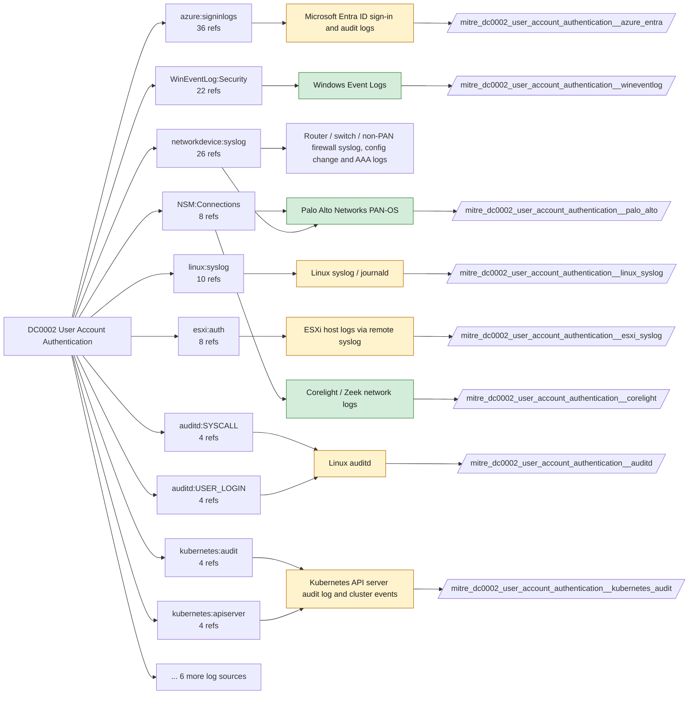

# DC0002 User Account Authentication

[ATT&CK](https://attack.mitre.org/datacomponents/DC0002) · version 3.0 · modified 2026-10-13 · ATT&CK release 20.1

Status: **Live** · umbrella eventtype `mitre_dc0002_user_account_authentication`

> An attempt (successful and failed login attempts) by a user, service, or application to gain access to a network, system, or cloud-based resource. This typically involves credentials such as passwords, tokens, multi-factor authentication (MFA), or biometric validation.

## Why this component matters

Credential validation events: Kerberos TGT/TGS (4768/4769/4771), NTLM (4776), failed logons, GlobalProtect auth, Entra sign-ins. 112 analytics for brute force, password spraying, Kerberoasting and token abuse.

ATT&CK v20.1 has **112 analytics** across **55 detection strategies** that read this component, covering **55 techniques**. Tactics most dependent on it: credential-access (51), persistence (21), privilege-escalation (19), stealth (18).

Analytic references by platform: Identity Provider 21, SaaS 17, Linux 15, Network Devices 13, Windows 12, Office Suite 9, macOS 8, ESXi 6, IaaS 6, Containers 5

## Where it comes from



## Requirements

Component specific:

- Audit Kerberos Authentication Service and Kerberos Service Ticket Operations on domain controllers; Audit Credential Validation for NTLM.

Per feed (from `config/stack.yml` and `config/log_sources.yml`):

| Feed | Status | Sourcetypes | Constraint | Origin | TA / collector |
|---|---|---|---|---|---|
| `corelight` | live | `corelight_kerberos`, `corelight_ntlm`, `corelight_radius`, `corelight_rdp`, `corelight_ssh` | `(whole feed)` | defaults | Corelight App for Splunk (corelight_<log>). For TA_zeek use prefix zeek: and suffix :json. |
| `palo_alto` | live | `pan:globalprotect`, `pan:system` | `(whole feed)` | defaults | Splunk Add-on for Palo Alto Networks (pan:*) |
| `wineventlog` | live | `XmlWinEventLog:Security` | `EventCode IN (4624, 4625, 4648, 4768, 4769, 4770, 4771, 4776, 4777)` | defaults | Splunk Add-on for Microsoft Windows (Splunk_TA_windows), XML rendering |
| `auditd` | ready (tick in stack.yml) | `linux:audit` | `type IN (CRED_ACQ, USER_ACCT, USER_AUTH, USER_LOGIN)` | defaults | Splunk Add-on for Unix and Linux (linux:audit) or auditd -> auditbeat/syslog |
| `azure_entra` | ready (tick in stack.yml) | `azure:aad:signin` | `(whole feed)` | defaults | Splunk Add-on for Microsoft Azure (azure:aad:signin, azure:aad:audit) or Microsoft Cloud Services add-on via Event Hub |
| `esxi_syslog` | ready (tick in stack.yml) | `vmware:esxlog:auth` | `(whole feed)` | defaults | Splunk Add-on for VMware ESXi Logs (vmware:esxlog:<log>) |
| `kubernetes_audit` | ready (tick in stack.yml) | `kube:apiserver-audit` | `(responseStatus.code=401 OR responseStatus.code=403)` | defaults | Splunk OpenTelemetry Collector for Kubernetes / Splunk Connect for Kubernetes |
| `linux_syslog` | ready (tick in stack.yml) | `linux_secure` | `(whole feed)` | defaults | Splunk Add-on for Unix and Linux (syslog, linux_secure, linux_messages_syslog) |

Collection prerequisites:

- **corelight**: Sensor placement covering east-west (DC, server VLANs) and north-south; without internal taps the lateral-movement components are blind.
- **corelight**: Enable the log set above; files/pe/smb_* and ldap/kerberos/ntlm are what distinguish Corelight from flow data.
- **palo_alto**: Log forwarding profiles attached to every security rule (traffic start+end, threat, url, wildfire, data).
- **palo_alto**: System and Config logs forwarded from each firewall / Panorama; GlobalProtect logs enabled.
- **palo_alto**: URL filtering and Threat Prevention licensed for pan:threat subtypes url/vulnerability/virus/spyware.
- **wineventlog**: Advanced Audit Policy configured (at minimum Process Creation, Logon, Account Management, Object Access, Policy Change, Privilege Use, Detailed Tracking). Without the matching subcategory the EventCodes below never fire.
- **wineventlog**: Include command line in process creation events enabled for 4688 (Computer Configuration > Administrative Templates > System > Audit Process Creation).
- **wineventlog**: PowerShell Script Block Logging (4104) and Module Logging (4103) enabled via GPO for the PowerShell/Operational channel.
- **wineventlog**: Object access events (4656/4663/4657/4660/4670) require SACLs on the files/keys of interest.
- **wineventlog**: Non-default channels (TaskScheduler, WMI-Activity, CodeIntegrity, Defender, Firewall, WinRM, SMBClient/Server...) must be listed as inputs in Splunk_TA_windows inputs.conf; several are disabled by default in Windows.
- **auditd**: audit rules for execve, connect, open/openat on sensitive paths, ptrace, module load, mount, setuid; a Neo23x0/auditd baseline or Florian Roth's rule set is a reasonable start.
- **auditd**: log_format = ENRICHED in auditd.conf so syscall names and uids resolve (otherwise syscall numbers are architecture dependent).
- **azure_entra**: Diagnostic settings on the tenant streaming SignInLogs
- **azure_entra**: AuditLogs
- **azure_entra**: NonInteractiveUserSignInLogs
- **azure_entra**: ServicePrincipalSignInLogs to an Event Hub or direct Graph pull.
- **esxi_syslog**: Syslog.global.logHost set on every host; ESXi Shell/SSH audit enabled; consider Syslog.global.auditRecord (ESXi 8).
- **kubernetes_audit**: Audit policy at Metadata level minimum
- **kubernetes_audit**: RequestResponse for secrets/pods/exec; ship the audit log file from control-plane nodes.

Review notes: `corelight` has 10 ATT&CK reference(s) with no usable event filter (prose channel), constraint origin is *defaults*; `azure_entra` has 36 ATT&CK reference(s) with no usable event filter (prose channel), constraint origin is *defaults*; `kubernetes_audit` has 4 ATT&CK reference(s) with no usable event filter (prose channel), constraint origin is *defaults*; `linux_syslog` has 13 ATT&CK reference(s) with no usable event filter (prose channel), constraint origin is *defaults*.

## Splunk

Eventtypes (literal constraints, see `dist/splunk/TA-mitre-attack-datacomponents/default/eventtypes.conf`):

```ini
[mitre_dc0002_user_account_authentication__corelight]
search = index=corelight sourcetype IN (corelight_kerberos, corelight_ntlm, corelight_radius, corelight_rdp, corelight_ssh)

[mitre_dc0002_user_account_authentication__palo_alto]
search = index=pan_logs sourcetype IN ("pan:globalprotect", "pan:system")

[mitre_dc0002_user_account_authentication__wineventlog]
search = index=wineventlog sourcetype=XmlWinEventLog:Security EventCode IN (4624, 4625, 4648, 4768, 4769, 4770, 4771, 4776, 4777)

[mitre_dc0002_user_account_authentication__auditd]
search = index=linux sourcetype=linux:audit type IN (CRED_ACQ, USER_ACCT, USER_AUTH, USER_LOGIN)
disabled = 1

[mitre_dc0002_user_account_authentication__azure_entra]
search = index=azure sourcetype=azure:aad:signin
disabled = 1

[mitre_dc0002_user_account_authentication__esxi_syslog]
search = index=vmware sourcetype=vmware:esxlog:auth
disabled = 1

[mitre_dc0002_user_account_authentication__kubernetes_audit]
search = index=k8s sourcetype=kube:apiserver-audit (responseStatus.code=401 OR responseStatus.code=403)
disabled = 1

[mitre_dc0002_user_account_authentication__linux_syslog]
search = index=linux sourcetype=linux_secure
disabled = 1

[mitre_dc0002_user_account_authentication]
search = eventtype=mitre_dc0002_user_account_authentication__corelight OR eventtype=mitre_dc0002_user_account_authentication__palo_alto OR eventtype=mitre_dc0002_user_account_authentication__wineventlog OR eventtype=mitre_dc0002_user_account_authentication__auditd OR eventtype=mitre_dc0002_user_account_authentication__azure_entra OR eventtype=mitre_dc0002_user_account_authentication__esxi_syslog OR eventtype=mitre_dc0002_user_account_authentication__kubernetes_audit OR eventtype=mitre_dc0002_user_account_authentication__linux_syslog
```

Macros for analytics: `` `mitre_dc0002` `` (umbrella), `` `mitre_dc0002_corelight` ``, `` `mitre_dc0002_palo_alto` ``, `` `mitre_dc0002_wineventlog` ``, `` `mitre_dc0002_auditd` ``, `` `mitre_dc0002_azure_entra` ``, `` `mitre_dc0002_esxi_syslog` ``, `` `mitre_dc0002_kubernetes_audit` ``, `` `mitre_dc0002_linux_syslog` ``, `` `mitre_dc0002_filter` `` (site exclusions).
CIM: `Authentication.Authentication` via `` `mitre_dc0002_dm` `` / `` `mitre_dc0002_dm_where` `` for `tstats`. CIM tags emitted for: `palo_alto`, `wineventlog`, `azure_entra`, `linux_syslog`.

## Sigma

No generic Sigma category maps to this component; rules use `product`/`service` logsources, which the pipeline maps to index and sourcetype.

## Dependents

Top techniques detected through this component (of 55):

| Technique | Name | Tactics | Analytics using this DC |
|---|---|---|---|
| [T1110.004](https://attack.mitre.org/techniques/T1110/004) | Credential Stuffing | credential-access | 9 |
| [T1110.003](https://attack.mitre.org/techniques/T1110/003) | Password Spraying | credential-access | 8 |
| [T1110.001](https://attack.mitre.org/techniques/T1110/001) | Password Guessing | credential-access | 6 |
| [T1110](https://attack.mitre.org/techniques/T1110) | Brute Force | credential-access | 5 |
| [T1078](https://attack.mitre.org/techniques/T1078) | Valid Accounts | stealth, persistence, privilege-escalation, initial-access | 4 |
| [T1078.004](https://attack.mitre.org/techniques/T1078/004) | Cloud Accounts | stealth, persistence, privilege-escalation, initial-access | 4 |
| [T1531](https://attack.mitre.org/techniques/T1531) | Account Access Removal | impact | 4 |
| [T1550.001](https://attack.mitre.org/techniques/T1550/001) | Application Access Token | lateral-movement | 4 |
| [T1621](https://attack.mitre.org/techniques/T1621) | Multi-Factor Authentication Request Generation | credential-access | 4 |
| [T1078.001](https://attack.mitre.org/techniques/T1078/001) | Default Accounts | stealth, persistence, privilege-escalation, initial-access | 3 |
| [T1078.002](https://attack.mitre.org/techniques/T1078/002) | Domain Accounts | stealth, persistence, privilege-escalation, initial-access | 3 |
| [T1212](https://attack.mitre.org/techniques/T1212) | Exploitation for Credential Access | credential-access | 3 |
| [T1538](https://attack.mitre.org/techniques/T1538) | Cloud Service Dashboard | discovery | 3 |
| [T1550](https://attack.mitre.org/techniques/T1550) | Use Alternate Authentication Material | lateral-movement | 3 |
| [T1697](https://attack.mitre.org/techniques/T1697) | Steal Application Specific Passwords | credential-access | 3 |
| … | 40 more | | |

Full list: `lookups/mitre_attack_analytics.csv` filtered on `dc_ids` containing `DC0002`.
