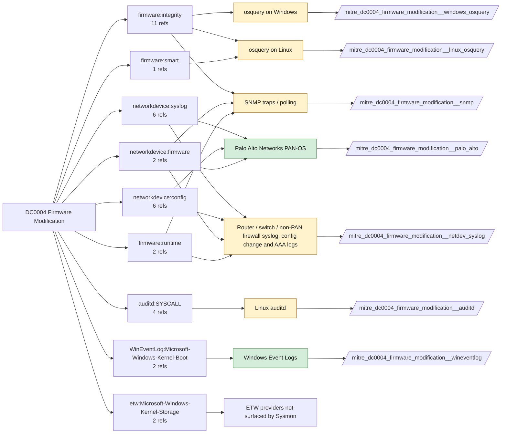

# DC0004 Firmware Modification

[ATT&CK](https://attack.mitre.org/datacomponents/DC0004) · version 2.0 · modified 2026-10-13 · ATT&CK release 20.1

Status: **Live** · umbrella eventtype `mitre_dc0004_firmware_modification`

> Changes made to firmware, which may include its settings, configurations, or underlying data. This can encompass alterations to the Master Boot Record (MBR), Volume Boot Record (VBR), or other firmware components critical to system boot and functionality. Such modifications are often indicators of adversary activity, including malware persistence and system compromise. Examples:   - Changes to Master Boot Record (MBR): Modifying the MBR to load malicious code during the boot process. - Changes to Volume Boot Record (VBR): Altering the VBR to redirect boot processes to malicious locations. - Firmware Configuration Changes: Modifying BIOS/UEFI settings such as disabling Secure Boot. - Firmware Image Tampering: Updating firmware with a malicious or unauthorized image. - Logs or Errors Indicating Firmware Changes: Logs showing unauthorized firmware updates or checksum mismatches.  This data component can be collected through the following measures:  - BIOS/UEFI Logs: Enable and monitor BIOS/UEFI logs to capture settings changes or firmware updates. - Firmware Integrity Monitoring: Use tools or firmware security features to detect changes to firmware components. - Endpoint Detection and Response (EDR) Solutions: Many EDR platforms can detect abnormal firmware activity, such as changes to MBR/VBR or unauthorized firmware updates. - File System Monitoring: Monitor changes to MBR/VBR-related files using tools like Sysmon or auditd.     - Windows Example (Sysmon): Monitor Event ID 7 (Raw disk access).     - Linux Example (auditd): `auditctl -w /dev/sda -p wa -k firmware_modification` - Network Traffic Analysis: Capture firmware updates downloaded over the network, particularly from untrusted sources. Use network monitoring tools like Zeek or Wireshark to analyze firmware-related traffic. - Secure Boot Logs: Collect and analyze Secure Boot logs for signs of tampering or unauthorized configurations. Example: Use PowerShell to retrieve Secure Boot settings on Windows: `Confirm-SecureBootUEFI` - Vendor-Specific Firmware Tools: Many hardware vendors provide tools for firmware integrity checks.Examples:     - Intel Platform Firmware Resilience (PFR).     - Lenovo UEFI diagnostics.

## Why this component matters

Firmware and boot-level changes: Kernel-Boot channel, PAN-OS system log software/content updates, fwupd on Linux, device syslog. Rare and worth alerting on.

ATT&CK v20.1 has **15 analytics** across **10 detection strategies** that read this component, covering **10 techniques**. Tactics most dependent on it: stealth (8), persistence (7), impact (4), collection (1).

Analytic references by platform: Network Devices 8, Windows 3, Linux 2, macOS 2

## Where it comes from



## Requirements

Per feed (from `config/stack.yml` and `config/log_sources.yml`):

| Feed | Status | Sourcetype or source | Constraint | Origin | TA / collector |
|---|---|---|---|---|---|
| `palo_alto` | live | sourcetype=`pan:system` | `(whole feed)` | defaults | Splunk Add-on for Palo Alto Networks (pan:*) |
| `wineventlog` | live | source=`XmlWinEventLog:Microsoft-Windows-Kernel-Boot`, source=`XmlWinEventLog:System` | `EventCode IN (12, 13, 20, 1001)` | defaults | Splunk Add-on for Microsoft Windows (Splunk_TA_windows), XML rendering (renderXml = true) |
| `auditd` | ready (tick in stack.yml) | sourcetype=`linux:audit` | `type IN (SYSCALL) (syscall IN (ioctl, write) OR SYSCALL IN (ioctl, write)) (name="/dev/mem" OR name="/dev/mtd*" OR exe="*flashrom*" OR exe="*fwupd*")` | defaults | Splunk Add-on for Unix and Linux (linux:audit) or auditd -> auditbeat/syslog |
| `linux_osquery` | ready (tick in stack.yml) | sourcetype=`osquery:results` | `(whole feed)` | derived | osquery TA |
| `netdev_syslog` | ready (tick in stack.yml) | sourcetype=`cisco:asa`, sourcetype=`cisco:ios`, sourcetype=`syslog` | `(whole feed)` | derived | Cisco Networks Add-on (cisco:ios, cisco:asa), Juniper/Arista TAs, or generic syslog |
| `snmp` | ready (tick in stack.yml) | sourcetype=`sc4snmp:event` | `(whole feed)` | derived | Splunk Connect for SNMP |
| `windows_osquery` | ready (tick in stack.yml) | sourcetype=`osquery:results` | `(whole feed)` | derived | osquery TA (osquery:results) |

Collection prerequisites:

- **palo_alto**: Log forwarding profiles attached to every security rule (traffic start+end, threat, url, wildfire, data).
- **palo_alto**: System and Config logs forwarded from each firewall / Panorama; GlobalProtect logs enabled.
- **palo_alto**: URL filtering and Threat Prevention licensed for pan:threat subtypes url/vulnerability/virus/spyware.
- **palo_alto**: Operational (show/debug) commands are not in config or system logs by default. Enable administrator activity audit tracking (Device > Setup > Management > Logging and Reporting, PAN-OS 10.1+) and forward the audit log if you want CLI discovery analytics for the firewall.
- **wineventlog**: Advanced Audit Policy configured (at minimum Process Creation, Logon, Account Management, Object Access, Policy Change, Privilege Use, Detailed Tracking). Without the matching subcategory the EventCodes below never fire.
- **wineventlog**: Include command line in process creation events enabled for 4688 (Computer Configuration > Administrative Templates > System > Audit Process Creation).
- **wineventlog**: PowerShell Script Block Logging (4104) and Module Logging (4103) enabled via GPO for the PowerShell/Operational channel.
- **wineventlog**: Object access events (4656/4663/4657/4660/4670) require SACLs on the files/keys of interest.
- **wineventlog**: Non-default channels (TaskScheduler, WMI-Activity, CodeIntegrity, Defender, Firewall, WinRM, SMBClient/Server...) must be listed as inputs in Splunk_TA_windows inputs.conf; several are disabled by default in Windows.
- **auditd**: audit rules for execve, connect, open/openat on sensitive paths, ptrace, module load, mount, setuid; a Neo23x0/auditd baseline or Florian Roth's rule set is a reasonable start.
- **auditd**: log_format = ENRICHED in auditd.conf so syscall names and uids resolve (otherwise syscall numbers are architecture dependent).
- **netdev_syslog**: Enable config-change archive logging and AAA command accounting; forward at informational level.

Review notes: `wineventlog` has 2 ATT&CK reference(s) with no usable event filter (prose channel), constraint origin is *defaults*; `linux_osquery` has 12 ATT&CK reference(s) with no usable event filter (prose channel), constraint origin is *derived*; `netdev_syslog` has 16 ATT&CK reference(s) with no usable event filter (prose channel), constraint origin is *derived*; `snmp` has 15 ATT&CK reference(s) with no usable event filter (prose channel), constraint origin is *derived*; `windows_osquery` has 11 ATT&CK reference(s) with no usable event filter (prose channel), constraint origin is *derived*.

## Splunk

Eventtypes (literal constraints, see `dist/splunk/TA-mitre-attack-datacomponents/default/eventtypes.conf`):

```ini
[mitre_dc0004_firmware_modification__palo_alto]
search = index=pan_logs sourcetype="pan:system"

[mitre_dc0004_firmware_modification__wineventlog]
search = index=wineventlog source IN ("XmlWinEventLog:Microsoft-Windows-Kernel-Boot", "XmlWinEventLog:System") EventCode IN (12, 13, 20, 1001)

[mitre_dc0004_firmware_modification__auditd]
search = index=linux sourcetype="linux:audit" type IN (SYSCALL) (syscall IN (ioctl, write) OR SYSCALL IN (ioctl, write)) (name="/dev/mem" OR name="/dev/mtd*" OR exe="*flashrom*" OR exe="*fwupd*")
disabled = 1

[mitre_dc0004_firmware_modification__linux_osquery]
search = index=osquery sourcetype="osquery:results"
disabled = 1

[mitre_dc0004_firmware_modification__netdev_syslog]
search = index=netops sourcetype IN ("cisco:asa", "cisco:ios", syslog)
disabled = 1

[mitre_dc0004_firmware_modification__snmp]
search = index=netops sourcetype="sc4snmp:event"
disabled = 1

[mitre_dc0004_firmware_modification__windows_osquery]
search = index=osquery sourcetype="osquery:results"
disabled = 1

[mitre_dc0004_firmware_modification]
search = eventtype=mitre_dc0004_firmware_modification__palo_alto OR eventtype=mitre_dc0004_firmware_modification__wineventlog OR eventtype=mitre_dc0004_firmware_modification__auditd OR eventtype=mitre_dc0004_firmware_modification__linux_osquery OR eventtype=mitre_dc0004_firmware_modification__netdev_syslog OR eventtype=mitre_dc0004_firmware_modification__snmp OR eventtype=mitre_dc0004_firmware_modification__windows_osquery
```

Macros for analytics: `` `mitre_dc0004` `` (umbrella), `` `mitre_dc0004_palo_alto` ``, `` `mitre_dc0004_wineventlog` ``, `` `mitre_dc0004_auditd` ``, `` `mitre_dc0004_linux_osquery` ``, `` `mitre_dc0004_netdev_syslog` ``, `` `mitre_dc0004_snmp` ``, `` `mitre_dc0004_windows_osquery` ``, `` `mitre_dc0004_filter` `` (site exclusions).
CIM: no data model mapping; analytics on this component run as raw eventtype searches.

## Sigma

No generic Sigma category maps to this component; rules use `product`/`service` logsources, which the pipeline maps to index and sourcetype.

## Dependents

Top techniques detected through this component (of 10):

| Technique | Name | Tactics | Analytics using this DC |
|---|---|---|---|
| [T1495](https://attack.mitre.org/techniques/T1495) | Firmware Corruption | impact | 4 |
| [T1542.002](https://attack.mitre.org/techniques/T1542/002) | Component Firmware | stealth, persistence | 3 |
| [T1056.001](https://attack.mitre.org/techniques/T1056/001) | Keylogging | collection, credential-access | 1 |
| [T1090.003](https://attack.mitre.org/techniques/T1090/003) | Multi-hop Proxy | command-and-control | 1 |
| [T1542](https://attack.mitre.org/techniques/T1542) | Pre-OS Boot | stealth, persistence | 1 |
| [T1542.001](https://attack.mitre.org/techniques/T1542/001) | System Firmware | stealth, persistence | 1 |
| [T1542.004](https://attack.mitre.org/techniques/T1542/004) | ROMMONkit | stealth, persistence | 1 |
| [T1542.005](https://attack.mitre.org/techniques/T1542/005) | TFTP Boot | stealth, persistence | 1 |
| [T1564.005](https://attack.mitre.org/techniques/T1564/005) | Hidden File System | stealth | 1 |
| [T1601.001](https://attack.mitre.org/techniques/T1601/001) | Patch System Image | defense-impairment | 1 |

Full list: `lookups/mitre_attack_analytics.csv` filtered on `dc_ids` containing `DC0004`.
