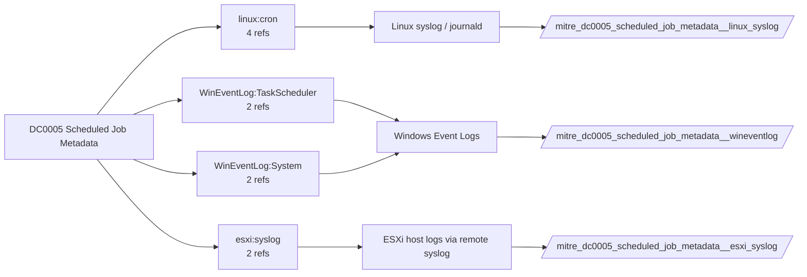

# DC0005 Scheduled Job Metadata

[ATT&CK](https://attack.mitre.org/datacomponents/DC0005) · version 2.0 · modified 2025-11-12 · ATT&CK release 20.1

Umbrella eventtype `mitre_dc0005_scheduled_job_metadata` over 3 feed(s)

> Contextual data about a scheduled job, which may include information such as name, timing, command(s), etc.

## Why this component matters

Task run/complete events (200/201) and cron execution lines let you spot tasks executing unexpected binaries or at odd times.

ATT&CK v20.1 has **9 analytics** across **3 detection strategies** that read this component, covering **3 techniques**. Tactics most dependent on it: discovery (4), exfiltration (3), stealth (2).

Analytic references by platform: Linux 3, macOS 3, Windows 2, ESXi 1

## Where it comes from



## Requirements

Per feed (from `config/stack.yml` and `config/log_sources.yml`):

| Feed | Schedule | Sourcetype or source | Constraint | Origin | TA / collector |
|---|---|---|---|---|---|
| `esxi_syslog` | scheduled | sourcetype=`vmware:esxlog:syslog` | `(whole feed)` | derived | Splunk Add-on for VMware ESXi Logs (vmware:esxlog:<log>) |
| `linux_syslog` | scheduled | sourcetype=`linux_messages_syslog`, sourcetype=`linux_secure`, sourcetype=`syslog` | `(process=CRON OR process=cron OR process=crond)` | defaults | Splunk Add-on for Unix and Linux (syslog, linux_secure, linux_messages_syslog) |
| `wineventlog` | scheduled | source=`XmlWinEventLog:Microsoft-Windows-TaskScheduler/Operational` | `EventCode IN (106, 140, 200, 201)` | defaults | Splunk Add-on for Microsoft Windows (Splunk_TA_windows), XML rendering (renderXml = true) |

Collection prerequisites:

- **esxi_syslog**: Syslog.global.logHost set on every host; ESXi Shell/SSH audit enabled; consider Syslog.global.auditRecord (ESXi 8).
- **wineventlog**: Advanced Audit Policy configured (at minimum Process Creation, Logon, Account Management, Object Access, Policy Change, Privilege Use, Detailed Tracking). Without the matching subcategory the EventCodes below never fire.
- **wineventlog**: Include command line in process creation events enabled for 4688 (Computer Configuration > Administrative Templates > System > Audit Process Creation).
- **wineventlog**: PowerShell Script Block Logging (4104) and Module Logging (4103) enabled via GPO for the PowerShell/Operational channel.
- **wineventlog**: Object access events (4656/4663/4657/4660/4670) require SACLs on the files/keys of interest.
- **wineventlog**: Non-default channels (TaskScheduler, WMI-Activity, CodeIntegrity, Defender, Firewall, WinRM, SMBClient/Server...) must be listed as inputs in Splunk_TA_windows inputs.conf; several are disabled by default in Windows.
- **wineventlog**: Enable the Microsoft-Windows-TaskScheduler/Operational log (disabled by default) and add it as an input.

Review notes: `wineventlog` has 2 ATT&CK reference(s) with no usable event filter (prose channel), constraint origin is *defaults*.

## Splunk

Eventtypes (literal constraints, see `dist/splunk/TA-mitre-attack-datacomponents/default/eventtypes.conf`):

```ini
[mitre_dc0005_scheduled_job_metadata__esxi_syslog]
search = index=vmware sourcetype="vmware:esxlog:syslog"

[mitre_dc0005_scheduled_job_metadata__linux_syslog]
search = index=linux sourcetype IN (linux_messages_syslog, linux_secure, syslog) (process=CRON OR process=cron OR process=crond)

[mitre_dc0005_scheduled_job_metadata__wineventlog]
search = index=wineventlog source="XmlWinEventLog:Microsoft-Windows-TaskScheduler/Operational" EventCode IN (106, 140, 200, 201)

[mitre_dc0005_scheduled_job_metadata]
search = eventtype=mitre_dc0005_scheduled_job_metadata__esxi_syslog OR eventtype=mitre_dc0005_scheduled_job_metadata__linux_syslog OR eventtype=mitre_dc0005_scheduled_job_metadata__wineventlog
```

Macros for analytics: `` `mitre_dc0005` `` (umbrella), `` `mitre_dc0005_esxi_syslog` ``, `` `mitre_dc0005_linux_syslog` ``, `` `mitre_dc0005_wineventlog` ``, `` `mitre_dc0005_filter` `` (site exclusions).
CIM: no data model mapping; analytics on this component run as raw eventtype searches.

## Sigma

No generic Sigma category maps to this component; rules use `product`/`service` logsources, which the pipeline maps to index and sourcetype.

## Dependents

Top techniques detected through this component (of 3):

| Technique | Name | Tactics | Analytics using this DC |
|---|---|---|---|
| [T1124](https://attack.mitre.org/techniques/T1124) | System Time Discovery | discovery | 4 |
| [T1029](https://attack.mitre.org/techniques/T1029) | Scheduled Transfer | exfiltration | 3 |
| [T1036.004](https://attack.mitre.org/techniques/T1036/004) | Masquerade Task or Service | stealth | 2 |

Full list: `lookups/mitre_attack_analytics.csv` filtered on `dc_ids` containing `DC0005`.
