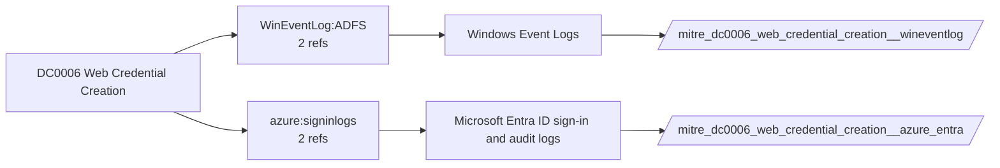

# DC0006 Web Credential Creation

[ATT&CK](https://attack.mitre.org/datacomponents/DC0006) · version 2.0 · modified 2025-11-12 · ATT&CK release 20.1

Umbrella eventtype `mitre_dc0006_web_credential_creation` over 2 feed(s)

> Initial construction of new web credential material (ex: Windows EID 1200 or 4769)

## Why this component matters

AD FS token issuance (1200/1202), Entra service principal credential additions, Kerberos tickets for web services.

ATT&CK v20.1 has **5 analytics** across **2 detection strategies** that read this component, covering **2 techniques**. Tactics most dependent on it: credential-access (5).

Analytic references by platform: Windows 1, SaaS 1, Office Suite 1, Identity Provider 1, IaaS 1

## Where it comes from



## Requirements

Per feed (from `config/stack.yml` and `config/log_sources.yml`):

| Feed | Schedule | Sourcetype or source | Constraint | Origin | TA / collector |
|---|---|---|---|---|---|
| `azure_entra` | scheduled | sourcetype=`azure:aad:audit`, sourcetype=`azure:aad:signin` | `(whole feed)` | defaults | Splunk Add-on for Microsoft Azure (azure:aad:signin, azure:aad:audit) or Microsoft Cloud Services add-on via Event Hub |
| `wineventlog` | scheduled | source=`XmlWinEventLog:AD FS/Admin`, source=`XmlWinEventLog:Security` | `EventCode IN (1200, 1202, 4662, 4769)` | defaults | Splunk Add-on for Microsoft Windows (Splunk_TA_windows), XML rendering (renderXml = true) |

Collection prerequisites:

- **azure_entra**: Diagnostic settings on the tenant streaming SignInLogs
- **azure_entra**: AuditLogs
- **azure_entra**: NonInteractiveUserSignInLogs
- **azure_entra**: ServicePrincipalSignInLogs to an Event Hub or direct Graph pull.
- **wineventlog**: Advanced Audit Policy configured (at minimum Process Creation, Logon, Account Management, Object Access, Policy Change, Privilege Use, Detailed Tracking). Without the matching subcategory the EventCodes below never fire.
- **wineventlog**: Include command line in process creation events enabled for 4688 (Computer Configuration > Administrative Templates > System > Audit Process Creation).
- **wineventlog**: PowerShell Script Block Logging (4104) and Module Logging (4103) enabled via GPO for the PowerShell/Operational channel.
- **wineventlog**: Object access events (4656/4663/4657/4660/4670) require SACLs on the files/keys of interest.
- **wineventlog**: Non-default channels (TaskScheduler, WMI-Activity, CodeIntegrity, Defender, Firewall, WinRM, SMBClient/Server...) must be listed as inputs in Splunk_TA_windows inputs.conf; several are disabled by default in Windows.

Review notes: `azure_entra` has 2 ATT&CK reference(s) with no usable event filter (prose channel), constraint origin is *defaults*; `wineventlog` has 2 ATT&CK reference(s) with no usable event filter (prose channel), constraint origin is *defaults*.

## Splunk

Eventtypes (literal constraints, see `dist/splunk/TA-mitre-attack-datacomponents/default/eventtypes.conf`):

```ini
[mitre_dc0006_web_credential_creation__azure_entra]
search = index=azure sourcetype IN ("azure:aad:audit", "azure:aad:signin")

[mitre_dc0006_web_credential_creation__wineventlog]
search = index=wineventlog source IN ("XmlWinEventLog:AD FS/Admin", "XmlWinEventLog:Security") EventCode IN (1200, 1202, 4662, 4769)

[mitre_dc0006_web_credential_creation]
search = eventtype=mitre_dc0006_web_credential_creation__azure_entra OR eventtype=mitre_dc0006_web_credential_creation__wineventlog
```

Macros for analytics: `` `mitre_dc0006` `` (umbrella), `` `mitre_dc0006_azure_entra` ``, `` `mitre_dc0006_wineventlog` ``, `` `mitre_dc0006_filter` `` (site exclusions).
CIM: no data model mapping; analytics on this component run as raw eventtype searches.

## Sigma

No generic Sigma category maps to this component; rules use `product`/`service` logsources, which the pipeline maps to index and sourcetype.

## Dependents

Top techniques detected through this component (of 2):

| Technique | Name | Tactics | Analytics using this DC |
|---|---|---|---|
| [T1606](https://attack.mitre.org/techniques/T1606) | Forge Web Credentials | credential-access | 4 |
| [T1606.002](https://attack.mitre.org/techniques/T1606/002) | SAML Tokens | credential-access | 1 |

Full list: `lookups/mitre_attack_analytics.csv` filtered on `dc_ids` containing `DC0006`.
