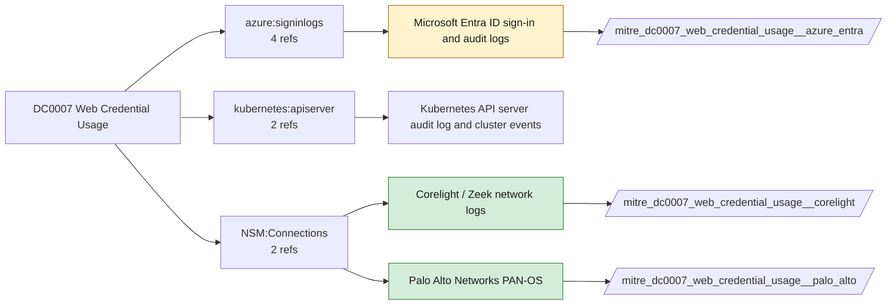

# DC0007 Web Credential Usage

[ATT&CK](https://attack.mitre.org/datacomponents/DC0007) · version 2.0 · modified 2025-11-12 · ATT&CK release 20.1

Status: **Live** · umbrella eventtype `mitre_dc0007_web_credential_usage`

> An attempt by a user to gain access to a network or computing resource by providing web credentials (ex: Windows EID 1202)

## Why this component matters

Entra sign-ins with tokens or cookies, HTTP sessions reusing stolen tokens seen by Corelight/PAN-OS; session hijacking analytics.

ATT&CK v20.1 has **20 analytics** across **6 detection strategies** that read this component, covering **6 techniques**. Tactics most dependent on it: lateral-movement (11), credential-access (9).

Analytic references by platform: SaaS 6, IaaS 5, Office Suite 3, Identity Provider 3, macOS 2, Containers 1

## Where it comes from



## Requirements

Per feed (from `config/stack.yml` and `config/log_sources.yml`):

| Feed | Status | Sourcetype or source | Constraint | Origin | TA / collector |
|---|---|---|---|---|---|
| `corelight` | live | sourcetype=`corelight_http`, sourcetype=`corelight_ssl` | `(whole feed)` | defaults | Corelight App for Splunk (corelight_<log>). For TA_zeek use prefix zeek: and suffix :json. |
| `palo_alto` | live | sourcetype=`pan:threat`, sourcetype=`pan:traffic` | `(whole feed)` | defaults | Splunk Add-on for Palo Alto Networks (pan:*) |
| `azure_entra` | ready (tick in stack.yml) | sourcetype=`azure:aad:signin` | `(whole feed)` | defaults | Splunk Add-on for Microsoft Azure (azure:aad:signin, azure:aad:audit) or Microsoft Cloud Services add-on via Event Hub |

Collection prerequisites:

- **corelight**: Sensor placement covering east-west (DC, server VLANs) and north-south; without internal taps the lateral-movement components are blind.
- **corelight**: Enable the log set above; files/pe/smb_* and ldap/kerberos/ntlm are what distinguish Corelight from flow data.
- **palo_alto**: Log forwarding profiles attached to every security rule (traffic start+end, threat, url, wildfire, data).
- **palo_alto**: System and Config logs forwarded from each firewall / Panorama; GlobalProtect logs enabled.
- **palo_alto**: URL filtering and Threat Prevention licensed for pan:threat subtypes url/vulnerability/virus/spyware.
- **palo_alto**: Operational (show/debug) commands are not in config or system logs by default. Enable administrator activity audit tracking (Device > Setup > Management > Logging and Reporting, PAN-OS 10.1+) and forward the audit log if you want CLI discovery analytics for the firewall.
- **azure_entra**: Diagnostic settings on the tenant streaming SignInLogs
- **azure_entra**: AuditLogs
- **azure_entra**: NonInteractiveUserSignInLogs
- **azure_entra**: ServicePrincipalSignInLogs to an Event Hub or direct Graph pull.

Review notes: `corelight` has 2 ATT&CK reference(s) with no usable event filter (prose channel), constraint origin is *defaults*; `azure_entra` has 4 ATT&CK reference(s) with no usable event filter (prose channel), constraint origin is *defaults*.

## Splunk

Eventtypes (literal constraints, see `dist/splunk/TA-mitre-attack-datacomponents/default/eventtypes.conf`):

```ini
[mitre_dc0007_web_credential_usage__corelight]
search = index=corelight sourcetype IN (corelight_http, corelight_ssl)

[mitre_dc0007_web_credential_usage__palo_alto]
search = index=pan_logs sourcetype IN ("pan:threat", "pan:traffic")

[mitre_dc0007_web_credential_usage__azure_entra]
search = index=azure sourcetype="azure:aad:signin"
disabled = 1

[mitre_dc0007_web_credential_usage]
search = eventtype=mitre_dc0007_web_credential_usage__corelight OR eventtype=mitre_dc0007_web_credential_usage__palo_alto OR eventtype=mitre_dc0007_web_credential_usage__azure_entra
```

Macros for analytics: `` `mitre_dc0007` `` (umbrella), `` `mitre_dc0007_corelight` ``, `` `mitre_dc0007_palo_alto` ``, `` `mitre_dc0007_azure_entra` ``, `` `mitre_dc0007_filter` `` (site exclusions).
CIM: `Authentication.Authentication` via `` `mitre_dc0007_dm` `` / `` `mitre_dc0007_dm_where` `` for `tstats`. CIM tags emitted for: `azure_entra`.

## Sigma

No generic Sigma category maps to this component; rules use `product`/`service` logsources, which the pipeline maps to index and sourcetype.

## Dependents

Top techniques detected through this component (of 6):

| Technique | Name | Tactics | Analytics using this DC |
|---|---|---|---|
| [T1550.001](https://attack.mitre.org/techniques/T1550/001) | Application Access Token | lateral-movement | 5 |
| [T1550](https://attack.mitre.org/techniques/T1550) | Use Alternate Authentication Material | lateral-movement | 4 |
| [T1606](https://attack.mitre.org/techniques/T1606) | Forge Web Credentials | credential-access | 3 |
| [T1606.001](https://attack.mitre.org/techniques/T1606/001) | Web Cookies | credential-access | 3 |
| [T1606.002](https://attack.mitre.org/techniques/T1606/002) | SAML Tokens | credential-access | 3 |
| [T1550.004](https://attack.mitre.org/techniques/T1550/004) | Web Session Cookie | lateral-movement | 2 |

Full list: `lookups/mitre_attack_analytics.csv` filtered on `dc_ids` containing `DC0007`.
