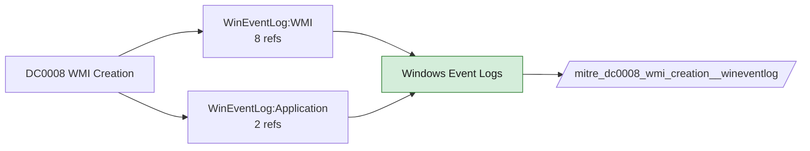

# DC0008 WMI Creation

[ATT&CK](https://attack.mitre.org/datacomponents/DC0008) · version 2.0 · modified 2025-11-12 · ATT&CK release 20.1

Status: **Live** · umbrella eventtype `mitre_dc0008_wmi_creation`

> Initial construction of a WMI object, such as a filter, consumer, subscription, binding, or providers.

## Why this component matters

WMI event subscriptions (filter/consumer/binding) are a classic fileless persistence. WMI-Activity/Operational 5857-5861 and Sysmon 19/20/21 both see them.

ATT&CK v20.1 has **7 analytics** across **7 detection strategies** that read this component, covering **7 techniques**. Tactics most dependent on it: stealth (3), privilege-escalation (2), persistence (2), execution (1).

Analytic references by platform: Windows 7

## Where it comes from



## Requirements

Component specific:

- Enable the Microsoft-Windows-WMI-Activity/Operational channel and add it as an input; Sysmon WmiEvent rules are in the modular configs.

Per feed (from `config/stack.yml` and `config/log_sources.yml`):

| Feed | Status | Sourcetypes | Constraint | Origin | TA / collector |
|---|---|---|---|---|---|
| `sysmon` | live | `XmlWinEventLog:Microsoft-Windows-Sysmon/Operational` | `EventCode IN (19, 20, 21)` | defaults | Splunk Add-on for Sysmon (TA-microsoft-sysmon) |
| `wineventlog` | live | `XmlWinEventLog:Microsoft-Windows-WMI-Activity/Operational` | `EventCode IN (5857, 5858, 5859, 5860, 5861)` | defaults | Splunk Add-on for Microsoft Windows (Splunk_TA_windows), XML rendering |

Collection prerequisites:

- **sysmon**: Sysmon deployed with a maintained modular configuration (e.g. sysmon-modular or SwiftOnSecurity). Event IDs referenced by a data component only exist if the config includes that rule group (ProcessAccess=10, ImageLoad=7, DNS=22, FileDelete=23/26, ClipboardChange=24, ProcessTampering=25, FileBlock=27/28 are off in minimal configs).
- **sysmon**: Hashes configured (SHA256 at least, IMPHASH useful) for File/Process metadata components.
- **wineventlog**: Advanced Audit Policy configured (at minimum Process Creation, Logon, Account Management, Object Access, Policy Change, Privilege Use, Detailed Tracking). Without the matching subcategory the EventCodes below never fire.
- **wineventlog**: Include command line in process creation events enabled for 4688 (Computer Configuration > Administrative Templates > System > Audit Process Creation).
- **wineventlog**: PowerShell Script Block Logging (4104) and Module Logging (4103) enabled via GPO for the PowerShell/Operational channel.
- **wineventlog**: Object access events (4656/4663/4657/4660/4670) require SACLs on the files/keys of interest.
- **wineventlog**: Non-default channels (TaskScheduler, WMI-Activity, CodeIntegrity, Defender, Firewall, WinRM, SMBClient/Server...) must be listed as inputs in Splunk_TA_windows inputs.conf; several are disabled by default in Windows.

Review notes: `wineventlog` has 2 ATT&CK reference(s) with no usable event filter (prose channel), constraint origin is *defaults*.

## Splunk

Eventtypes (literal constraints, see `dist/splunk/TA-mitre-attack-datacomponents/default/eventtypes.conf`):

```ini
[mitre_dc0008_wmi_creation__sysmon]
search = index=sysmon sourcetype=XmlWinEventLog:Microsoft-Windows-Sysmon/Operational EventCode IN (19, 20, 21)

[mitre_dc0008_wmi_creation__wineventlog]
search = index=wineventlog sourcetype=XmlWinEventLog:Microsoft-Windows-WMI-Activity/Operational EventCode IN (5857, 5858, 5859, 5860, 5861)

[mitre_dc0008_wmi_creation]
search = eventtype=mitre_dc0008_wmi_creation__sysmon OR eventtype=mitre_dc0008_wmi_creation__wineventlog
```

Macros for analytics: `` `mitre_dc0008` `` (umbrella), `` `mitre_dc0008_sysmon` ``, `` `mitre_dc0008_wineventlog` ``, `` `mitre_dc0008_filter` `` (site exclusions).
CIM: no data model mapping; analytics on this component run as raw eventtype searches.

## Sigma

Generic logsource categories scoped by this component in `dist/sigma/pipelines/splunk_mitre_dc.yml`: product `windows`: `wmi_event`.

## Dependents

Top techniques detected through this component (of 7):

| Technique | Name | Tactics | Analytics using this DC |
|---|---|---|---|
| [T1027.011](https://attack.mitre.org/techniques/T1027/011) | Fileless Storage | stealth | 1 |
| [T1047](https://attack.mitre.org/techniques/T1047) | Windows Management Instrumentation | execution | 1 |
| [T1222.001](https://attack.mitre.org/techniques/T1222/001) | Windows Permissions | defense-impairment | 1 |
| [T1480](https://attack.mitre.org/techniques/T1480) | Execution Guardrails | stealth | 1 |
| [T1480.001](https://attack.mitre.org/techniques/T1480/001) | Environmental Keying | stealth | 1 |
| [T1546](https://attack.mitre.org/techniques/T1546) | Event Triggered Execution | privilege-escalation, persistence | 1 |
| [T1546.003](https://attack.mitre.org/techniques/T1546/003) | Windows Management Instrumentation Event Subscription | privilege-escalation, persistence | 1 |

Full list: `lookups/mitre_attack_analytics.csv` filtered on `dc_ids` containing `DC0008`.
