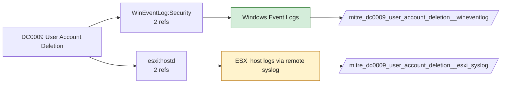

# DC0009 User Account Deletion

[ATT&CK](https://attack.mitre.org/datacomponents/DC0009) · version 2.0 · modified 2025-11-12 · ATT&CK release 20.1

Status: **Live** · umbrella eventtype `mitre_dc0009_user_account_deletion`

> The removal of a user, service, or machine account from an operating system, cloud identity management system, or directory service.

## Why this component matters

4726 and ESXi hostd user removal; low volume, useful for covering tracks detection.

ATT&CK v20.1 has **3 analytics** across **2 detection strategies** that read this component, covering **2 techniques**. Tactics most dependent on it: impact (2), stealth (1).

Analytic references by platform: ESXi 1, Windows 1, Office Suite 1

## Where it comes from



## Requirements

Per feed (from `config/stack.yml` and `config/log_sources.yml`):

| Feed | Status | Sourcetype or source | Constraint | Origin | TA / collector |
|---|---|---|---|---|---|
| `wineventlog` | live | source=`XmlWinEventLog:Security` | `EventCode IN (4726)` | defaults | Splunk Add-on for Microsoft Windows (Splunk_TA_windows), XML rendering (renderXml = true) |
| `esxi_syslog` | ready (tick in stack.yml) | sourcetype=`vmware:esxlog:hostd` | `(whole feed)` | defaults | Splunk Add-on for VMware ESXi Logs (vmware:esxlog:<log>) |

Collection prerequisites:

- **wineventlog**: Advanced Audit Policy configured (at minimum Process Creation, Logon, Account Management, Object Access, Policy Change, Privilege Use, Detailed Tracking). Without the matching subcategory the EventCodes below never fire.
- **wineventlog**: Include command line in process creation events enabled for 4688 (Computer Configuration > Administrative Templates > System > Audit Process Creation).
- **wineventlog**: PowerShell Script Block Logging (4104) and Module Logging (4103) enabled via GPO for the PowerShell/Operational channel.
- **wineventlog**: Object access events (4656/4663/4657/4660/4670) require SACLs on the files/keys of interest.
- **wineventlog**: Non-default channels (TaskScheduler, WMI-Activity, CodeIntegrity, Defender, Firewall, WinRM, SMBClient/Server...) must be listed as inputs in Splunk_TA_windows inputs.conf; several are disabled by default in Windows.
- **esxi_syslog**: Syslog.global.logHost set on every host; ESXi Shell/SSH audit enabled; consider Syslog.global.auditRecord (ESXi 8).

## Splunk

Eventtypes (literal constraints, see `dist/splunk/TA-mitre-attack-datacomponents/default/eventtypes.conf`):

```ini
[mitre_dc0009_user_account_deletion__wineventlog]
search = index=wineventlog source="XmlWinEventLog:Security" EventCode IN (4726)

[mitre_dc0009_user_account_deletion__esxi_syslog]
search = index=vmware sourcetype="vmware:esxlog:hostd"
disabled = 1

[mitre_dc0009_user_account_deletion]
search = eventtype=mitre_dc0009_user_account_deletion__wineventlog OR eventtype=mitre_dc0009_user_account_deletion__esxi_syslog
```

Macros for analytics: `` `mitre_dc0009` `` (umbrella), `` `mitre_dc0009_wineventlog` ``, `` `mitre_dc0009_esxi_syslog` ``, `` `mitre_dc0009_filter` `` (site exclusions).
CIM: `Change.Account_Management` via `` `mitre_dc0009_dm` `` / `` `mitre_dc0009_dm_where` `` for `tstats`. CIM tags emitted for: `wineventlog`.

## Sigma

No generic Sigma category maps to this component; rules use `product`/`service` logsources, which the pipeline maps to index and sourcetype.

## Dependents

Top techniques detected through this component (of 2):

| Technique | Name | Tactics | Analytics using this DC |
|---|---|---|---|
| [T1531](https://attack.mitre.org/techniques/T1531) | Account Access Removal | impact | 2 |
| [T1070.009](https://attack.mitre.org/techniques/T1070/009) | Clear Persistence | stealth | 1 |

Full list: `lookups/mitre_attack_analytics.csv` filtered on `dc_ids` containing `DC0009`.
