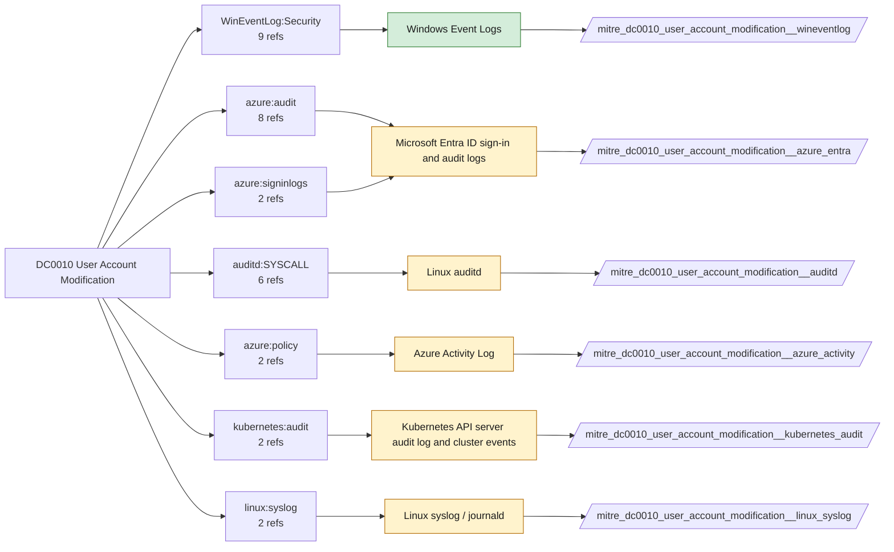

# DC0010 User Account Modification

[ATT&CK](https://attack.mitre.org/datacomponents/DC0010) · version 2.0 · modified 2026-09-23 · ATT&CK release 20.1

Status: **Live** · umbrella eventtype `mitre_dc0010_user_account_modification`

> Changes made to an existing user, service, or machine account, including alterations to attributes, permissions, roles, authentication methods, or group memberships.

## Why this component matters

Password resets, group membership changes, enabling disabled accounts and privilege grants (4722-4740, 4728/4732/4756). Entra audit logs are the cloud equivalent.

ATT&CK v20.1 has **40 analytics** across **21 detection strategies** that read this component, covering **21 techniques**. Tactics most dependent on it: persistence (26), privilege-escalation (21), defense-impairment (8), credential-access (8).

Analytic references by platform: Identity Provider 12, IaaS 6, Office Suite 5, Windows 5, SaaS 5, Linux 4, macOS 2, Containers 1

## Where it comes from



## Requirements

Component specific:

- Audit User Account Management and Security Group Management enabled on domain controllers.

Per feed (from `config/stack.yml` and `config/log_sources.yml`):

| Feed | Status | Sourcetypes | Constraint | Origin | TA / collector |
|---|---|---|---|---|---|
| `wineventlog` | live | `XmlWinEventLog:Security` | `EventCode IN (4670, 4704, 4722, 4723, 4724, 4725, 4728, 4729, 4732, 4733, 4738, 4740, 4756, 4757, 4767)` | defaults | Splunk Add-on for Microsoft Windows (Splunk_TA_windows), XML rendering |
| `auditd` | ready (tick in stack.yml) | `linux:audit` | `type IN (EXECVE, SYSCALL, USER_CHAUTHTOK, USER_MGMT) (exe="/usr/sbin/usermod" OR exe="/usr/bin/passwd" OR exe="/usr/sbin/chpasswd" OR type=USER_CHAUTHTOK OR type=USER_MGMT)` | defaults | Splunk Add-on for Unix and Linux (linux:audit) or auditd -> auditbeat/syslog |
| `azure_activity` | ready (tick in stack.yml) | `mscs:azure:audit` | `(category=Policy)` | derived | Splunk Add-on for Microsoft Cloud Services (mscs:azure:audit) |
| `azure_entra` | ready (tick in stack.yml) | `azure:aad:audit` | `(whole feed)` | defaults | Splunk Add-on for Microsoft Azure (azure:aad:signin, azure:aad:audit) or Microsoft Cloud Services add-on via Event Hub |
| `kubernetes_audit` | ready (tick in stack.yml) | `kube:apiserver-audit` | `verb IN (create, patch, update) (objectRef.resource IN (rolebindings, clusterrolebindings, serviceaccounts))` | defaults | Splunk OpenTelemetry Collector for Kubernetes / Splunk Connect for Kubernetes |
| `linux_syslog` | ready (tick in stack.yml) | `linux_secure` | `(whole feed)` | defaults | Splunk Add-on for Unix and Linux (syslog, linux_secure, linux_messages_syslog) |

Collection prerequisites:

- **wineventlog**: Advanced Audit Policy configured (at minimum Process Creation, Logon, Account Management, Object Access, Policy Change, Privilege Use, Detailed Tracking). Without the matching subcategory the EventCodes below never fire.
- **wineventlog**: Include command line in process creation events enabled for 4688 (Computer Configuration > Administrative Templates > System > Audit Process Creation).
- **wineventlog**: PowerShell Script Block Logging (4104) and Module Logging (4103) enabled via GPO for the PowerShell/Operational channel.
- **wineventlog**: Object access events (4656/4663/4657/4660/4670) require SACLs on the files/keys of interest.
- **wineventlog**: Non-default channels (TaskScheduler, WMI-Activity, CodeIntegrity, Defender, Firewall, WinRM, SMBClient/Server...) must be listed as inputs in Splunk_TA_windows inputs.conf; several are disabled by default in Windows.
- **auditd**: audit rules for execve, connect, open/openat on sensitive paths, ptrace, module load, mount, setuid; a Neo23x0/auditd baseline or Florian Roth's rule set is a reasonable start.
- **auditd**: log_format = ENRICHED in auditd.conf so syscall names and uids resolve (otherwise syscall numbers are architecture dependent).
- **azure_activity**: Export Activity Log for every subscription to the Event Hub.
- **azure_entra**: Diagnostic settings on the tenant streaming SignInLogs
- **azure_entra**: AuditLogs
- **azure_entra**: NonInteractiveUserSignInLogs
- **azure_entra**: ServicePrincipalSignInLogs to an Event Hub or direct Graph pull.
- **kubernetes_audit**: Audit policy at Metadata level minimum
- **kubernetes_audit**: RequestResponse for secrets/pods/exec; ship the audit log file from control-plane nodes.

Review notes: `azure_entra` has 10 ATT&CK reference(s) with no usable event filter (prose channel), constraint origin is *defaults*; `linux_syslog` has 2 ATT&CK reference(s) with no usable event filter (prose channel), constraint origin is *defaults*.

## Splunk

Eventtypes (literal constraints, see `dist/splunk/TA-mitre-attack-datacomponents/default/eventtypes.conf`):

```ini
[mitre_dc0010_user_account_modification__wineventlog]
search = index=wineventlog sourcetype=XmlWinEventLog:Security EventCode IN (4670, 4704, 4722, 4723, 4724, 4725, 4728, 4729, 4732, 4733, 4738, 4740, 4756, 4757, 4767)

[mitre_dc0010_user_account_modification__auditd]
search = index=linux sourcetype=linux:audit type IN (EXECVE, SYSCALL, USER_CHAUTHTOK, USER_MGMT) (exe="/usr/sbin/usermod" OR exe="/usr/bin/passwd" OR exe="/usr/sbin/chpasswd" OR type=USER_CHAUTHTOK OR type=USER_MGMT)
disabled = 1

[mitre_dc0010_user_account_modification__azure_activity]
search = index=azure sourcetype=mscs:azure:audit (category=Policy)
disabled = 1

[mitre_dc0010_user_account_modification__azure_entra]
search = index=azure sourcetype=azure:aad:audit
disabled = 1

[mitre_dc0010_user_account_modification__kubernetes_audit]
search = index=k8s sourcetype=kube:apiserver-audit verb IN (create, patch, update) (objectRef.resource IN (rolebindings, clusterrolebindings, serviceaccounts))
disabled = 1

[mitre_dc0010_user_account_modification__linux_syslog]
search = index=linux sourcetype=linux_secure
disabled = 1

[mitre_dc0010_user_account_modification]
search = eventtype=mitre_dc0010_user_account_modification__wineventlog OR eventtype=mitre_dc0010_user_account_modification__auditd OR eventtype=mitre_dc0010_user_account_modification__azure_activity OR eventtype=mitre_dc0010_user_account_modification__azure_entra OR eventtype=mitre_dc0010_user_account_modification__kubernetes_audit OR eventtype=mitre_dc0010_user_account_modification__linux_syslog
```

Macros for analytics: `` `mitre_dc0010` `` (umbrella), `` `mitre_dc0010_wineventlog` ``, `` `mitre_dc0010_auditd` ``, `` `mitre_dc0010_azure_activity` ``, `` `mitre_dc0010_azure_entra` ``, `` `mitre_dc0010_kubernetes_audit` ``, `` `mitre_dc0010_linux_syslog` ``, `` `mitre_dc0010_filter` `` (site exclusions).
CIM: `Change.Account_Management` via `` `mitre_dc0010_dm` `` / `` `mitre_dc0010_dm_where` `` for `tstats`. CIM tags emitted for: `wineventlog`, `azure_entra`.

## Sigma

No generic Sigma category maps to this component; rules use `product`/`service` logsources, which the pipeline maps to index and sourcetype.

## Dependents

Top techniques detected through this component (of 21):

| Technique | Name | Tactics | Analytics using this DC |
|---|---|---|---|
| [T1098](https://attack.mitre.org/techniques/T1098) | Account Manipulation | persistence, privilege-escalation | 6 |
| [T1098.001](https://attack.mitre.org/techniques/T1098/001) | Additional Cloud Credentials | persistence, privilege-escalation | 4 |
| [T1098.003](https://attack.mitre.org/techniques/T1098/003) | Additional Cloud Roles | persistence, privilege-escalation | 4 |
| [T1098.007](https://attack.mitre.org/techniques/T1098/007) | Additional Local or Domain Groups | persistence, privilege-escalation | 4 |
| [T1697](https://attack.mitre.org/techniques/T1697) | Steal Application Specific Passwords | credential-access | 4 |
| [T1036.010](https://attack.mitre.org/techniques/T1036/010) | Masquerade Account Name | stealth | 3 |
| [T1136.003](https://attack.mitre.org/techniques/T1136/003) | Cloud Account | persistence | 3 |
| [T1531](https://attack.mitre.org/techniques/T1531) | Account Access Removal | impact | 3 |
| [T1548](https://attack.mitre.org/techniques/T1548) | Abuse Elevation Control Mechanism | privilege-escalation | 3 |
| [T1556](https://attack.mitre.org/techniques/T1556) | Modify Authentication Process | defense-impairment, persistence, credential-access | 3 |
| [T1556.006](https://attack.mitre.org/techniques/T1556/006) | Multi-Factor Authentication | defense-impairment, persistence, credential-access | 3 |
| [T1098.002](https://attack.mitre.org/techniques/T1098/002) | Additional Email Delegate Permissions | persistence, privilege-escalation | 2 |
| [T1098.005](https://attack.mitre.org/techniques/T1098/005) | Device Registration | persistence, privilege-escalation | 2 |
| [T1098.006](https://attack.mitre.org/techniques/T1098/006) | Additional Container Cluster Roles | persistence, privilege-escalation | 2 |
| [T1136](https://attack.mitre.org/techniques/T1136) | Create Account | persistence | 2 |
| … | 6 more | | |

Full list: `lookups/mitre_attack_analytics.csv` filtered on `dc_ids` containing `DC0010`.
