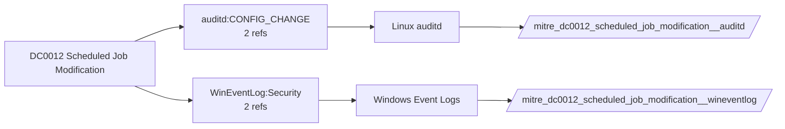

# DC0012 Scheduled Job Modification

[ATT&CK](https://attack.mitre.org/datacomponents/DC0012) · version 2.0 · modified 2025-10-21 · ATT&CK release 20.1

Umbrella eventtype `mitre_dc0012_scheduled_job_modification` over 2 feed(s)

> Changes made to an existing scheduled job, including modifications to its execution parameters, command payload, or execution timing.

## Why this component matters

Changing an existing task's action or trigger (4702, TaskScheduler 140) is a quieter persistence variant than creating one.

ATT&CK v20.1 has **3 analytics** across **3 detection strategies** that read this component, covering **3 techniques**. Tactics most dependent on it: stealth (2), execution (1), persistence (1), privilege-escalation (1).

Analytic references by platform: Windows 1, Linux 1, Office Suite 1

## Where it comes from



## Requirements

Per feed (from `config/stack.yml` and `config/log_sources.yml`):

| Feed | Schedule | Sourcetype or source | Constraint | Origin | TA / collector |
|---|---|---|---|---|---|
| `auditd` | scheduled | sourcetype=`linux:audit` | `type IN (CONFIG_CHANGE, PATH) (name="/etc/cron*" OR name="/var/spool/cron/*")` | defaults | Splunk Add-on for Unix and Linux (linux:audit) or auditd -> auditbeat/syslog |
| `wineventlog` | scheduled | source=`XmlWinEventLog:Microsoft-Windows-TaskScheduler/Operational`, source=`XmlWinEventLog:Security` | `EventCode IN (140, 4702)` | defaults | Splunk Add-on for Microsoft Windows (Splunk_TA_windows), XML rendering (renderXml = true) |

Collection prerequisites:

- **auditd**: audit rules for execve, connect, open/openat on sensitive paths, ptrace, module load, mount, setuid; a Neo23x0/auditd baseline or Florian Roth's rule set is a reasonable start.
- **auditd**: log_format = ENRICHED in auditd.conf so syscall names and uids resolve (otherwise syscall numbers are architecture dependent).
- **wineventlog**: Advanced Audit Policy configured (at minimum Process Creation, Logon, Account Management, Object Access, Policy Change, Privilege Use, Detailed Tracking). Without the matching subcategory the EventCodes below never fire.
- **wineventlog**: Include command line in process creation events enabled for 4688 (Computer Configuration > Administrative Templates > System > Audit Process Creation).
- **wineventlog**: PowerShell Script Block Logging (4104) and Module Logging (4103) enabled via GPO for the PowerShell/Operational channel.
- **wineventlog**: Object access events (4656/4663/4657/4660/4670) require SACLs on the files/keys of interest.
- **wineventlog**: Non-default channels (TaskScheduler, WMI-Activity, CodeIntegrity, Defender, Firewall, WinRM, SMBClient/Server...) must be listed as inputs in Splunk_TA_windows inputs.conf; several are disabled by default in Windows.

## Splunk

Eventtypes (literal constraints, see `dist/splunk/TA-mitre-attack-datacomponents/default/eventtypes.conf`):

```ini
[mitre_dc0012_scheduled_job_modification__auditd]
search = index=linux sourcetype="linux:audit" type IN (CONFIG_CHANGE, PATH) (name="/etc/cron*" OR name="/var/spool/cron/*")

[mitre_dc0012_scheduled_job_modification__wineventlog]
search = index=wineventlog source IN ("XmlWinEventLog:Microsoft-Windows-TaskScheduler/Operational", "XmlWinEventLog:Security") EventCode IN (140, 4702)

[mitre_dc0012_scheduled_job_modification]
search = eventtype=mitre_dc0012_scheduled_job_modification__auditd OR eventtype=mitre_dc0012_scheduled_job_modification__wineventlog
```

Macros for analytics: `` `mitre_dc0012` `` (umbrella), `` `mitre_dc0012_auditd` ``, `` `mitre_dc0012_wineventlog` ``, `` `mitre_dc0012_filter` `` (site exclusions).
CIM: no data model mapping; analytics on this component run as raw eventtype searches.

## Sigma

No generic Sigma category maps to this component; rules use `product`/`service` logsources, which the pipeline maps to index and sourcetype.

## Dependents

Top techniques detected through this component (of 3):

| Technique | Name | Tactics | Analytics using this DC |
|---|---|---|---|
| [T1036.004](https://attack.mitre.org/techniques/T1036/004) | Masquerade Task or Service | stealth | 1 |
| [T1053.005](https://attack.mitre.org/techniques/T1053/005) | Scheduled Task | execution, persistence, privilege-escalation | 1 |
| [T1070](https://attack.mitre.org/techniques/T1070) | Indicator Removal | stealth | 1 |

Full list: `lookups/mitre_attack_analytics.csv` filtered on `dc_ids` containing `DC0012`.
