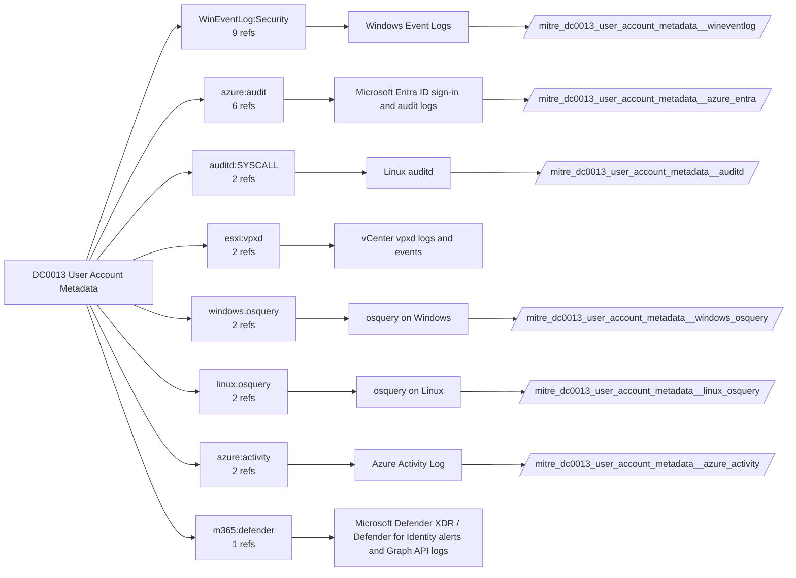

# DC0013 User Account Metadata

[ATT&CK](https://attack.mitre.org/datacomponents/DC0013) · version 2.1 · modified 2026-05-12 · ATT&CK release 20.1

Umbrella eventtype `mitre_dc0013_user_account_metadata` over 6 feed(s)

> Contextual data about an account, which may include a username, user ID, environmental data, etc.

## Why this component matters

Account attributes and privileges in use (4672/4673/4674, 4720/4738 details) and reads of /etc/passwd, /etc/shadow on Linux via auditd watches.

ATT&CK v20.1 has **33 analytics** across **20 detection strategies** that read this component, covering **20 techniques**. Tactics most dependent on it: discovery (15), stealth (6), impact (4), privilege-escalation (3).

Analytic references by platform: IaaS 7, Windows 7, Identity Provider 6, SaaS 4, macOS 3, Office Suite 2, Linux 2, Containers 1, ESXi 1

## Where it comes from



## Requirements

Per feed (from `config/stack.yml` and `config/log_sources.yml`):

| Feed | Schedule | Sourcetype or source | Constraint | Origin | TA / collector |
|---|---|---|---|---|---|
| `auditd` | scheduled | sourcetype=`linux:audit` | `type IN (PATH, SYSCALL) (syscall IN (open, openat, read) OR SYSCALL IN (open, openat, read)) (name="/etc/passwd" OR name="/etc/shadow" OR name="/etc/group" OR name="/etc/sudoers*")` | defaults | Splunk Add-on for Unix and Linux (linux:audit) or auditd -> auditbeat/syslog |
| `azure_activity` | scheduled | sourcetype=`mscs:azure:audit` | `(whole feed)` | derived | Splunk Add-on for Microsoft Cloud Services (mscs:azure:audit) |
| `azure_entra` | scheduled | sourcetype=`azure:aad:audit` | `(whole feed)` | defaults | Splunk Add-on for Microsoft Azure (azure:aad:signin, azure:aad:audit) or Microsoft Cloud Services add-on via Event Hub |
| `linux_osquery` | scheduled | sourcetype=`osquery:results` | `(name=users OR name=groups OR name=sudoers OR name=shadow)` | defaults | osquery TA |
| `windows_osquery` | scheduled | sourcetype=`osquery:results` | `(name=users OR name=groups OR name=logged_in_users)` | defaults | osquery TA (osquery:results) |
| `wineventlog` | scheduled | source=`XmlWinEventLog:Security` | `EventCode IN (4672, 4673, 4674, 4720, 4738)` | defaults | Splunk Add-on for Microsoft Windows (Splunk_TA_windows), XML rendering (renderXml = true) |

Collection prerequisites:

- **auditd**: audit rules for execve, connect, open/openat on sensitive paths, ptrace, module load, mount, setuid; a Neo23x0/auditd baseline or Florian Roth's rule set is a reasonable start.
- **auditd**: log_format = ENRICHED in auditd.conf so syscall names and uids resolve (otherwise syscall numbers are architecture dependent).
- **azure_activity**: Export Activity Log for every subscription to the Event Hub.
- **azure_entra**: Diagnostic settings on the tenant streaming SignInLogs
- **azure_entra**: AuditLogs
- **azure_entra**: NonInteractiveUserSignInLogs
- **azure_entra**: ServicePrincipalSignInLogs to an Event Hub or direct Graph pull.
- **wineventlog**: Advanced Audit Policy configured (at minimum Process Creation, Logon, Account Management, Object Access, Policy Change, Privilege Use, Detailed Tracking). Without the matching subcategory the EventCodes below never fire.
- **wineventlog**: Include command line in process creation events enabled for 4688 (Computer Configuration > Administrative Templates > System > Audit Process Creation).
- **wineventlog**: PowerShell Script Block Logging (4104) and Module Logging (4103) enabled via GPO for the PowerShell/Operational channel.
- **wineventlog**: Object access events (4656/4663/4657/4660/4670) require SACLs on the files/keys of interest.
- **wineventlog**: Non-default channels (TaskScheduler, WMI-Activity, CodeIntegrity, Defender, Firewall, WinRM, SMBClient/Server...) must be listed as inputs in Splunk_TA_windows inputs.conf; several are disabled by default in Windows.

Review notes: `azure_activity` has 2 ATT&CK reference(s) with no usable event filter (prose channel), constraint origin is *derived*; `azure_entra` has 6 ATT&CK reference(s) with no usable event filter (prose channel), constraint origin is *defaults*; `linux_osquery` has 2 ATT&CK reference(s) with no usable event filter (prose channel), constraint origin is *defaults*; `windows_osquery` has 2 ATT&CK reference(s) with no usable event filter (prose channel), constraint origin is *defaults*.

## Splunk

Eventtypes (literal constraints, see `dist/splunk/TA-mitre-attack-datacomponents/default/eventtypes.conf`):

```ini
[mitre_dc0013_user_account_metadata__auditd]
search = index=linux sourcetype="linux:audit" type IN (PATH, SYSCALL) (syscall IN (open, openat, read) OR SYSCALL IN (open, openat, read)) (name="/etc/passwd" OR name="/etc/shadow" OR name="/etc/group" OR name="/etc/sudoers*")

[mitre_dc0013_user_account_metadata__azure_activity]
search = index=azure sourcetype="mscs:azure:audit"

[mitre_dc0013_user_account_metadata__azure_entra]
search = index=azure sourcetype="azure:aad:audit"

[mitre_dc0013_user_account_metadata__linux_osquery]
search = index=osquery sourcetype="osquery:results" (name=users OR name=groups OR name=sudoers OR name=shadow)

[mitre_dc0013_user_account_metadata__windows_osquery]
search = index=osquery sourcetype="osquery:results" (name=users OR name=groups OR name=logged_in_users)

[mitre_dc0013_user_account_metadata__wineventlog]
search = index=wineventlog source="XmlWinEventLog:Security" EventCode IN (4672, 4673, 4674, 4720, 4738)

[mitre_dc0013_user_account_metadata]
search = eventtype=mitre_dc0013_user_account_metadata__auditd OR eventtype=mitre_dc0013_user_account_metadata__azure_activity OR eventtype=mitre_dc0013_user_account_metadata__azure_entra OR eventtype=mitre_dc0013_user_account_metadata__linux_osquery OR eventtype=mitre_dc0013_user_account_metadata__windows_osquery OR eventtype=mitre_dc0013_user_account_metadata__wineventlog
```

Macros for analytics: `` `mitre_dc0013` `` (umbrella), `` `mitre_dc0013_auditd` ``, `` `mitre_dc0013_azure_activity` ``, `` `mitre_dc0013_azure_entra` ``, `` `mitre_dc0013_linux_osquery` ``, `` `mitre_dc0013_windows_osquery` ``, `` `mitre_dc0013_wineventlog` ``, `` `mitre_dc0013_filter` `` (site exclusions).
CIM: `Change.Account_Management` via `` `mitre_dc0013_dm` `` / `` `mitre_dc0013_dm_where` `` for `tstats`. CIM tags emitted for: `wineventlog`.

## Sigma

No generic Sigma category maps to this component; rules use `product`/`service` logsources, which the pipeline maps to index and sourcetype.

## Dependents

Top techniques detected through this component (of 20):

| Technique | Name | Tactics | Analytics using this DC |
|---|---|---|---|
| [T1201](https://attack.mitre.org/techniques/T1201) | Password Policy Discovery | discovery | 5 |
| [T1087.004](https://attack.mitre.org/techniques/T1087/004) | Cloud Account | discovery | 4 |
| [T1036.010](https://attack.mitre.org/techniques/T1036/010) | Masquerade Account Name | stealth | 3 |
| [T1087](https://attack.mitre.org/techniques/T1087) | Account Discovery | discovery | 3 |
| [T1548.005](https://attack.mitre.org/techniques/T1548/005) | Temporary Elevated Cloud Access | privilege-escalation | 2 |
| [T1550](https://attack.mitre.org/techniques/T1550) | Use Alternate Authentication Material | lateral-movement | 2 |
| [T1003.001](https://attack.mitre.org/techniques/T1003/001) | LSASS Memory | credential-access | 1 |
| [T1087.001](https://attack.mitre.org/techniques/T1087/001) | Local Account | discovery | 1 |
| [T1087.003](https://attack.mitre.org/techniques/T1087/003) | Email Account | discovery | 1 |
| [T1134.005](https://attack.mitre.org/techniques/T1134/005) | SID-History Injection | stealth, privilege-escalation | 1 |
| [T1185](https://attack.mitre.org/techniques/T1185) | Browser Session Hijacking | collection | 1 |
| [T1189](https://attack.mitre.org/techniques/T1189) | Drive-by Compromise | initial-access | 1 |
| [T1496.004](https://attack.mitre.org/techniques/T1496/004) | Cloud Service Hijacking | impact | 1 |
| [T1526](https://attack.mitre.org/techniques/T1526) | Cloud Service Discovery | discovery | 1 |
| [T1530](https://attack.mitre.org/techniques/T1530) | Data from Cloud Storage | collection | 1 |
| … | 5 more | | |

Full list: `lookups/mitre_attack_analytics.csv` filtered on `dc_ids` containing `DC0013`.
