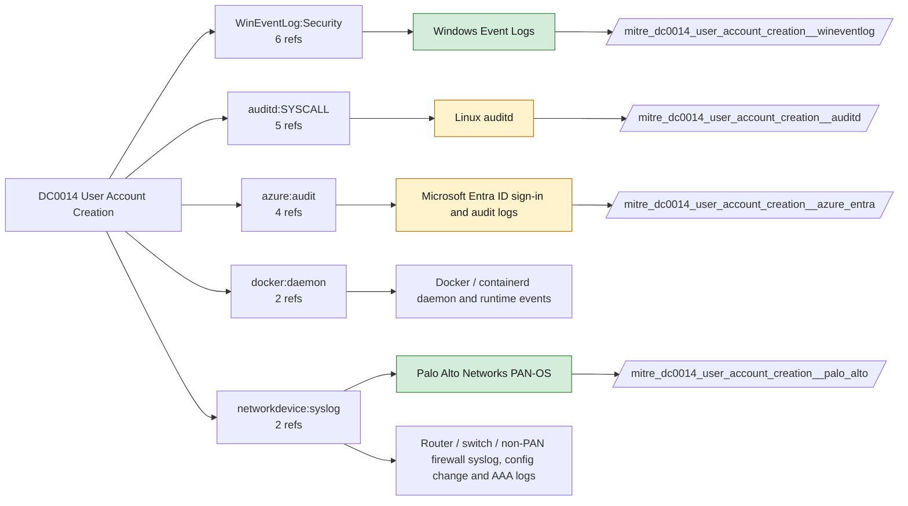

# DC0014 User Account Creation

[ATT&CK](https://attack.mitre.org/datacomponents/DC0014) · version 2.0 · modified 2025-11-12 · ATT&CK release 20.1

Status: **Live** · umbrella eventtype `mitre_dc0014_user_account_creation`

> The initial establishment of a new user, service, or machine account within an operating system, cloud environment, or identity management system.

## Why this component matters

4720 is rare and high signal; on Linux useradd shows in linux_secure and auditd ADD_USER; PAN-OS config logs record admin account creation.

ATT&CK v20.1 has **17 analytics** across **6 detection strategies** that read this component, covering **6 techniques**. Tactics most dependent on it: persistence (12), stealth (5).

Analytic references by platform: Windows 5, Identity Provider 3, Linux 3, IaaS 2, Office Suite 1, Network Devices 1, SaaS 1, Containers 1

## Where it comes from



## Requirements

Component specific:

- Audit User Account Management enabled.

Per feed (from `config/stack.yml` and `config/log_sources.yml`):

| Feed | Status | Sourcetype or source | Constraint | Origin | TA / collector |
|---|---|---|---|---|---|
| `palo_alto` | live | sourcetype=`pan:config` | `(whole feed)` | defaults | Splunk Add-on for Palo Alto Networks (pan:*) |
| `wineventlog` | live | source=`XmlWinEventLog:Security` | `EventCode IN (4720)` | defaults | Splunk Add-on for Microsoft Windows (Splunk_TA_windows), XML rendering (renderXml = true) |
| `auditd` | ready (tick in stack.yml) | sourcetype=`linux:audit` | `type IN (ADD_USER, EXECVE, SYSCALL) (exe="/usr/sbin/useradd" OR exe="/usr/sbin/adduser" OR type=ADD_USER)` | defaults | Splunk Add-on for Unix and Linux (linux:audit) or auditd -> auditbeat/syslog |
| `azure_entra` | ready (tick in stack.yml) | sourcetype=`azure:aad:audit` | `(operationName="Add user")` | defaults | Splunk Add-on for Microsoft Azure (azure:aad:signin, azure:aad:audit) or Microsoft Cloud Services add-on via Event Hub |
| `linux_syslog` | ready (tick in stack.yml) | sourcetype=`linux_secure` | `(useradd OR adduser)` | defaults | Splunk Add-on for Unix and Linux (syslog, linux_secure, linux_messages_syslog) |

Collection prerequisites:

- **palo_alto**: Log forwarding profiles attached to every security rule (traffic start+end, threat, url, wildfire, data).
- **palo_alto**: System and Config logs forwarded from each firewall / Panorama; GlobalProtect logs enabled.
- **palo_alto**: URL filtering and Threat Prevention licensed for pan:threat subtypes url/vulnerability/virus/spyware.
- **palo_alto**: Operational (show/debug) commands are not in config or system logs by default. Enable administrator activity audit tracking (Device > Setup > Management > Logging and Reporting, PAN-OS 10.1+) and forward the audit log if you want CLI discovery analytics for the firewall.
- **wineventlog**: Advanced Audit Policy configured (at minimum Process Creation, Logon, Account Management, Object Access, Policy Change, Privilege Use, Detailed Tracking). Without the matching subcategory the EventCodes below never fire.
- **wineventlog**: Include command line in process creation events enabled for 4688 (Computer Configuration > Administrative Templates > System > Audit Process Creation).
- **wineventlog**: PowerShell Script Block Logging (4104) and Module Logging (4103) enabled via GPO for the PowerShell/Operational channel.
- **wineventlog**: Object access events (4656/4663/4657/4660/4670) require SACLs on the files/keys of interest.
- **wineventlog**: Non-default channels (TaskScheduler, WMI-Activity, CodeIntegrity, Defender, Firewall, WinRM, SMBClient/Server...) must be listed as inputs in Splunk_TA_windows inputs.conf; several are disabled by default in Windows.
- **auditd**: audit rules for execve, connect, open/openat on sensitive paths, ptrace, module load, mount, setuid; a Neo23x0/auditd baseline or Florian Roth's rule set is a reasonable start.
- **auditd**: log_format = ENRICHED in auditd.conf so syscall names and uids resolve (otherwise syscall numbers are architecture dependent).
- **azure_entra**: Diagnostic settings on the tenant streaming SignInLogs
- **azure_entra**: AuditLogs
- **azure_entra**: NonInteractiveUserSignInLogs
- **azure_entra**: ServicePrincipalSignInLogs to an Event Hub or direct Graph pull.

Review notes: `azure_entra` has 4 ATT&CK reference(s) with no usable event filter (prose channel), constraint origin is *defaults*.

## Splunk

Eventtypes (literal constraints, see `dist/splunk/TA-mitre-attack-datacomponents/default/eventtypes.conf`):

```ini
[mitre_dc0014_user_account_creation__palo_alto]
search = index=pan_logs sourcetype="pan:config"

[mitre_dc0014_user_account_creation__wineventlog]
search = index=wineventlog source="XmlWinEventLog:Security" EventCode IN (4720)

[mitre_dc0014_user_account_creation__auditd]
search = index=linux sourcetype="linux:audit" type IN (ADD_USER, EXECVE, SYSCALL) (exe="/usr/sbin/useradd" OR exe="/usr/sbin/adduser" OR type=ADD_USER)
disabled = 1

[mitre_dc0014_user_account_creation__azure_entra]
search = index=azure sourcetype="azure:aad:audit" (operationName="Add user")
disabled = 1

[mitre_dc0014_user_account_creation__linux_syslog]
search = index=linux sourcetype=linux_secure (useradd OR adduser)
disabled = 1

[mitre_dc0014_user_account_creation]
search = eventtype=mitre_dc0014_user_account_creation__palo_alto OR eventtype=mitre_dc0014_user_account_creation__wineventlog OR eventtype=mitre_dc0014_user_account_creation__auditd OR eventtype=mitre_dc0014_user_account_creation__azure_entra OR eventtype=mitre_dc0014_user_account_creation__linux_syslog
```

Macros for analytics: `` `mitre_dc0014` `` (umbrella), `` `mitre_dc0014_palo_alto` ``, `` `mitre_dc0014_wineventlog` ``, `` `mitre_dc0014_auditd` ``, `` `mitre_dc0014_azure_entra` ``, `` `mitre_dc0014_linux_syslog` ``, `` `mitre_dc0014_filter` `` (site exclusions).
CIM: `Change.Account_Management` via `` `mitre_dc0014_dm` `` / `` `mitre_dc0014_dm_where` `` for `tstats`. CIM tags emitted for: `wineventlog`, `azure_entra`.

## Sigma

No generic Sigma category maps to this component; rules use `product`/`service` logsources, which the pipeline maps to index and sourcetype.

## Dependents

Top techniques detected through this component (of 6):

| Technique | Name | Tactics | Analytics using this DC |
|---|---|---|---|
| [T1036.010](https://attack.mitre.org/techniques/T1036/010) | Masquerade Account Name | stealth | 4 |
| [T1136](https://attack.mitre.org/techniques/T1136) | Create Account | persistence | 4 |
| [T1136.003](https://attack.mitre.org/techniques/T1136/003) | Cloud Account | persistence | 4 |
| [T1136.001](https://attack.mitre.org/techniques/T1136/001) | Local Account | persistence | 3 |
| [T1136.002](https://attack.mitre.org/techniques/T1136/002) | Domain Account | persistence | 1 |
| [T1564.002](https://attack.mitre.org/techniques/T1564/002) | Hidden Users | stealth | 1 |

Full list: `lookups/mitre_attack_analytics.csv` filtered on `dc_ids` containing `DC0014`.
