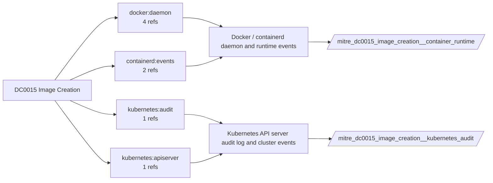

# DC0015 Image Creation

[ATT&CK](https://attack.mitre.org/datacomponents/DC0015) · version 2.0 · modified 2025-11-12 · ATT&CK release 20.1

Umbrella eventtype `mitre_dc0015_image_creation` over 2 feed(s)

> Initial construction of a virtual machine image within a cloud environment. Virtual machine images are templates containing an operating system and installed applications, which can be deployed to create new virtual machines. Monitoring the creation of these images is important because adversaries may create custom images to include malicious software or misconfigurations for later exploitation. Examples:   - Azure Compute Service Image Creation     - Example: Creating a virtual machine image in Azure using Azure CLI: `az image create --resource-group MyResourceGroup --name MyImage --source MyVM` - AWS EC2 AMI (Amazon Machine Image) Creation     - Example: Creating an AMI from an EC2 instance: `aws ec2 create-image --instance-id i-1234567890abcdef0 --name "MyAMI" --description "An AMI for my app"` - Google Cloud Compute Engine Image Creation     - Example: Creating a custom image using gcloud: `gcloud compute images create my-custom-image --source-disk my-disk --source-disk-zone us-central1-a` - VMware vSphere     - Example: Exporting a VM to create an OVF (Open Virtualization Format) template: This could later be imported into other environments with potential tampering.

## Why this component matters

Image build, commit, pull and tag events from the container runtime; backdoored images are created here.

ATT&CK v20.1 has **4 analytics** across **3 detection strategies** that read this component, covering **3 techniques**. Tactics most dependent on it: persistence (2), execution (1), stealth (1).

Analytic references by platform: Containers 2, Linux 1, IaaS 1

## Where it comes from



## Requirements

Per feed (from `config/stack.yml` and `config/log_sources.yml`):

| Feed | Schedule | Sourcetype or source | Constraint | Origin | TA / collector |
|---|---|---|---|---|---|
| `container_runtime` | scheduled | sourcetype=`containerd:events`, sourcetype=`docker:daemon` | `(status IN (commit, build, import, pull, tag))` | defaults | docker events scripted input or OpenTelemetry (docker:events, containerd) |
| `kubernetes_audit` | scheduled | sourcetype=`kube:apiserver-audit` | `verb IN (create) (objectRef.resource=pods)` | defaults | Splunk OpenTelemetry Collector for Kubernetes / Splunk Connect for Kubernetes |

Collection prerequisites:

- **kubernetes_audit**: Audit policy at Metadata level minimum
- **kubernetes_audit**: RequestResponse for secrets/pods/exec; ship the audit log file from control-plane nodes.

Review notes: `container_runtime` has 6 ATT&CK reference(s) with no usable event filter (prose channel), constraint origin is *defaults*; `kubernetes_audit` has 1 ATT&CK reference(s) with no usable event filter (prose channel), constraint origin is *defaults*.

## Splunk

Eventtypes (literal constraints, see `dist/splunk/TA-mitre-attack-datacomponents/default/eventtypes.conf`):

```ini
[mitre_dc0015_image_creation__container_runtime]
search = index=k8s sourcetype IN ("containerd:events", "docker:daemon") (status IN (commit, build, import, pull, tag))

[mitre_dc0015_image_creation__kubernetes_audit]
search = index=k8s sourcetype="kube:apiserver-audit" verb IN (create) (objectRef.resource=pods)

[mitre_dc0015_image_creation]
search = eventtype=mitre_dc0015_image_creation__container_runtime OR eventtype=mitre_dc0015_image_creation__kubernetes_audit
```

Macros for analytics: `` `mitre_dc0015` `` (umbrella), `` `mitre_dc0015_container_runtime` ``, `` `mitre_dc0015_kubernetes_audit` ``, `` `mitre_dc0015_filter` `` (site exclusions).
CIM: no data model mapping; analytics on this component run as raw eventtype searches.

## Sigma

No generic Sigma category maps to this component; rules use `product`/`service` logsources, which the pipeline maps to index and sourcetype.

## Dependents

Top techniques detected through this component (of 3):

| Technique | Name | Tactics | Analytics using this DC |
|---|---|---|---|
| [T1525](https://attack.mitre.org/techniques/T1525) | Implant Internal Image | persistence | 2 |
| [T1204.003](https://attack.mitre.org/techniques/T1204/003) | Malicious Image | execution | 1 |
| [T1612](https://attack.mitre.org/techniques/T1612) | Build Image on Host | stealth | 1 |

Full list: `lookups/mitre_attack_analytics.csv` filtered on `dc_ids` containing `DC0015`.
