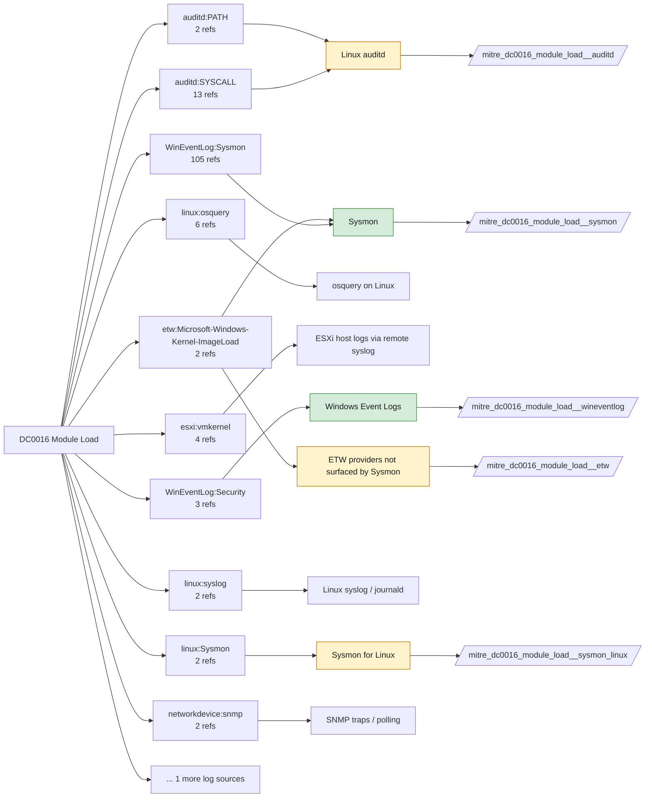

# DC0016 Module Load

[ATT&CK](https://attack.mitre.org/datacomponents/DC0016) · version 3.1 · modified 2026-10-13 · ATT&CK release 20.1

Status: **Live** · umbrella eventtype `mitre_dc0016_module_load`

> When a process or program dynamically attaches a shared library, module, or plugin into its memory space. This action is typically performed to extend the functionality of an application, access shared system resources, or interact with kernel-mode components.

## Why this component matters

DLL side-loading, unsigned module injection, LSASS credential dumpers and COM hijacks all show up as image loads. Sysmon EID 7 is the only broadly deployable source and is also the most expensive one; CodeIntegrity 3033/3063 add the signature-enforcement failures.

ATT&CK v20.1 has **130 analytics** across **110 detection strategies** that read this component, covering **110 techniques**. Tactics most dependent on it: stealth (53), persistence (31), execution (23), privilege-escalation (22).

Analytic references by platform: Windows 101, macOS 14, Linux 11, ESXi 2, Office Suite 1, Network Devices 1

## Where it comes from



## Requirements

Component specific:

- Sysmon ImageLoad (EID 7) is off in minimal configs and is high volume; scope it to interesting images (LSASS, unsigned, non-system paths) in the Sysmon config rather than in Splunk.
- Solidcore PROCESS_HIJACK_ATTEMPTED covers injection attempts into protected processes when Application Control memory protection is on.

Per feed (from `config/stack.yml` and `config/log_sources.yml`):

| Feed | Status | Sourcetype or source | Constraint | Origin | TA / collector |
|---|---|---|---|---|---|
| `solidcore` | live | sourcetype=`mcafee:epo` | `(threat_name=PROCESS_HIJACK_ATTEMPTED OR event_description=PROCESS_HIJACK_ATTEMPTED) (product_name="Solidcore*")` | defaults | Arrives through the ePO TA; Solidcore events carry event names such as FILE_CREATED, FILE_MODIFIED, FILE_DELETED, EXECUTION_DENIED, REG_VALUE_MODIFIED, PROCESS_HIJACK_ATTEMPTED. Verify field names (threat_name / event_description) in your data. |
| `sysmon` | live | source=`XmlWinEventLog:Microsoft-Windows-Sysmon/Operational` | `EventCode IN (7)` | defaults | Splunk Add-on for Sysmon (needs Splunk_TA_windows for XML parsing) |
| `wineventlog` | live | source=`XmlWinEventLog:Application`, source=`XmlWinEventLog:Microsoft-Windows-CodeIntegrity/Operational`, source=`XmlWinEventLog:Security` | `EventCode IN (3033, 3063, 3077, 8001)` | defaults | Splunk Add-on for Microsoft Windows (Splunk_TA_windows), XML rendering (renderXml = true) |
| `auditd` | ready (tick in stack.yml) | sourcetype=`linux:audit` | `type IN (PATH, SYSCALL) (syscall IN (mmap, open, openat) OR SYSCALL IN (mmap, open, openat)) (name="*.so" OR name="*.so.*")` | defaults | Splunk Add-on for Unix and Linux (linux:audit) or auditd -> auditbeat/syslog |
| `etw` | ready (tick in stack.yml) | sourcetype=`etw:json` | `(ProviderName="Microsoft-Windows-Kernel-ImageLoad")` | derived | Requires a user-mode ETW consumer (SilkETW/Sealighter, Splunk Stream for NDIS, or an EDR that exposes the provider). No standard Splunk TA. |
| `sysmon_linux` | ready (tick in stack.yml) | sourcetype=`sysmon:linux` | `EventCode IN (7)` | defaults | Splunk Add-on for Sysmon for Linux |

Collection prerequisites:

- **solidcore**: Change Control file and registry monitoring rules scoped to the paths/keys of interest; Application Control in Enabled (not Observe) mode for EXECUTION_DENIED.
- **sysmon**: Sysmon deployed with a maintained modular configuration (e.g. sysmon-modular or SwiftOnSecurity). Event IDs referenced by a data component only exist if the config includes that rule group (ProcessAccess=10, ImageLoad=7, DNS=22, FileDelete=23/26, ClipboardChange=24, ProcessTampering=25, FileBlock=27/28 are off in minimal configs).
- **sysmon**: Hashes configured (SHA256 at least, IMPHASH useful) for File/Process metadata components.
- **wineventlog**: Advanced Audit Policy configured (at minimum Process Creation, Logon, Account Management, Object Access, Policy Change, Privilege Use, Detailed Tracking). Without the matching subcategory the EventCodes below never fire.
- **wineventlog**: Include command line in process creation events enabled for 4688 (Computer Configuration > Administrative Templates > System > Audit Process Creation).
- **wineventlog**: PowerShell Script Block Logging (4104) and Module Logging (4103) enabled via GPO for the PowerShell/Operational channel.
- **wineventlog**: Object access events (4656/4663/4657/4660/4670) require SACLs on the files/keys of interest.
- **wineventlog**: Non-default channels (TaskScheduler, WMI-Activity, CodeIntegrity, Defender, Firewall, WinRM, SMBClient/Server...) must be listed as inputs in Splunk_TA_windows inputs.conf; several are disabled by default in Windows.
- **auditd**: audit rules for execve, connect, open/openat on sensitive paths, ptrace, module load, mount, setuid; a Neo23x0/auditd baseline or Florian Roth's rule set is a reasonable start.
- **auditd**: log_format = ENRICHED in auditd.conf so syscall names and uids resolve (otherwise syscall numbers are architecture dependent).

Review notes: `wineventlog` has 2 ATT&CK reference(s) with no usable event filter (prose channel), constraint origin is *defaults*.

## Splunk

Eventtypes (literal constraints, see `dist/splunk/TA-mitre-attack-datacomponents/default/eventtypes.conf`):

```ini
[mitre_dc0016_module_load__solidcore]
search = index=epo sourcetype="mcafee:epo" (threat_name=PROCESS_HIJACK_ATTEMPTED OR event_description=PROCESS_HIJACK_ATTEMPTED) (product_name="Solidcore*")

[mitre_dc0016_module_load__sysmon]
search = index=sysmon source="XmlWinEventLog:Microsoft-Windows-Sysmon/Operational" EventCode IN (7)

[mitre_dc0016_module_load__wineventlog]
search = index=wineventlog source IN ("XmlWinEventLog:Application", "XmlWinEventLog:Microsoft-Windows-CodeIntegrity/Operational", "XmlWinEventLog:Security") EventCode IN (3033, 3063, 3077, 8001)

[mitre_dc0016_module_load__auditd]
search = index=linux sourcetype="linux:audit" type IN (PATH, SYSCALL) (syscall IN (mmap, open, openat) OR SYSCALL IN (mmap, open, openat)) (name="*.so" OR name="*.so.*")
disabled = 1

[mitre_dc0016_module_load__etw]
search = index=etw sourcetype="etw:json" (ProviderName="Microsoft-Windows-Kernel-ImageLoad")
disabled = 1

[mitre_dc0016_module_load__sysmon_linux]
search = index=linux sourcetype="sysmon:linux" EventCode IN (7)
disabled = 1

[mitre_dc0016_module_load]
search = eventtype=mitre_dc0016_module_load__solidcore OR eventtype=mitre_dc0016_module_load__sysmon OR eventtype=mitre_dc0016_module_load__wineventlog OR eventtype=mitre_dc0016_module_load__auditd OR eventtype=mitre_dc0016_module_load__etw OR eventtype=mitre_dc0016_module_load__sysmon_linux
```

Macros for analytics: `` `mitre_dc0016` `` (umbrella), `` `mitre_dc0016_solidcore` ``, `` `mitre_dc0016_sysmon` ``, `` `mitre_dc0016_wineventlog` ``, `` `mitre_dc0016_auditd` ``, `` `mitre_dc0016_etw` ``, `` `mitre_dc0016_sysmon_linux` ``, `` `mitre_dc0016_filter` `` (site exclusions).
CIM: `Endpoint.Processes` via `` `mitre_dc0016_dm` `` / `` `mitre_dc0016_dm_where` `` for `tstats`. CIM tags emitted for: none (no feed is known CIM-compliant for this model).

## Sigma

Generic logsource categories scoped by this component in `dist/sigma/pipelines/splunk_mitre_dc.yml`: product `windows`: `image_load`.

## Dependents

Top techniques detected through this component (of 110):

| Technique | Name | Tactics | Analytics using this DC |
|---|---|---|---|
| [T1056.004](https://attack.mitre.org/techniques/T1056/004) | Credential API Hooking | collection, credential-access | 3 |
| [T1106](https://attack.mitre.org/techniques/T1106) | Native API | execution | 3 |
| [T1129](https://attack.mitre.org/techniques/T1129) | Shared Modules | execution | 3 |
| [T1560.002](https://attack.mitre.org/techniques/T1560/002) | Archive via Library | collection | 3 |
| [T1014](https://attack.mitre.org/techniques/T1014) | Rootkit | stealth | 2 |
| [T1027.014](https://attack.mitre.org/techniques/T1027/014) | Polymorphic Code | stealth | 2 |
| [T1055](https://attack.mitre.org/techniques/T1055) | Process Injection | stealth, privilege-escalation | 2 |
| [T1068](https://attack.mitre.org/techniques/T1068) | Exploitation for Privilege Escalation | privilege-escalation | 2 |
| [T1137.002](https://attack.mitre.org/techniques/T1137/002) | Office Test | persistence | 2 |
| [T1497](https://attack.mitre.org/techniques/T1497) | Virtualization/Sandbox Evasion | stealth, discovery | 2 |
| [T1505.002](https://attack.mitre.org/techniques/T1505/002) | Transport Agent | persistence | 2 |
| [T1573.001](https://attack.mitre.org/techniques/T1573/001) | Symmetric Cryptography | command-and-control | 2 |
| [T1573.002](https://attack.mitre.org/techniques/T1573/002) | Asymmetric Cryptography | command-and-control | 2 |
| [T1574](https://attack.mitre.org/techniques/T1574) | Hijack Execution Flow | stealth, execution | 2 |
| [T1620](https://attack.mitre.org/techniques/T1620) | Reflective Code Loading | stealth | 2 |
| … | 95 more | | |

Full list: `lookups/mitre_attack_analytics.csv` filtered on `dc_ids` containing `DC0016`.
