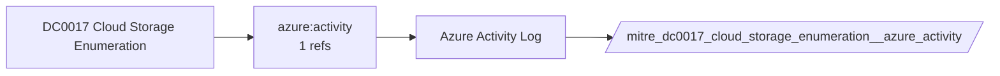

# DC0017 Cloud Storage Enumeration

[ATT&CK](https://attack.mitre.org/datacomponents/DC0017) · version 2.0 · modified 2025-11-12 · ATT&CK release 20.1

Umbrella eventtype `mitre_dc0017_cloud_storage_enumeration` over 1 feed(s)

> Cloud Storage Enumeration involves retrieving a list of available cloud storage infrastructure, such as buckets, containers, or objects, within a cloud environment. This activity may be performed for legitimate administrative purposes or malicious reconnaissance by adversaries seeking to identify accessible storage resources.Examples:  - AWS S3 Bucket Enumeration: An AWS user lists all buckets using the `ListBuckets` API call. - Azure Blob Storage Container Enumeration: A user retrieves a list of all containers within a storage account using the Azure Storage SDK or API. - Google Cloud Storage Bucket Enumeration: A Google Cloud user lists all buckets within a project using the `storage.buckets.list` API. - OpenStack Swift Container Enumeration: A user retrieves a list of containers in OpenStack Swift using the `GET` method on the storage endpoint.

## Why this component matters

ATT&CK v20.1 has **3 analytics** across **3 detection strategies** that read this component, covering **3 techniques**. Tactics most dependent on it: discovery (2), impact (1).

Analytic references by platform: IaaS 3

## Where it comes from



## Requirements

Per feed (from `config/stack.yml` and `config/log_sources.yml`):

| Feed | Schedule | Sourcetype or source | Constraint | Origin | TA / collector |
|---|---|---|---|---|---|
| `azure_activity` | scheduled | sourcetype=`mscs:azure:audit` | `(whole feed)` | derived | Splunk Add-on for Microsoft Cloud Services (mscs:azure:audit) |

Collection prerequisites:

- **azure_activity**: Export Activity Log for every subscription to the Event Hub.

Review notes: `azure_activity` has 1 ATT&CK reference(s) with no usable event filter (prose channel), constraint origin is *derived*.

## Splunk

Eventtypes (literal constraints, see `dist/splunk/TA-mitre-attack-datacomponents/default/eventtypes.conf`):

```ini
[mitre_dc0017_cloud_storage_enumeration__azure_activity]
search = index=azure sourcetype="mscs:azure:audit"

[mitre_dc0017_cloud_storage_enumeration]
search = eventtype=mitre_dc0017_cloud_storage_enumeration__azure_activity
```

Macros for analytics: `` `mitre_dc0017` `` (umbrella), `` `mitre_dc0017_azure_activity` ``, `` `mitre_dc0017_filter` `` (site exclusions).
CIM: no data model mapping; analytics on this component run as raw eventtype searches.

## Sigma

No generic Sigma category maps to this component; rules use `product`/`service` logsources, which the pipeline maps to index and sourcetype.

## Dependents

Top techniques detected through this component (of 3):

| Technique | Name | Tactics | Analytics using this DC |
|---|---|---|---|
| [T1491.002](https://attack.mitre.org/techniques/T1491/002) | External Defacement | impact | 1 |
| [T1580](https://attack.mitre.org/techniques/T1580) | Cloud Infrastructure Discovery | discovery | 1 |
| [T1619](https://attack.mitre.org/techniques/T1619) | Cloud Storage Object Discovery | discovery | 1 |

Full list: `lookups/mitre_attack_analytics.csv` filtered on `dc_ids` containing `DC0017`.
