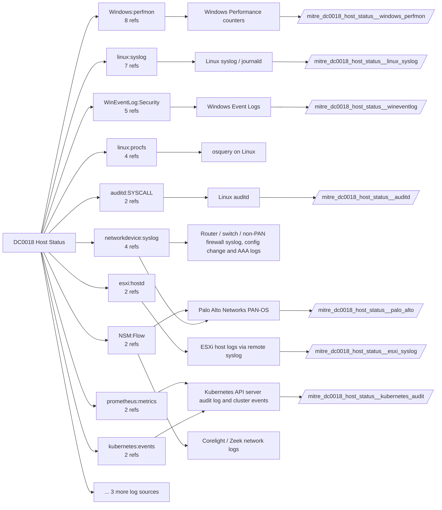

# DC0018 Host Status

[ATT&CK](https://attack.mitre.org/datacomponents/DC0018) · version 2.2 · modified 2026-10-13 · ATT&CK release 20.1

Umbrella eventtype `mitre_dc0018_host_status` over 9 feed(s)

> Logging, messaging, and other artifacts that highlight the health and operational state of host-based security sensors, such as Endpoint Detection and Response (EDR) agents, antivirus software, logging services, and system monitoring tools. Monitoring sensor health is essential for detecting misconfigurations, sensor failures, tampering, or deliberate security control evasion by adversaries.  *Data Collection Measures:*  - Windows Event Logs:     - Event ID 1074 (System Shutdown): Detects unexpected system reboots/shutdowns.     - Event ID 6006 (Event Log Stopped): Logs when Windows event logging is stopped.     - Event ID 16 (Sysmon): Detects configuration state changes that may indicate log tampering.     - Event ID 12 (Windows Defender Status Change) – Detects changes in Windows Defender state. - Linux/macOS Monitoring:     - `/var/log/syslog`, `/var/log/auth.log`, `/var/log/kern.log`     - Journald (journalctl) for kernel and system alerts. - Endpoint Detection and Response (EDR) Tools:     - Monitor agent health status, detect sensor tampering, and alert on missing telemetry. - Mobile Threat Intelligence Logs:     - Samsung Knox, SafetyNet, iOS Secure Enclave provide sensor health status for mobile endpoints.

## Why this component matters

Security control health: Defender/ENS disabled, audit log cleared (1102), Sysmon stopped, auditd stopped, ESXi services changed, PAN-OS system alerts. Also where missing-telemetry checks belong.

ATT&CK v20.1 has **36 analytics** across **14 detection strategies** that read this component, covering **14 techniques**. Tactics most dependent on it: impact (27), initial-access (3), defense-impairment (3), exfiltration (1).

Analytic references by platform: Windows 9, macOS 8, IaaS 7, Linux 7, Containers 2, Network Devices 2, ESXi 1

## Where it comes from



## Requirements

Component specific:

- ePO must forward product status and tamper events, not only threat detections.
- Windows System channel for 7036 and shutdown events; Security for 1100/1102.

Per feed (from `config/stack.yml` and `config/log_sources.yml`):

| Feed | Schedule | Sourcetype or source | Constraint | Origin | TA / collector |
|---|---|---|---|---|---|
| `auditd` | scheduled | sourcetype=`linux:audit` | `type IN (CONFIG_CHANGE, DAEMON_ABORT, DAEMON_END, DAEMON_START, SERVICE_START, SERVICE_STOP)` | defaults | Splunk Add-on for Unix and Linux (linux:audit) or auditd -> auditbeat/syslog |
| `esxi_syslog` | scheduled | sourcetype=`vmware:esxlog:hostd`, sourcetype=`vmware:esxlog:vobd` | `(whole feed)` | defaults | Splunk Add-on for VMware ESXi Logs (vmware:esxlog:<log>) |
| `kubernetes_audit` | scheduled | sourcetype=`kube:objects:events` | `(whole feed)` | defaults | Splunk OpenTelemetry Collector for Kubernetes / Splunk Connect for Kubernetes |
| `linux_syslog` | scheduled | sourcetype=`linux_messages_syslog`, sourcetype=`linux_secure`, sourcetype=`syslog` | `(process=auditd OR process=systemd OR process=kernel OR rsyslogd)` | defaults | Splunk Add-on for Unix and Linux (syslog, linux_secure, linux_messages_syslog) |
| `palo_alto` | scheduled | sourcetype=`pan:system` | `(whole feed)` | defaults | Splunk Add-on for Palo Alto Networks (pan:*) |
| `sysmon` | scheduled | source=`XmlWinEventLog:Microsoft-Windows-Sysmon/Operational` | `EventCode IN (4, 16, 255)` | defaults | Splunk Add-on for Sysmon (needs Splunk_TA_windows for XML parsing) |
| `trellix_epo` | scheduled | sourcetype=`mcafee:epo:syslog` | `(whole feed)` | defaults | Splunk Add-on for McAfee ePO Syslog (sourcetype mcafee:epo:syslog, documented by Splunk). If ePO data arrives another way (DB Connect pull, a community Trellix REST add-on such as trellix_epo:threat_events), change the sourcetype here. |
| `windows_perfmon` | scheduled | sourcetype=`Perfmon:*` | `(whole feed)` | derived | Splunk_TA_windows perfmon inputs |
| `wineventlog` | scheduled | source=`XmlWinEventLog:Microsoft-Windows-Windows Defender/Operational`, source=`XmlWinEventLog:Security`, source=`XmlWinEventLog:System` | `EventCode IN (104, 1001, 1074, 1100, 1102, 5001, 5004, 5007, 5010, 5012, 6005, 6006, 6008, 7036, 7045)` | defaults | Splunk Add-on for Microsoft Windows (Splunk_TA_windows), XML rendering (renderXml = true) |

Collection prerequisites:

- **auditd**: audit rules for execve, connect, open/openat on sensitive paths, ptrace, module load, mount, setuid; a Neo23x0/auditd baseline or Florian Roth's rule set is a reasonable start.
- **auditd**: log_format = ENRICHED in auditd.conf so syscall names and uids resolve (otherwise syscall numbers are architecture dependent).
- **esxi_syslog**: Syslog.global.logHost set on every host; ESXi Shell/SSH audit enabled; consider Syslog.global.auditRecord (ESXi 8).
- **kubernetes_audit**: Audit policy at Metadata level minimum
- **kubernetes_audit**: RequestResponse for secrets/pods/exec; ship the audit log file from control-plane nodes.
- **palo_alto**: Log forwarding profiles attached to every security rule (traffic start+end, threat, url, wildfire, data).
- **palo_alto**: System and Config logs forwarded from each firewall / Panorama; GlobalProtect logs enabled.
- **palo_alto**: URL filtering and Threat Prevention licensed for pan:threat subtypes url/vulnerability/virus/spyware.
- **palo_alto**: Operational (show/debug) commands are not in config or system logs by default. Enable administrator activity audit tracking (Device > Setup > Management > Logging and Reporting, PAN-OS 10.1+) and forward the audit log if you want CLI discovery analytics for the firewall.
- **sysmon**: Sysmon deployed with a maintained modular configuration (e.g. sysmon-modular or SwiftOnSecurity). Event IDs referenced by a data component only exist if the config includes that rule group (ProcessAccess=10, ImageLoad=7, DNS=22, FileDelete=23/26, ClipboardChange=24, ProcessTampering=25, FileBlock=27/28 are off in minimal configs).
- **sysmon**: Hashes configured (SHA256 at least, IMPHASH useful) for File/Process metadata components.
- **trellix_epo**: ePO configured to forward threat events to Splunk (syslog or DB pull); confirm product_name/threat_type fields populate.
- **trellix_epo**: ENS AMSI and Exploit Prevention enabled if AMSI-type analytics are expected.
- **wineventlog**: Advanced Audit Policy configured (at minimum Process Creation, Logon, Account Management, Object Access, Policy Change, Privilege Use, Detailed Tracking). Without the matching subcategory the EventCodes below never fire.
- **wineventlog**: Include command line in process creation events enabled for 4688 (Computer Configuration > Administrative Templates > System > Audit Process Creation).
- **wineventlog**: PowerShell Script Block Logging (4104) and Module Logging (4103) enabled via GPO for the PowerShell/Operational channel.
- **wineventlog**: Object access events (4656/4663/4657/4660/4670) require SACLs on the files/keys of interest.
- **wineventlog**: Non-default channels (TaskScheduler, WMI-Activity, CodeIntegrity, Defender, Firewall, WinRM, SMBClient/Server...) must be listed as inputs in Splunk_TA_windows inputs.conf; several are disabled by default in Windows.

Review notes: `kubernetes_audit` has 4 ATT&CK reference(s) with no usable event filter (prose channel), constraint origin is *defaults*; `linux_syslog` has 7 ATT&CK reference(s) with no usable event filter (prose channel), constraint origin is *defaults*; `windows_perfmon` has 8 ATT&CK reference(s) with no usable event filter (prose channel), constraint origin is *derived*; `wineventlog` has 2 ATT&CK reference(s) with no usable event filter (prose channel), constraint origin is *defaults*.

## Splunk

Eventtypes (literal constraints, see `dist/splunk/TA-mitre-attack-datacomponents/default/eventtypes.conf`):

```ini
[mitre_dc0018_host_status__auditd]
search = index=linux sourcetype="linux:audit" type IN (CONFIG_CHANGE, DAEMON_ABORT, DAEMON_END, DAEMON_START, SERVICE_START, SERVICE_STOP)

[mitre_dc0018_host_status__esxi_syslog]
search = index=vmware sourcetype IN ("vmware:esxlog:hostd", "vmware:esxlog:vobd")

[mitre_dc0018_host_status__kubernetes_audit]
search = index=k8s sourcetype="kube:objects:events"

[mitre_dc0018_host_status__linux_syslog]
search = index=linux sourcetype IN (linux_messages_syslog, linux_secure, syslog) (process=auditd OR process=systemd OR process=kernel OR rsyslogd)

[mitre_dc0018_host_status__palo_alto]
search = index=pan_logs sourcetype="pan:system"

[mitre_dc0018_host_status__sysmon]
search = index=sysmon source="XmlWinEventLog:Microsoft-Windows-Sysmon/Operational" EventCode IN (4, 16, 255)

[mitre_dc0018_host_status__trellix_epo]
search = index=epo sourcetype="mcafee:epo:syslog"

[mitre_dc0018_host_status__windows_perfmon]
search = index=perfmon sourcetype="Perfmon:*"

[mitre_dc0018_host_status__wineventlog]
search = index=wineventlog source IN ("XmlWinEventLog:Microsoft-Windows-Windows Defender/Operational", "XmlWinEventLog:Security", "XmlWinEventLog:System") EventCode IN (104, 1001, 1074, 1100, 1102, 5001, 5004, 5007, 5010, 5012, 6005, 6006, 6008, 7036, 7045)

[mitre_dc0018_host_status]
search = eventtype=mitre_dc0018_host_status__auditd OR eventtype=mitre_dc0018_host_status__esxi_syslog OR eventtype=mitre_dc0018_host_status__kubernetes_audit OR eventtype=mitre_dc0018_host_status__linux_syslog OR eventtype=mitre_dc0018_host_status__palo_alto OR eventtype=mitre_dc0018_host_status__sysmon OR eventtype=mitre_dc0018_host_status__trellix_epo OR eventtype=mitre_dc0018_host_status__windows_perfmon OR eventtype=mitre_dc0018_host_status__wineventlog
```

Macros for analytics: `` `mitre_dc0018` `` (umbrella), `` `mitre_dc0018_auditd` ``, `` `mitre_dc0018_esxi_syslog` ``, `` `mitre_dc0018_kubernetes_audit` ``, `` `mitre_dc0018_linux_syslog` ``, `` `mitre_dc0018_palo_alto` ``, `` `mitre_dc0018_sysmon` ``, `` `mitre_dc0018_trellix_epo` ``, `` `mitre_dc0018_windows_perfmon` ``, `` `mitre_dc0018_wineventlog` ``, `` `mitre_dc0018_filter` `` (site exclusions).
CIM: `Endpoint.Services` via `` `mitre_dc0018_dm` `` / `` `mitre_dc0018_dm_where` `` for `tstats`. CIM tags emitted for: none (no feed is known CIM-compliant for this model).

## Sigma

Generic logsource categories scoped by this component in `dist/sigma/pipelines/splunk_mitre_dc.yml`: product `windows`: `sysmon_status`.

## Dependents

Top techniques detected through this component (of 14):

| Technique | Name | Tactics | Analytics using this DC |
|---|---|---|---|
| [T1499](https://attack.mitre.org/techniques/T1499) | Endpoint Denial of Service | impact | 6 |
| [T1529](https://attack.mitre.org/techniques/T1529) | System Shutdown/Reboot | impact | 6 |
| [T1496](https://attack.mitre.org/techniques/T1496) | Resource Hijacking | impact | 5 |
| [T1195.003](https://attack.mitre.org/techniques/T1195/003) | Compromise Hardware Supply Chain | initial-access | 4 |
| [T1498.002](https://attack.mitre.org/techniques/T1498/002) | Reflection Amplification | impact | 4 |
| [T1499.001](https://attack.mitre.org/techniques/T1499/001) | OS Exhaustion Flood | impact | 4 |
| [T1499.002](https://attack.mitre.org/techniques/T1499/002) | Service Exhaustion Flood | impact | 4 |
| [T1499.003](https://attack.mitre.org/techniques/T1499/003) | Application Exhaustion Flood | impact | 3 |
| [T1685.003](https://attack.mitre.org/techniques/T1685/003) | Modify or Spoof Tool UI | defense-impairment | 3 |
| [T1011](https://attack.mitre.org/techniques/T1011) | Exfiltration Over Other Network Medium | exfiltration | 2 |
| [T1496.001](https://attack.mitre.org/techniques/T1496/001) | Compute Hijacking | impact | 2 |
| [T1498.001](https://attack.mitre.org/techniques/T1498/001) | Direct Network Flood | impact | 2 |
| [T1548.006](https://attack.mitre.org/techniques/T1548/006) | TCC Manipulation | privilege-escalation | 2 |
| [T1685](https://attack.mitre.org/techniques/T1685) | Disable or Modify Tools | defense-impairment | 2 |

Full list: `lookups/mitre_attack_analytics.csv` filtered on `dc_ids` containing `DC0018`.
