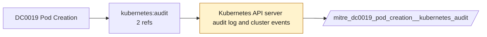

# DC0019 Pod Creation

[ATT&CK](https://attack.mitre.org/datacomponents/DC0019) · version 2.0 · modified 2025-10-21 · ATT&CK release 20.1

Status: **Ready** (needs a feed you have not ticked) · umbrella eventtype `mitre_dc0019_pod_creation`

> The initial deployment or instantiation of a new pod in a containerized environment. This includes creating a pod manually, through orchestration tools (Kubernetes), or via Infrastructure-as-Code (IaC) configurations. A Pod is the smallest deployable unit in Kubernetes, typically containing one or more containers. Creation methods include: - Direct pod deployment (`kubectl run`, `kubectl apply`) - Automated deployment via CI/CD pipelines (e.g., ArgoCD, Jenkins, GitOps) - Infrastructure-as-Code (IaC) templates (e.g., Terraform, Helm Charts) - API-based deployments via Kubernetes control plane (create_pod API calls) - Pods can be ephemeral (short-lived) or persistent (part of a StatefulSet or Deployment).  *Data Collection Measures:*  - Kubernetes Audit Logs     - Captures all API requests, including pod `create` events. - Kube-api server Logs	     - Monitors API calls related to pod deployments and modifications. Related Events: `PodSandboxChanged`, `SyncLoop`, `Created pod` - Container Runtime Logs	     - Logs from CRI-O, containerd, or Docker capture pod creation events. Related Events: `container start`, `container create` - Cloud Provider Logs	     - GKE, EKS, AKS logs provide insights into Kubernetes API interactions. - SIEM & Log Aggregation	     - Integrates Kubernetes logs into SIEM solutions. - EDR/XDR Solutions	     - Monitors container-based activity for anomalous pod creations.

## Why this component matters

Kubernetes pod creation via API audit; the control-plane view of Container Creation.

ATT&CK v20.1 has **2 analytics** across **2 detection strategies** that read this component, covering **2 techniques**. Tactics most dependent on it: persistence (1), privilege-escalation (1), execution (1).

Analytic references by platform: Containers 2

## Where it comes from



## Requirements

Per feed (from `config/stack.yml` and `config/log_sources.yml`):

| Feed | Status | Sourcetype or source | Constraint | Origin | TA / collector |
|---|---|---|---|---|---|
| `kubernetes_audit` | ready (tick in stack.yml) | sourcetype=`kube:apiserver-audit` | `verb IN (create) (objectRef.resource=pods)` | defaults | Splunk OpenTelemetry Collector for Kubernetes / Splunk Connect for Kubernetes |

Collection prerequisites:

- **kubernetes_audit**: Audit policy at Metadata level minimum
- **kubernetes_audit**: RequestResponse for secrets/pods/exec; ship the audit log file from control-plane nodes.

## Splunk

Eventtypes (literal constraints, see `dist/splunk/TA-mitre-attack-datacomponents/default/eventtypes.conf`):

```ini
[mitre_dc0019_pod_creation__kubernetes_audit]
search = index=k8s sourcetype="kube:apiserver-audit" verb IN (create) (objectRef.resource=pods)
disabled = 1

[mitre_dc0019_pod_creation]
search = eventtype=mitre_dc0019_pod_creation__kubernetes_audit
```

Macros for analytics: `` `mitre_dc0019` `` (umbrella), `` `mitre_dc0019_kubernetes_audit` ``, `` `mitre_dc0019_filter` `` (site exclusions).
CIM: no data model mapping; analytics on this component run as raw eventtype searches.

## Sigma

No generic Sigma category maps to this component; rules use `product`/`service` logsources, which the pipeline maps to index and sourcetype.

## Dependents

Top techniques detected through this component (of 2):

| Technique | Name | Tactics | Analytics using this DC |
|---|---|---|---|
| [T1059.013](https://attack.mitre.org/techniques/T1059/013) | Container CLI/API | execution | 1 |
| [T1543.005](https://attack.mitre.org/techniques/T1543/005) | Container Service | persistence, privilege-escalation | 1 |

Full list: `lookups/mitre_attack_analytics.csv` filtered on `dc_ids` containing `DC0019`.
