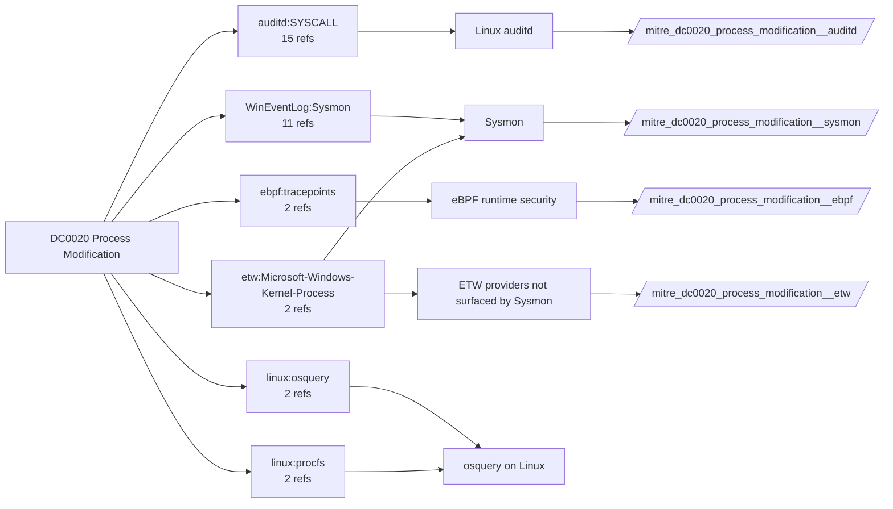

# DC0020 Process Modification

[ATT&CK](https://attack.mitre.org/datacomponents/DC0020) · version 2.0 · modified 2025-11-12 · ATT&CK release 20.1

Umbrella eventtype `mitre_dc0020_process_modification` over 4 feed(s)

> Changes made to a running process, such as writing data into memory, modifying execution behavior, or injecting code into an existing process. Adversaries frequently modify processes to execute malicious payloads, evade detection, or gain escalated privileges.

## Why this component matters

Covers tampering with a running process image: hollowing, herpaderping, remote thread creation. Sysmon EID 25 (ProcessTampering) and EID 8 (CreateRemoteThread) are the signals; EID 10 adds the handle.

ATT&CK v20.1 has **29 analytics** across **24 detection strategies** that read this component, covering **24 techniques**. Tactics most dependent on it: stealth (19), privilege-escalation (8), collection (5), initial-access (4).

Analytic references by platform: Linux 11, Windows 11, macOS 7

## Where it comes from



## Requirements

Component specific:

- Sysmon ProcessTampering (EID 25) requires Sysmon 13+ and an explicit rule group.

Per feed (from `config/stack.yml` and `config/log_sources.yml`):

| Feed | Schedule | Sourcetype or source | Constraint | Origin | TA / collector |
|---|---|---|---|---|---|
| `auditd` | scheduled | sourcetype=`linux:audit` | `type IN (SYSCALL) (syscall IN (memfd_create, mprotect, process_vm_writev, ptrace) OR SYSCALL IN (memfd_create, mprotect, process_vm_writev, ptrace))` | defaults | Splunk Add-on for Unix and Linux (linux:audit) or auditd -> auditbeat/syslog |
| `ebpf` | scheduled | sourcetype=`falco` | `(whole feed)` | derived | Vendor specific (falco JSON, tetragon) |
| `etw` | scheduled | sourcetype=`etw:json` | `(ProviderName="Microsoft-Windows-Kernel-Process")` | derived | Requires a user-mode ETW consumer (SilkETW/Sealighter, Splunk Stream for NDIS, or an EDR that exposes the provider). No standard Splunk TA. |
| `sysmon` | scheduled | source=`XmlWinEventLog:Microsoft-Windows-Sysmon/Operational` | `EventCode IN (8, 10, 25)` | defaults | Splunk Add-on for Sysmon (needs Splunk_TA_windows for XML parsing) |

Collection prerequisites:

- **auditd**: audit rules for execve, connect, open/openat on sensitive paths, ptrace, module load, mount, setuid; a Neo23x0/auditd baseline or Florian Roth's rule set is a reasonable start.
- **auditd**: log_format = ENRICHED in auditd.conf so syscall names and uids resolve (otherwise syscall numbers are architecture dependent).
- **sysmon**: Sysmon deployed with a maintained modular configuration (e.g. sysmon-modular or SwiftOnSecurity). Event IDs referenced by a data component only exist if the config includes that rule group (ProcessAccess=10, ImageLoad=7, DNS=22, FileDelete=23/26, ClipboardChange=24, ProcessTampering=25, FileBlock=27/28 are off in minimal configs).
- **sysmon**: Hashes configured (SHA256 at least, IMPHASH useful) for File/Process metadata components.

Review notes: `ebpf` has 2 ATT&CK reference(s) with no usable event filter (prose channel), constraint origin is *derived*.

## Splunk

Eventtypes (literal constraints, see `dist/splunk/TA-mitre-attack-datacomponents/default/eventtypes.conf`):

```ini
[mitre_dc0020_process_modification__auditd]
search = index=linux sourcetype="linux:audit" type IN (SYSCALL) (syscall IN (memfd_create, mprotect, process_vm_writev, ptrace) OR SYSCALL IN (memfd_create, mprotect, process_vm_writev, ptrace))

[mitre_dc0020_process_modification__ebpf]
search = index=linux sourcetype=falco

[mitre_dc0020_process_modification__etw]
search = index=etw sourcetype="etw:json" (ProviderName="Microsoft-Windows-Kernel-Process")

[mitre_dc0020_process_modification__sysmon]
search = index=sysmon source="XmlWinEventLog:Microsoft-Windows-Sysmon/Operational" EventCode IN (8, 10, 25)

[mitre_dc0020_process_modification]
search = eventtype=mitre_dc0020_process_modification__auditd OR eventtype=mitre_dc0020_process_modification__ebpf OR eventtype=mitre_dc0020_process_modification__etw OR eventtype=mitre_dc0020_process_modification__sysmon
```

Macros for analytics: `` `mitre_dc0020` `` (umbrella), `` `mitre_dc0020_auditd` ``, `` `mitre_dc0020_ebpf` ``, `` `mitre_dc0020_etw` ``, `` `mitre_dc0020_sysmon` ``, `` `mitre_dc0020_filter` `` (site exclusions).
CIM: no data model mapping; analytics on this component run as raw eventtype searches.

## Sigma

Generic logsource categories scoped by this component in `dist/sigma/pipelines/splunk_mitre_dc.yml`: product `windows`: `process_tampering`.

## Dependents

Top techniques detected through this component (of 24):

| Technique | Name | Tactics | Analytics using this DC |
|---|---|---|---|
| [T1027.002](https://attack.mitre.org/techniques/T1027/002) | Software Packing | stealth | 2 |
| [T1027.016](https://attack.mitre.org/techniques/T1027/016) | Junk Code Insertion | stealth | 2 |
| [T1056.004](https://attack.mitre.org/techniques/T1056/004) | Credential API Hooking | collection, credential-access | 2 |
| [T1189](https://attack.mitre.org/techniques/T1189) | Drive-by Compromise | initial-access | 2 |
| [T1560.003](https://attack.mitre.org/techniques/T1560/003) | Archive via Custom Method | collection | 2 |
| [T1027.005](https://attack.mitre.org/techniques/T1027/005) | Indicator Removal from Tools | stealth | 1 |
| [T1027.013](https://attack.mitre.org/techniques/T1027/013) | Encrypted/Encoded File | stealth | 1 |
| [T1027.014](https://attack.mitre.org/techniques/T1027/014) | Polymorphic Code | stealth | 1 |
| [T1036.005](https://attack.mitre.org/techniques/T1036/005) | Match Legitimate Resource Name or Location | stealth | 1 |
| [T1036.011](https://attack.mitre.org/techniques/T1036/011) | Overwrite Process Arguments | stealth | 1 |
| [T1055](https://attack.mitre.org/techniques/T1055) | Process Injection | stealth, privilege-escalation | 1 |
| [T1055.002](https://attack.mitre.org/techniques/T1055/002) | Portable Executable Injection | stealth, privilege-escalation | 1 |
| [T1055.003](https://attack.mitre.org/techniques/T1055/003) | Thread Execution Hijacking | stealth, privilege-escalation | 1 |
| [T1055.004](https://attack.mitre.org/techniques/T1055/004) | Asynchronous Procedure Call | stealth, privilege-escalation | 1 |
| [T1055.005](https://attack.mitre.org/techniques/T1055/005) | Thread Local Storage | stealth, privilege-escalation | 1 |
| … | 9 more | | |

Full list: `lookups/mitre_attack_analytics.csv` filtered on `dc_ids` containing `DC0020`.
