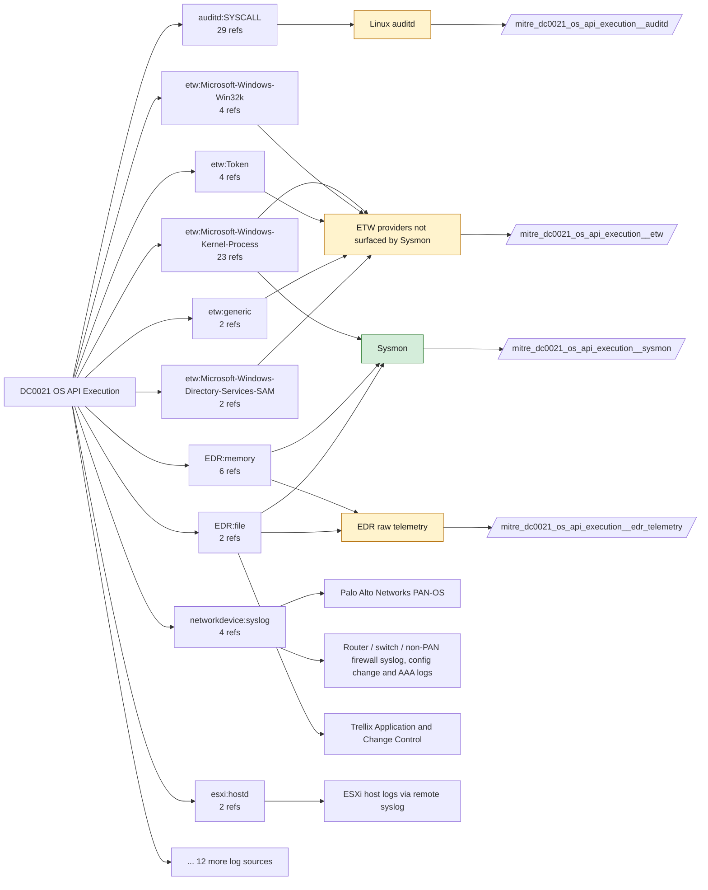

# DC0021 OS API Execution

[ATT&CK](https://attack.mitre.org/datacomponents/DC0021) · version 2.2 · modified 2026-10-13 · ATT&CK release 20.1

Status: **Live** · umbrella eventtype `mitre_dc0021_os_api_execution`

> Calls made by a process to operating system-provided Application Programming Interfaces (APIs). These calls are essential for interacting with system resources such as memory, files, and hardware, or for performing system-level tasks. Monitoring these calls can provide insight into a process's intent, especially if the process is malicious.

## Why this component matters

ATT&CK's catch-all for in-process API use (VirtualAllocEx, NtQueueApcThread, keyctl, ptrace). Nothing in your stack records API calls directly; Sysmon 8/10/25 and object-access auditing observe the side effects, and ETW providers or an EDR would close the gap.

ATT&CK v20.1 has **66 analytics** across **54 detection strategies** that read this component, covering **54 techniques**. Tactics most dependent on it: stealth (36), privilege-escalation (24), discovery (15), collection (6).

Analytic references by platform: Windows 28, Linux 16, macOS 15, IaaS 3, Network Devices 3, ESXi 1

## Where it comes from



## Requirements

Component specific:

- Treat the Sysmon-based eventtype as a partial proxy. The etw feed (Kernel-Process, Win32k, RPC, DotNETRuntime) is the honest source and is unticked.

Per feed (from `config/stack.yml` and `config/log_sources.yml`):

| Feed | Status | Sourcetype or source | Constraint | Origin | TA / collector |
|---|---|---|---|---|---|
| `sysmon` | live | source=`XmlWinEventLog:Microsoft-Windows-Sysmon/Operational` | `EventCode IN (8, 10, 25)` | defaults | Splunk Add-on for Sysmon (needs Splunk_TA_windows for XML parsing) |
| `wineventlog` | live | source=`XmlWinEventLog:Security` | `EventCode IN (4656, 4663)` | defaults | Splunk Add-on for Microsoft Windows (Splunk_TA_windows), XML rendering (renderXml = true) |
| `auditd` | ready (tick in stack.yml) | sourcetype=`linux:audit` | `type IN (SYSCALL) (syscall IN (bpf, keyctl, mmap, mprotect, process_vm_writev, ptrace, setns, unshare) OR SYSCALL IN (bpf, keyctl, mmap, mprotect, process_vm_writev, ptrace, setns, unshare))` | defaults | Splunk Add-on for Unix and Linux (linux:audit) or auditd -> auditbeat/syslog |
| `edr_telemetry` | ready (tick in stack.yml) | sourcetype=`edr:telemetry` | `(whole feed)` | derived | Vendor specific |
| `etw` | ready (tick in stack.yml) | sourcetype=`etw:json` | `(ProviderName="Microsoft-Windows-Kernel-Process")` | derived | Requires a user-mode ETW consumer (SilkETW/Sealighter, Splunk Stream for NDIS, or an EDR that exposes the provider). No standard Splunk TA. |

Collection prerequisites:

- **sysmon**: Sysmon deployed with a maintained modular configuration (e.g. sysmon-modular or SwiftOnSecurity). Event IDs referenced by a data component only exist if the config includes that rule group (ProcessAccess=10, ImageLoad=7, DNS=22, FileDelete=23/26, ClipboardChange=24, ProcessTampering=25, FileBlock=27/28 are off in minimal configs).
- **sysmon**: Hashes configured (SHA256 at least, IMPHASH useful) for File/Process metadata components.
- **wineventlog**: Advanced Audit Policy configured (at minimum Process Creation, Logon, Account Management, Object Access, Policy Change, Privilege Use, Detailed Tracking). Without the matching subcategory the EventCodes below never fire.
- **wineventlog**: Include command line in process creation events enabled for 4688 (Computer Configuration > Administrative Templates > System > Audit Process Creation).
- **wineventlog**: PowerShell Script Block Logging (4104) and Module Logging (4103) enabled via GPO for the PowerShell/Operational channel.
- **wineventlog**: Object access events (4656/4663/4657/4660/4670) require SACLs on the files/keys of interest.
- **wineventlog**: Non-default channels (TaskScheduler, WMI-Activity, CodeIntegrity, Defender, Firewall, WinRM, SMBClient/Server...) must be listed as inputs in Splunk_TA_windows inputs.conf; several are disabled by default in Windows.
- **auditd**: audit rules for execve, connect, open/openat on sensitive paths, ptrace, module load, mount, setuid; a Neo23x0/auditd baseline or Florian Roth's rule set is a reasonable start.
- **auditd**: log_format = ENRICHED in auditd.conf so syscall names and uids resolve (otherwise syscall numbers are architecture dependent).

Review notes: `wineventlog` has 4 ATT&CK reference(s) with no usable event filter (prose channel), constraint origin is *defaults*; `edr_telemetry` has 9 ATT&CK reference(s) with no usable event filter (prose channel), constraint origin is *derived*; `etw` has 22 ATT&CK reference(s) with no usable event filter (prose channel), constraint origin is *derived*.

## Splunk

Eventtypes (literal constraints, see `dist/splunk/TA-mitre-attack-datacomponents/default/eventtypes.conf`):

```ini
[mitre_dc0021_os_api_execution__sysmon]
search = index=sysmon source="XmlWinEventLog:Microsoft-Windows-Sysmon/Operational" EventCode IN (8, 10, 25)

[mitre_dc0021_os_api_execution__wineventlog]
search = index=wineventlog source="XmlWinEventLog:Security" EventCode IN (4656, 4663)

[mitre_dc0021_os_api_execution__auditd]
search = index=linux sourcetype="linux:audit" type IN (SYSCALL) (syscall IN (bpf, keyctl, mmap, mprotect, process_vm_writev, ptrace, setns, unshare) OR SYSCALL IN (bpf, keyctl, mmap, mprotect, process_vm_writev, ptrace, setns, unshare))
disabled = 1

[mitre_dc0021_os_api_execution__edr_telemetry]
search = index=edr sourcetype="edr:telemetry"
disabled = 1

[mitre_dc0021_os_api_execution__etw]
search = index=etw sourcetype="etw:json" (ProviderName="Microsoft-Windows-Kernel-Process")
disabled = 1

[mitre_dc0021_os_api_execution]
search = eventtype=mitre_dc0021_os_api_execution__sysmon OR eventtype=mitre_dc0021_os_api_execution__wineventlog OR eventtype=mitre_dc0021_os_api_execution__auditd OR eventtype=mitre_dc0021_os_api_execution__edr_telemetry OR eventtype=mitre_dc0021_os_api_execution__etw
```

Macros for analytics: `` `mitre_dc0021` `` (umbrella), `` `mitre_dc0021_sysmon` ``, `` `mitre_dc0021_wineventlog` ``, `` `mitre_dc0021_auditd` ``, `` `mitre_dc0021_edr_telemetry` ``, `` `mitre_dc0021_etw` ``, `` `mitre_dc0021_filter` `` (site exclusions).
CIM: no data model mapping; analytics on this component run as raw eventtype searches.

## Sigma

Generic logsource categories scoped by this component in `dist/sigma/pipelines/splunk_mitre_dc.yml`: product `windows`: `clipboard_capture`.

## Dependents

Top techniques detected through this component (of 54):

| Technique | Name | Tactics | Analytics using this DC |
|---|---|---|---|
| [T1125](https://attack.mitre.org/techniques/T1125) | Video Capture | collection | 3 |
| [T1036.009](https://attack.mitre.org/techniques/T1036/009) | Break Process Trees | stealth | 2 |
| [T1049](https://attack.mitre.org/techniques/T1049) | System Network Connections Discovery | discovery | 2 |
| [T1055](https://attack.mitre.org/techniques/T1055) | Process Injection | stealth, privilege-escalation | 2 |
| [T1124](https://attack.mitre.org/techniques/T1124) | System Time Discovery | discovery | 2 |
| [T1135](https://attack.mitre.org/techniques/T1135) | Network Share Discovery | discovery | 2 |
| [T1548](https://attack.mitre.org/techniques/T1548) | Abuse Elevation Control Mechanism | privilege-escalation | 2 |
| [T1565.002](https://attack.mitre.org/techniques/T1565/002) | Transmitted Data Manipulation | impact | 2 |
| [T1614](https://attack.mitre.org/techniques/T1614) | System Location Discovery | discovery | 2 |
| [T1620](https://attack.mitre.org/techniques/T1620) | Reflective Code Loading | stealth | 2 |
| [T1622](https://attack.mitre.org/techniques/T1622) | Debugger Evasion | stealth, discovery | 2 |
| [T1010](https://attack.mitre.org/techniques/T1010) | Application Window Discovery | discovery | 1 |
| [T1027](https://attack.mitre.org/techniques/T1027) | Obfuscated Files or Information | stealth | 1 |
| [T1027.007](https://attack.mitre.org/techniques/T1027/007) | Dynamic API Resolution | stealth | 1 |
| [T1033](https://attack.mitre.org/techniques/T1033) | System Owner/User Discovery | discovery | 1 |
| … | 39 more | | |

Full list: `lookups/mitre_attack_analytics.csv` filtered on `dc_ids` containing `DC0021`.

## Notes

- Most analytics on this component are better implemented against Process Access / Process Modification on your stack.
