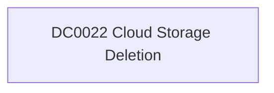

# DC0022 Cloud Storage Deletion

[ATT&CK](https://attack.mitre.org/datacomponents/DC0022) · version 2.0 · modified 2025-11-12 · ATT&CK release 20.1

Status: **Out of scope** for the current platform set

> Cloud Storage Deletion refers to the removal or destruction of cloud storage infrastructure, such as buckets, containers, or directories, within a cloud environment. Monitoring this activity is critical to detecting potential unauthorized or malicious actions, such as data destruction by adversaries or accidental deletions that may lead to data loss. Examples:   - AWS S3 Bucket Deletion: An AWS user deletes an S3 bucket using the `DeleteBucket` API call. - Azure Blob Storage Container Deletion: A user deletes a container in Azure Blob Storage using the `Delete Container` operation. - Google Cloud Storage Bucket Deletion: A Google Cloud user deletes a bucket using the `storage.buckets.delete` API. - OpenStack Swift Container Deletion: A user deletes a container in OpenStack Swift using the `DELETE` method.  This data component can be collected through the following measures:  Enable Logging for Cloud Storage Services  - AWS S3: Enable AWS CloudTrail to log DeleteBucket API actions. - Azure Blob Storage: Enable Azure Monitor and Diagnostic Logs to capture Delete Container operations. Use Azure Event Grid to capture and trigger alerts for container deletion. - Google Cloud Storage: Enable Data Access logs in Cloud Audit Logs to monitor storage.buckets.delete API calls. - OpenStack Swift: Configure Swift logging to capture DELETE requests for containers.  Centralized Logging and Analysis  - Use platforms like Splunk or native SIEMs to forward and analyze logs for anomalies in cloud storage deletions.

## Why this component matters

ATT&CK v20.1 has **2 analytics** across **2 detection strategies** that read this component, covering **2 techniques**. Tactics most dependent on it: impact (2).

Analytic references by platform: IaaS 2

## Where it comes from

## Requirements

Per feed (from `config/stack.yml` and `config/log_sources.yml`):

| Feed | Status | Sourcetypes | Constraint | Origin | TA / collector |
|---|---|---|---|---|---|

## Splunk

No eventtypes rendered: none of this component's log sources belong to an in-scope platform feed. See [gaps](../gaps.md).

## Sigma

No generic Sigma category maps to this component; rules use `product`/`service` logsources, which the pipeline maps to index and sourcetype.

## Dependents

Top techniques detected through this component (of 2):

| Technique | Name | Tactics | Analytics using this DC |
|---|---|---|---|
| [T1485](https://attack.mitre.org/techniques/T1485) | Data Destruction | impact | 1 |
| [T1490](https://attack.mitre.org/techniques/T1490) | Inhibit System Recovery | impact | 1 |

Full list: `lookups/mitre_attack_analytics.csv` filtered on `dc_ids` containing `DC0022`.
