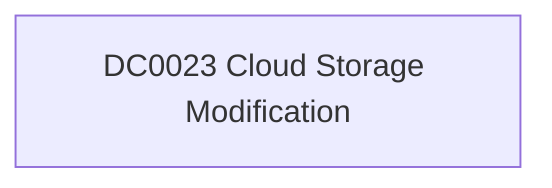

# DC0023 Cloud Storage Modification

[ATT&CK](https://attack.mitre.org/datacomponents/DC0023) · version 2.0 · modified 2025-11-12 · ATT&CK release 20.1

Status: **Out of scope** for the current platform set

> Cloud Storage Modification involves tracking changes made to cloud storage infrastructure, including updates to settings, permissions, or stored data. Examples include modifying object access control lists (ACLs), uploading new objects, or updating bucket policies. Examples:   AWS S3: An object is uploaded or its ACL is modified. - Azure Blob Storage: A blob's metadata or permissions are updated. - Google Cloud Storage: An object's lifecycle policy is updated, or a bucket policy is changed. - OpenStack Swift: Modifications to container settings or uploading of new objects.

## Why this component matters

ATT&CK v20.1 has **5 analytics** across **3 detection strategies** that read this component, covering **3 techniques**. Tactics most dependent on it: exfiltration (3), impact (2).

Analytic references by platform: IaaS 3, Office Suite 1, SaaS 1

## Where it comes from

## Requirements

Per feed (from `config/stack.yml` and `config/log_sources.yml`):

| Feed | Status | Sourcetype or source | Constraint | Origin | TA / collector |
|---|---|---|---|---|---|

## Splunk

No eventtypes rendered: none of this component's log sources belong to an in-scope platform feed. See [gaps](../gaps.md).

## Sigma

No generic Sigma category maps to this component; rules use `product`/`service` logsources, which the pipeline maps to index and sourcetype.

## Dependents

Top techniques detected through this component (of 3):

| Technique | Name | Tactics | Analytics using this DC |
|---|---|---|---|
| [T1537](https://attack.mitre.org/techniques/T1537) | Transfer Data to Cloud Account | exfiltration | 3 |
| [T1485.001](https://attack.mitre.org/techniques/T1485/001) | Lifecycle-Triggered Deletion | impact | 1 |
| [T1486](https://attack.mitre.org/techniques/T1486) | Data Encrypted for Impact | impact | 1 |

Full list: `lookups/mitre_attack_analytics.csv` filtered on `dc_ids` containing `DC0023`.
