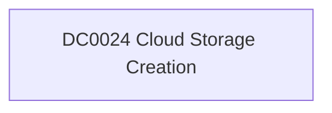

# DC0024 Cloud Storage Creation

[ATT&CK](https://attack.mitre.org/datacomponents/DC0024) · version 2.0 · modified 2025-11-12 · ATT&CK release 20.1

Status: **Out of scope** for the current platform set

> Cloud Storage Creation refers to the initial creation of a new cloud storage resource, such as buckets, containers, or directories, within a cloud environment. This action is critical to track as it might indicate the legitimate provisioning of resources or unauthorized actions taken by adversaries to stage, store, or exfiltrate data. Examples:   - AWS S3 Bucket Creation: An AWS user creates a new S3 bucket using the `CreateBucket` API call. - Azure Blob Storage Container Creation: A user creates a new container in Azure Blob Storage using the `Create Container` operation. - Google Cloud Storage Bucket Creation: A Google Cloud user creates a new bucket using `storage.buckets.create`. - OpenStack Swift Container Creation: A user creates a new container in OpenStack Swift using the `PUT` method.

## Why this component matters

ATT&CK v20.1 has **1 analytics** across **1 detection strategies** that read this component, covering **1 techniques**. Tactics most dependent on it: stealth (1).

Analytic references by platform: IaaS 1

## Where it comes from

## Requirements

Per feed (from `config/stack.yml` and `config/log_sources.yml`):

| Feed | Status | Sourcetypes | Constraint | Origin | TA / collector |
|---|---|---|---|---|---|

## Splunk

No eventtypes rendered: none of this component's log sources belong to an in-scope platform feed. See [gaps](../gaps.md).

## Sigma

No generic Sigma category maps to this component; rules use `product`/`service` logsources, which the pipeline maps to index and sourcetype.

## Dependents

Top techniques detected through this component (of 1):

| Technique | Name | Tactics | Analytics using this DC |
|---|---|---|---|
| [T1535](https://attack.mitre.org/techniques/T1535) | Unused/Unsupported Cloud Regions | stealth | 1 |

Full list: `lookups/mitre_attack_analytics.csv` filtered on `dc_ids` containing `DC0024`.
