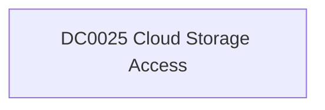

# DC0025 Cloud Storage Access

[ATT&CK](https://attack.mitre.org/datacomponents/DC0025) · version 2.0 · modified 2025-11-12 · ATT&CK release 20.1

**Out of scope** for the current platform set

> Cloud storage access refers to the retrieval or interaction with data stored in cloud infrastructure. This data component includes activities such as reading, downloading, or accessing files and objects within cloud storage systems. Common examples include API calls like GetObject in AWS S3, which retrieves objects from cloud buckets. Examples:   - AWS S3 Access: An adversary uses the `GetObject` API to retrieve sensitive data from an AWS S3 bucket. - Azure Blob Storage Access: A user accesses a blob in Azure Storage using `Get Blob` or `Get Blob Properties`. - Google Cloud Storage Access: An adversary uses `storage.objects.get` to download objects from - OpenStack Swift Storage Access: A user retrieves an object from OpenStack Swift using the `GET` method.

## Why this component matters

ATT&CK v20.1 has **13 analytics** across **11 detection strategies** that read this component, covering **11 techniques**. Tactics most dependent on it: collection (7), impact (2), execution (1), exfiltration (1).

Analytic references by platform: IaaS 8, SaaS 2, Office Suite 2, Windows 1

## Where it comes from

## Requirements

Per feed (from `config/stack.yml` and `config/log_sources.yml`):

| Feed | Schedule | Sourcetype or source | Constraint | Origin | TA / collector |
|---|---|---|---|---|---|

## Splunk

No eventtypes rendered: none of this component's log sources belong to an in-scope platform feed. See [gaps](../gaps.md).

## Sigma

No generic Sigma category maps to this component; rules use `product`/`service` logsources, which the pipeline maps to index and sourcetype.

## Dependents

Top techniques detected through this component (of 11):

| Technique | Name | Tactics | Analytics using this DC |
|---|---|---|---|
| [T1530](https://attack.mitre.org/techniques/T1530) | Data from Cloud Storage | collection | 3 |
| [T1048](https://attack.mitre.org/techniques/T1048) | Exfiltration Over Alternative Protocol | exfiltration | 1 |
| [T1074](https://attack.mitre.org/techniques/T1074) | Data Staged | collection | 1 |
| [T1074.002](https://attack.mitre.org/techniques/T1074/002) | Remote Data Staging | collection | 1 |
| [T1213](https://attack.mitre.org/techniques/T1213) | Data from Information Repositories | collection | 1 |
| [T1213.006](https://attack.mitre.org/techniques/T1213/006) | Databases | collection | 1 |
| [T1491](https://attack.mitre.org/techniques/T1491) | Defacement | impact | 1 |
| [T1491.002](https://attack.mitre.org/techniques/T1491/002) | External Defacement | impact | 1 |
| [T1528](https://attack.mitre.org/techniques/T1528) | Steal Application Access Token | credential-access | 1 |
| [T1619](https://attack.mitre.org/techniques/T1619) | Cloud Storage Object Discovery | discovery | 1 |
| [T1677](https://attack.mitre.org/techniques/T1677) | Poisoned Pipeline Execution | execution | 1 |

Full list: `lookups/mitre_attack_analytics.csv` filtered on `dc_ids` containing `DC0025`.
