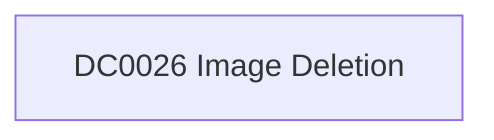

# DC0026 Image Deletion

[ATT&CK](https://attack.mitre.org/datacomponents/DC0026) · version 2.0 · modified 2025-10-21 · ATT&CK release 20.1

Status: **Out of scope** for the current platform set

> Removal of a virtual machine image in a cloud infrastructure (ex: Azure Compute Service Images DELETE) Examples:   - Azure Compute Service Image Deletion     - Example: Deleting a virtual machine image using Azure CLI: `az image delete --name MyImage --resource-group MyResourceGroup` - AWS EC2 AMI (Amazon Machine Image) Deletion     - Example: Deregistering an AMI in AWS: `aws ec2 deregister-image --image-id ami-1234567890abcdef0` - Google Cloud Compute Engine Image Deletion     - Example: Deleting a custom image in Google Cloud: `gcloud compute images delete my-custom-image` - VMware vSphere     - Example: Deleting a VM image/template from a vSphere environment:  This data component can be collected through the following measures:  Enable Cloud Platform Logging  - Azure: Enable "Activity Logs" to capture DELETE requests to `Microsoft.Compute/images`. - AWS: Use AWS CloudTrail to monitor `DeregisterImage` or `DeleteSnapshot` API calls. - Google Cloud: Enable "Cloud Audit Logs" to track image deletion events under `compute.googleapis.com/images`.  API Monitoring  - Monitor API activity to track the deletion of images using:     - AWS SDK/CLI `DeregisterImage` or `DeleteSnapshot`.     - Azure REST API DELETE operations for images.     - Google Cloud Compute Engine APIs for image deletion.  Cloud SIEM Integration  - Ingest logs into a centralized SIEM platform for monitoring and alerting:  Event Correlation  - Correlate image deletion events with unusual account activity or concurrent unauthorized operations.

## Why this component matters

ATT&CK v20.1 has **0 analytics** across **0 detection strategies** that read this component, covering **0 techniques**. Tactics most dependent on it: none.

## Where it comes from

## Requirements

Per feed (from `config/stack.yml` and `config/log_sources.yml`):

| Feed | Status | Sourcetypes | Constraint | Origin | TA / collector |
|---|---|---|---|---|---|

## Splunk

No eventtypes rendered: none of this component's log sources belong to an in-scope platform feed. See [gaps](../gaps.md).

## Sigma

No generic Sigma category maps to this component; rules use `product`/`service` logsources, which the pipeline maps to index and sourcetype.

## Dependents

Top techniques detected through this component (of 0):

| Technique | Name | Tactics | Analytics using this DC |
|---|---|---|---|

Full list: `lookups/mitre_attack_analytics.csv` filtered on `dc_ids` containing `DC0026`.
