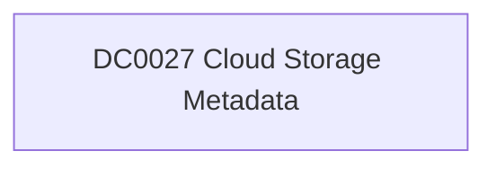

# DC0027 Cloud Storage Metadata

[ATT&CK](https://attack.mitre.org/datacomponents/DC0027) · version 2.0 · modified 2025-11-12 · ATT&CK release 20.1

Status: **Out of scope** for the current platform set

> Cloud Storage Metadata provides contextual information about cloud storage infrastructure and its associated activity. This data may include attributes such as storage name, size, owner, permissions, creation date, region, and activity metadata. It is essential for monitoring, auditing, and identifying anomalies in cloud storage environments. Examples:   - AWS S3 Bucket Metadata: Metadata about an S3 bucket includes the bucket name, region, creation date, owner, storage class, and permissions. - Azure Blob Storage Metadata: Metadata for an Azure Blob container includes container name, access level (e.g., private or public), size, and tags. - Google Cloud Storage Metadata: Metadata includes bucket name, storage class, location, labels, lifecycle policies, and versioning status. - OpenStack Swift Metadata: Metadata for a Swift container includes name, access level, quota, and custom attributes.

## Why this component matters

ATT&CK v20.1 has **3 analytics** across **2 detection strategies** that read this component, covering **2 techniques**. Tactics most dependent on it: exfiltration (2), discovery (1).

Analytic references by platform: Office Suite 1, IaaS 1, SaaS 1

## Where it comes from

## Requirements

Per feed (from `config/stack.yml` and `config/log_sources.yml`):

| Feed | Status | Sourcetypes | Constraint | Origin | TA / collector |
|---|---|---|---|---|---|

## Splunk

No eventtypes rendered: none of this component's log sources belong to an in-scope platform feed. See [gaps](../gaps.md).

## Sigma

No generic Sigma category maps to this component; rules use `product`/`service` logsources, which the pipeline maps to index and sourcetype.

## Dependents

Top techniques detected through this component (of 2):

| Technique | Name | Tactics | Analytics using this DC |
|---|---|---|---|
| [T1537](https://attack.mitre.org/techniques/T1537) | Transfer Data to Cloud Account | exfiltration | 2 |
| [T1538](https://attack.mitre.org/techniques/T1538) | Cloud Service Dashboard | discovery | 1 |

Full list: `lookups/mitre_attack_analytics.csv` filtered on `dc_ids` containing `DC0027`.
