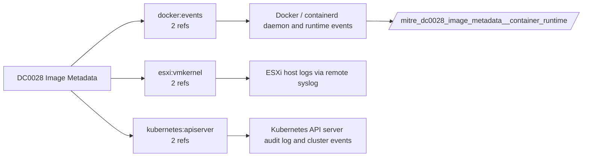

# DC0028 Image Metadata

[ATT&CK](https://attack.mitre.org/datacomponents/DC0028) · version 2.0 · modified 2025-11-12 · ATT&CK release 20.1

Umbrella eventtype `mitre_dc0028_image_metadata` over 1 feed(s)

> contextual information associated with a virtual machine image, such as its name, resource group, status (active or inactive), type (custom or prebuilt), size, creation date, and permissions. This metadata is critical for understanding the state and configuration of virtual machine images in cloud environments. Examples:   - Azure Compute Service Image Metadata Example:     - Name: MyCustomImage     - Resource Group: MyResourceGroup     - State: Available     - Type: Managed Image - AWS EC2 AMI Metadata Example:     - Image ID: ami-1234567890abcdef0     - Name: ProdImage     - State: Available     - Platform: Windows - Google Cloud Compute Engine Image Metadata Example:     - Image Name: webserver-image     - Project: my-project-id     - Family: webserver     - Source Disk: my-disk-id - VMware vSphere Template Metadata Example:     - Name: LinuxTemplate     - Disk Size: 40GB     - Network Adapter: VM Network

## Why this component matters

Image digests and tags from pull/tag events; enables mutable-tag and unknown-registry checks.

ATT&CK v20.1 has **3 analytics** across **3 detection strategies** that read this component, covering **3 techniques**. Tactics most dependent on it: stealth (3).

Analytic references by platform: Containers 2, ESXi 1

## Where it comes from



## Requirements

Per feed (from `config/stack.yml` and `config/log_sources.yml`):

| Feed | Schedule | Sourcetype or source | Constraint | Origin | TA / collector |
|---|---|---|---|---|---|
| `container_runtime` | scheduled | sourcetype=`docker:events` | `(status IN (pull, tag))` | defaults | docker events scripted input or OpenTelemetry (docker:events, containerd) |

Review notes: `container_runtime` has 2 ATT&CK reference(s) with no usable event filter (prose channel), constraint origin is *defaults*.

## Splunk

Eventtypes (literal constraints, see `dist/splunk/TA-mitre-attack-datacomponents/default/eventtypes.conf`):

```ini
[mitre_dc0028_image_metadata__container_runtime]
search = index=k8s sourcetype="docker:events" (status IN (pull, tag))

[mitre_dc0028_image_metadata]
search = eventtype=mitre_dc0028_image_metadata__container_runtime
```

Macros for analytics: `` `mitre_dc0028` `` (umbrella), `` `mitre_dc0028_container_runtime` ``, `` `mitre_dc0028_filter` `` (site exclusions).
CIM: no data model mapping; analytics on this component run as raw eventtype searches.

## Sigma

No generic Sigma category maps to this component; rules use `product`/`service` logsources, which the pipeline maps to index and sourcetype.

## Dependents

Top techniques detected through this component (of 3):

| Technique | Name | Tactics | Analytics using this DC |
|---|---|---|---|
| [T1036](https://attack.mitre.org/techniques/T1036) | Masquerading | stealth | 1 |
| [T1036.005](https://attack.mitre.org/techniques/T1036/005) | Match Legitimate Resource Name or Location | stealth | 1 |
| [T1564.006](https://attack.mitre.org/techniques/T1564/006) | Run Virtual Instance | stealth | 1 |

Full list: `lookups/mitre_attack_analytics.csv` filtered on `dc_ids` containing `DC0028`.
